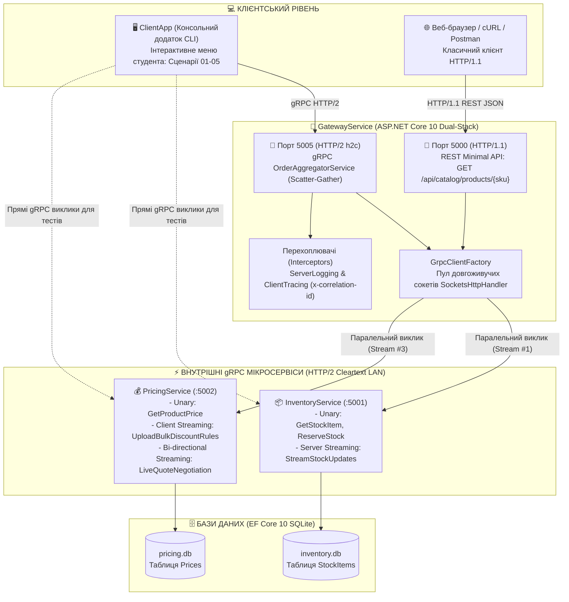

# 🚀 gRPC-Complete-Mastery (.NET 10)

[](https://dotnet.microsoft.com/)
[](https://grpc.io/)
[](https://protobuf.dev/)
[](https://learn.microsoft.com/ef/core/)
[-blue)](https://http2.github.io/)
[](LICENSE)

> **Фундаментальний навчальний комплекс та інженерний полігон з розробки клієнт-серверних та мікросервісних систем на базі gRPC в екосистемі ASP.NET Core 10 (.NET 10).**  
> Репозиторій створено спеціально для студентів та інженерів: він містить **3 серверні мікросервіси**, **1 інтерактивний консольний клієнт-полігон**, спільну бібліотеку Protobuf-контрактів та **5 вичерпних академічних посібників** із теорією, схемами та діаграмами.

---

## 🖥️ Що це за проєкти та які типи програм входять у рішення

Розв'язок **`gRPC-Complete-Mastery.sln`** містить **5 проєктів**, які розділені за архітектурними ролями:

| Проєкт у папці `src/` | Тип програми (.NET OutputType) | Технологічний стек | Роль в системі та призначення |
| :--- | :--- | :--- | :--- |
| **`ClientApp`** | **Консольний додаток (Console CLI)** | `net10.0`, `Grpc.Net.Client`, `HttpClient` | **Клієнтський тестовий полігон студента.** Інтерактивна консольна програма з меню (пункти 1–5, A), яка підключається до серверів через gRPC та REST і демонструє всі сценарії роботи. |
| **`GatewayService`** | **Веб-сервіс (ASP.NET Core Web App)** | Kestrel Dual-Stack, Minimal APIs, gRPC Aggregator | **Гібридний шлюз та Агрегатор.** Працює на двох портах: `:5000` (REST JSON для вебу) та `:5005` (gRPC для мобільних додатків та агрегації замовлень Scatter-Gather). |
| **`InventoryService`** | **Веб-сервіс (ASP.NET Core Web App)** | Kestrel HTTP/2 h2c, EF Core 10 SQLite | **Бекенд-мікросервіс складського обліку.** Слухає порт `:5001`. Відповідає за залишки товарів, транзакційне резервування та потоковий аудит складу. |
| **`PricingService`** | **Веб-сервіс (ASP.NET Core Web App)** | Kestrel HTTP/2 h2c, EF Core 10 SQLite | **Бекенд-мікросервіс ціноутворення.** Слухає порт `:5002`. Розраховує знижки, приймає клієнтські стріми оновлення цін та проводить повнодуплексні торги. |
| **`Shared.Contracts`** | **Бібліотека класів (Class Library)** | `Google.Protobuf`, `Grpc.Tools` | **Спільні двійкові контракти.** Містить `.proto`-файли (`inventory.proto`, `pricing.proto`, `aggregator.proto`), з яких компілятор `protoc` автоматично генерує C# класи. |

---

## 🏛️ Архітектурна схема взаємодії компонентів



---

## 🚀 Детальна інструкція: Як і звідки все запустити

Для повноцінної роботи комплексу необхідно запустити **3 серверні мікросервіси**, а потім запустити **консольний клієнт `ClientApp`**.

Ви можете обрати будь-який зі зручних для вас способів:

### Спосіб 1: Автоматичний запуск усім комплексом (Найпростіший варіант ⭐️)

У кореневій директорії репозиторію вже підготовлено готові скрипти автоматичного старту, які піднімуть усі три бекенди у фоні і відкриють консоль клієнта:

* **Для Windows (PowerShell):**
  ```powershell
  # Запустіть один скрипт у терміналі:
  .\run-all.ps1
  ```
* **Для Linux / macOS (Bash):**
  ```bash
  chmod +x run-all.sh
  ./run-all.sh
  ```
*Скрипт автоматично запустить `InventoryService`, `PricingService`, `GatewayService`, зачекає 3 секунди на створення SQLite баз даних і відкриє консольне меню `ClientApp`. При виході з консолі всі фонові процеси автоматично завершаться.*

---

### Спосіб 2: Запуск вручну в окремих терміналах (Рекомендовано для навчання 🎓)

Цей спосіб дозволяє наочно спостерігати за кольоровими логами кожного мікросервісу в реальному часі.

Відкрийте **4 окремих вікна терміналу** в папці репозиторію:

#### 1️⃣ Термінал 1: Сервіс складу (InventoryService)
```bash
dotnet run --project src/InventoryService
```
*Ви побачите: `Now listening on: http://localhost:5001`. Сервіс автоматично створить файл `inventory.db` та наповнить його товарами.*

#### 2️⃣ Термінал 2: Сервіс цін (PricingService)
```bash
dotnet run --project src/PricingService
```
*Ви побачите: `Now listening on: http://localhost:5002`. Сервіс створить базу `pricing.db`.*

#### 3️⃣ Термінал 3: Шлюз та Агрегатор (GatewayService)
```bash
dotnet run --project src/GatewayService
```
*Ви побачите: `Now listening on: http://localhost:5000` (REST) та `http://localhost:5005` (gRPC).*

#### 4️⃣ Термінал 4: Консольний клієнт студента (ClientApp)
```bash
dotnet run --project src/ClientApp
```
*У терміналі з'явиться інтерактивне консольне меню:*

```text
======================================================================
 🚀 gRPC Complete Mastery (.NET 10) - Interactive Student Test Bench  
======================================================================
 📍 Вузли: REST Gateway: http://localhost:5000 | gRPC Gateway: http://localhost:5005
         Inventory: http://localhost:5001 | Pricing: http://localhost:5002
----------------------------------------------------------------------
 [1] Сценарій 01: Unary RPC & Обробка статус-кодів RpcException
 [2] Сценарій 02: Потокові режими: Server, Client та Bi-directional
 [3] Сценарій 03: Гібридний підхід: REST-over-gRPC через HttpClient
 [4] Сценарій 04: Патерн Aggregator: Scatter-Gather та Composite DTO
 [5] Сценарій 05: Deadlines, Каскадне скасування та Метадані
 [A] Запустити ВСІ сценарії послідовно
 [0] Вихід із програми
======================================================================
Оберіть пункт меню (0-5, A): 
```

Введіть цифру від `1` до `5` для покрокового тестування або `A`, щоб виконати всі сценарії автоматично один за одним!

---

### Спосіб 3: Запуск через Visual Studio / JetBrains Rider (Multiple Startup Projects)

Якщо ви віддаєте перевагу роботі в графічній IDE (Visual Studio 2026 або JetBrains Rider):

1. Відкрийте файл рішення **`gRPC-Complete-Mastery.sln`** або **`gRPC-Complete-Mastery.slnx`**.
2. Клацніть правою кнопкою миші на назві розв'язку (Solution) у Solution Explorer -> оберіть **Configure Startup Projects...** (або *Set Startup Projects*).
3. Виберіть пункт **Multiple startup projects** і налаштуйте дію **Start** для чотирьох проєктів:
   - `InventoryService` $\rightarrow$ **Start**
   - `PricingService` $\rightarrow$ **Start**
   - `GatewayService` $\rightarrow$ **Start**
   - `ClientApp` $\rightarrow$ **Start**
4. Натисніть **F5** (або кнопку *Start / Run*).  
   IDE відкриє консолі для кожного мікросервісу та виведе інтерактивне вікно `ClientApp`.

---

### Спосіб 4: Автоматичний прогін без інтерактивного меню (CI/CD режим)

Якщо потрібно перевірити працездатність усіх тестів однією командою в автоматичному режимі:
```bash
dotnet run --project src/ClientApp -- --all
```

---

## 🧪 Тестування REST-фасаду через браузер або cURL

Оскільки `GatewayService` реалізує концепцію **Dual-Stack**, ви можете паралельно протестувати REST-ендпоінт прямо у браузері або через термінал:

* **У браузері:** відкрийте посилання [http://localhost:5000/api/catalog/products/LAPTOP-PRO-16?tier=VIP&qty=2](http://localhost:5000/api/catalog/products/LAPTOP-PRO-16?tier=VIP&qty=2)
* **Через PowerShell:**
  ```powershell
  Invoke-RestMethod -Uri "http://localhost:5000/api/catalog/products/LAPTOP-PRO-16?tier=VIP&qty=2" | ConvertTo-Json
  ```
* **Через cURL:**
  ```bash
  curl -i "http://localhost:5000/api/catalog/products/LAPTOP-PRO-16?tier=VIP&qty=2"
  ```

Приклад отриманого JSON-документа:
```json
{
  "source": "Hybrid REST-over-gRPC Gateway",
  "sku": "LAPTOP-PRO-16",
  "productName": "Apple MacBook Pro 16 (M3 Max / 36GB / 1TB)",
  "warehouse": "WH-KYIV-01",
  "stockStatus": "IN_STOCK",
  "availableUnits": 43,
  "pricing": {
    "basePrice": 2499,
    "finalUnitPrice": 2124.15,
    "discountPercent": 15,
    "campaign": "Tier: VIP (+10%), Bulk: (+0%)",
    "currency": "USD",
    "calculatedTotal": 4248.3
  }
}
```

---

## 📚 Навчальні модулі серії «Mastery»

Усі методичні матеріали розроблені у вигляді покрокових академічних підручників у папці [`docs/`](./docs/):

| Посібник | Академічна теорія та інженерні практики | Відповідні файли в коді |
| :--- | :--- | :--- |
| **[Mastery 01: Protobuf & Contracts](./docs/Mastery-01-Protobuf-Contracts.md)** | • Ретроспектива: від RPC/CORBA/SOAP до Protobuf<br>• Двійковий шар: Varints, ZigZag для від'ємних чисел, Tag-Length-Value (TLV)<br>• Побайтний розбір структури пакетів (Hex)<br>• Правила еволюції API, `reserved` та збереження невідомих полів (`UnknownFieldSet`) | [`Shared.Contracts`](./src/Shared.Contracts/)<br>• [`inventory.proto`](./src/Shared.Contracts/Protos/inventory.proto)<br>• [`pricing.proto`](./src/Shared.Contracts/Protos/pricing.proto)<br>• [`aggregator.proto`](./src/Shared.Contracts/Protos/aggregator.proto) |
| **[Mastery 02: Streaming In-Depth](./docs/Mastery-02-Streaming-In-Depth.md)** | • Мережева анатомія HTTP/2: 9-байтний заголовок фрейму, потоки, мультиплексування<br>• Алгоритм компресії заголовків HPACK (Static/Dynamic tables)<br>• Кредитний контроль потоку (Flow Control) та Backpressure (`WINDOW_UPDATE`)<br>• Усі 4 патерни взаємодії з діаграмами фреймів<br>• Deadlines та каскадне скасування через фрейм `RST_STREAM` | [`InventoryGrpcService.cs`](./src/InventoryService/Services/InventoryGrpcService.cs)<br>[`PricingGrpcService.cs`](./src/PricingService/Services/PricingGrpcService.cs)<br>[`02_StreamingScenario.cs`](./src/ClientApp/Scenarios/02_StreamingScenario.cs) |
| **[Mastery 03: EF Core Integration](./docs/Mastery-03-EFCore-Integration.md)** | • Потокобезпека та ізоляція `IServiceScope` при мультиплексуванні HTTP/2<br>• Чому `DbContext` зобов'язаний бути Scoped<br>• Оптимізація пам'яті через `.AsNoTracking()` та нульові алокації (Zero Allocations)<br>• Каскад скасування від клієнта до драйвера SQLite/Postgres через `CancellationToken`<br>• Транзакційне резервування, стан гонитви (Race Conditions) та матриця мапінгу винятків у `RpcException` | [`InventoryDbContext.cs`](./src/InventoryService/Data/InventoryDbContext.cs)<br>[`PricingDbContext.cs`](./src/PricingService/Data/PricingDbContext.cs)<br>[`InventoryGrpcService.cs`](./src/InventoryService/Services/InventoryGrpcService.cs) |
| **[Mastery 04: REST Meets gRPC](./docs/Mastery-04-REST-vs-gRPC-Hybrid.md)** | • Фізичне порівняння стеків HTTP/1.1 проти HTTP/2 (діаграми фреймів та алокацій пам'яті)<br>• Архітектура North-South проти East-West<br>• Мережева анатомія помилки `HTTP_1_1_REQUIRED (0xd)` у Cleartext без ALPN<br>• Налаштування Dual-Stack Kestrel (порт 5000 REST + порт 5005 gRPC)<br>• Пулінг каналів через `GrpcClientFactory` (захист від Socket Exhaustion)<br>• Повний порядковий аналіз `CatalogEndpoints.cs` та трансляція `RpcException` у ProblemDetails | [`GatewayService/Program.cs`](./src/GatewayService/Program.cs)<br>[`CatalogEndpoints.cs`](./src/GatewayService/Endpoints/CatalogEndpoints.cs)<br>[`03_RestGatewayScenario.cs`](./src/ClientApp/Scenarios/03_RestGatewayScenario.cs) |
| **[Mastery 05: The Aggregator Pattern](./docs/Mastery-05-Aggregator-Pattern.md)** | • Проблема балакучих клієнтів (Chatty Clients) та патерн API Composition<br>• Водоспад затримок (Latency Waterfall Gantt): доведення швидкості $T_{\text{par}} = \max(T_1, T_2)$<br>• Неблокуючий I/O в .NET 10: `Task.WhenAll` та `AsyncUnaryCall.ResponseAsync`<br>• Каскадне прокидання Deadlines через заголовок `grpc-timeout` та фрейми `RST_STREAM`<br>• Hard vs Soft Dependencies та Graceful Degradation (Fallback Pricing)<br>• Наскрізний конвеєр перехоплювачів (Interceptors) та порядковий розбір `OrderAggregatorService.cs` | [`OrderAggregatorService.cs`](./src/GatewayService/Services/OrderAggregatorService.cs)<br>[`ServerLoggingInterceptor.cs`](./src/GatewayService/Interceptors/ServerLoggingInterceptor.cs)<br>[`ClientTracingInterceptor.cs`](./src/GatewayService/Interceptors/ClientTracingInterceptor.cs) |

---

## 🧪 Автоматизоване тестування (xUnit Test Suite)

У репозиторії створено проєкт автоматизованих тестів **`tests/Mastery.Tests`** на базі **xUnit** та **In-Memory SQLite**, що дозволяє миттєво перевірити коректність бізнес-логіки та контрактів:

```bash
# Запуск усіх модульних та інтеграційних тестів
dotnet test
```

### Що перевіряють 10 автоматизованих тестів:
1. **Ціноутворення (`PricingServiceTests`):**
   - Розрахунок персональної знижки для грейдів VIP, Gold, Silver.
   - Застосування додаткового дисконту за гуртові партії ($\ge 10$ шт).
   - Валідація порожнього SKU $\rightarrow$ перевірка генерації `StatusCode.InvalidArgument`.
   - Запит неіснуючого товару $\rightarrow$ перевірка генерації `StatusCode.NotFound`.
2. **Складський облік (`InventoryServiceTests`):**
   - Успішне зчитування сутності товару та проєкція у Protobuf DTO.
   - Транзакційне резервування залишку (перевірка зменшення `AvailableQuantity` та збільшення `ReservedQuantity`).
   - Спроба резервування більшої кількості, ніж є на складі $\rightarrow$ перевірка `StatusCode.FailedPrecondition`.
3. **Перехоплювачі (`InterceptorTests`):**
   - Автоматична генерація та впровадження `x-correlation-id` та `x-client-timestamp` у вихідні заголовки.
   - Збереження вже існуючого ідентифікатора трасування без перезапису.

---

## 📡 gRPC Server Reflection та інструменти налагодження

Усі три сервіси (`InventoryService`, `PricingService`, `GatewayService`) мають увімкнений стандартний протокол **gRPC Server Reflection** (`Grpc.AspNetCore.Server.Reflection`).

Це означає, що вам **не потрібно вручну завантажувати `.proto`-файли** у тестувальні утиліти:
* **Postman:** Вкажіть адресу `http://localhost:5001` (або `:5002`, `:5005`) і виберіть тип запиту *gRPC* $\rightarrow$ Postman автоматично завантажить схему методів та підкаже структуру полів!
* **grpcurl:**
  ```bash
  # Список усіх сервісів на порту складу:
  grpcurl -plaintext localhost:5001 list
  
  # Опис методів сервісу:
  grpcurl -plaintext localhost:5001 describe mastery.inventory.v1.InventoryService
  ```

---

## 📄 Інтерактивні HTTP-запити (`requests.http`) та OpenAPI

* **Файл [`requests.http`](./requests.http):** Містить готові запити для тестування REST-фасаду та перевірки здоров'я мікросервісів. Підтримується нативно у Visual Studio 2026 та VS Code (розширення *REST Client*).
* **OpenAPI Специфікація:** Для `GatewayService` доступний стандартний ендпоінт опису API у форматі JSON:
  [http://localhost:5000/openapi/v1.json](http://localhost:5000/openapi/v1.json)

---

## 🐳 Контейнеризація (Docker & Docker Compose)

У репозиторії налаштовано багатоетапний [`Dockerfile`](./Dockerfile) та [`docker-compose.yml`](./docker-compose.yml), що дозволяє запустити весь розподілений комплекс однією командою:

```bash
# Збірка образів та запуск усього стеку
docker compose up --build
```

---

## 🛠️ Використаний технологічний стек
* **Платформа:** .NET 10.0 (C# 14, Roslyn compiler)
* **RPC фреймворк:** `Grpc.AspNetCore 2.84`, `Grpc.Net.Client 2.84`, `Grpc.Tools 2.84`
* **Сервісна рефлексія:** `Grpc.AspNetCore.Server.Reflection 2.84`
* **Серіалізація:** `Google.Protobuf 3.36`
* **ORM & Бази даних:** `Microsoft.EntityFrameworkCore.Sqlite 10.0`
* **Мережевий транспорт:** HTTP/2 Cleartext (`h2c`) з підтримкою multiplexing & streaming
* **Веб-сервер:** Kestrel Dual-Stack (HTTP/1.1 на :5000 + HTTP/2 на :5005)
* **Тестування:** `xUnit 2.9`, `Microsoft.NET.Test.Sdk 17.14`, In-Memory SQLite
* **Контейнери:** Docker Multi-stage & Docker Compose v2

