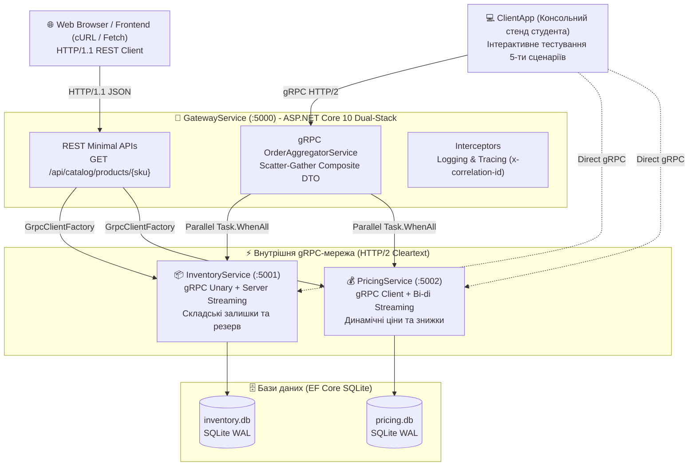

# 🚀 gRPC-Complete-Mastery (.NET 10)

[](https://dotnet.microsoft.com/)
[](https://grpc.io/)
[](https://protobuf.dev/)
[](https://learn.microsoft.com/ef/core/)
[-blue)](https://http2.github.io/)
[](LICENSE)

> **Фундаментальний навчальний курс та інженерний полігон з розробки мікросервісних систем на gRPC в екосистемі ASP.NET Core 10.**  
> Охоплює повний шлях: від контрактного проєктування (Contract-First на proto3) і збереження даних в Entity Framework Core до всіх 3-х потокових режимів, гібридної архітектури REST-over-gRPC, патерну Aggregator (Scatter-Gather) та виробничої стійкості (Interceptors, Deadlines, Graceful Fallback).

---

## 🏛️ Архітектура навчального комплексу

Система моделює високошвидкісну платформу електронної комерції та логістики:



---

## 📚 Навчальні модулі серії «Mastery»

Усі методичні матеріали розроблені у вигляді покрокових практичних посібників у папці [`docs/`](./docs/):

| Посібник | Ключові концепції та навички | Відповідний проєкт у коді |
| :--- | :--- | :--- |
| **[Mastery 01: Protobuf & Contracts](./docs/Mastery-01-Protobuf-Contracts.md)** | Contract-First дизайн, типи proto3, бінарна упаковка (`varint`, теги полів 1..15), правила сумісності, MSBuild кодогенерація в .NET 10 | [`Shared.Contracts`](./src/Shared.Contracts/) |
| **[Mastery 02: Streaming In-Depth](./docs/Mastery-02-Streaming-In-Depth.md)** | Всі 4 режими зв'язку (Unary, Server, Client, Bi-directional Streaming), робота з `IAsyncStreamReader` та `IServerStreamWriter`, Deadlines | [`InventoryService`](./src/InventoryService/) & [`PricingService`](./src/PricingService/) |
| **[Mastery 03: EF Core Integration](./docs/Mastery-03-EFCore-Integration.md)** | Робота з реальними БД, життєвий цикл `DbContext` у gRPC-скоупі, `.AsNoTracking()`, транзакційне резервування, мапінг у `RpcException` | [`InventoryService/Data`](./src/InventoryService/Data/) |
| **[Mastery 04: REST Meets gRPC](./docs/Mastery-04-REST-vs-gRPC-Hybrid.md)** | Гібридний підхід: REST-фасад над gRPC, Dual-Stack хостування (`Http1AndHttp2`) на одному порті, трансляція статусів у HTTP | [`GatewayService/Endpoints`](./src/GatewayService/Endpoints/) |
| **[Mastery 05: The Aggregator Pattern](./docs/Mastery-05-Aggregator-Pattern.md)** | Патерн Composite Service, Scatter-Gather паралелізм (`Task.WhenAll`), Graceful Degradation (fallback при збоях), Interceptors | [`GatewayService/Services`](./src/GatewayService/Services/) |

---

## 🔌 Порти та топологія сервісів

| Сервіс | Адреса | Протоколи | Призначення |
| :--- | :--- | :--- | :--- |
| **`GatewayService`** | `http://localhost:5000` | HTTP/1.1 + HTTP/2 | Гібридний шлюз: REST API + gRPC OrderAggregator |
| **`InventoryService`** | `http://localhost:5001` | HTTP/2 (h2c) | Чистий gRPC: облік та аудит залишків складу |
| **`PricingService`** | `http://localhost:5002` | HTTP/2 (h2c) | Чистий gRPC: ціноутворення, bulk знижки, торги |
| **`ClientApp`** | CLI Console | HTTP/1.1 + HTTP/2 | Інтерактивний полігон студента (сценарії 01–05) |

---

## ⚡ Швидкий старт (Quick Start)

### 1. Клонування та збірка рішення
```bash
git clone https://github.com/MrTomkaYurii/gRPC-Complete-Mastery.git
cd gRPC-Complete-Mastery
dotnet build
```

### 2. Запуск сервісів (у трьох окремих терміналах або фоном)

**Термінал 1: Сервіс складу**
```bash
dotnet run --project src/InventoryService
```

**Термінал 2: Сервіс цін**
```bash
dotnet run --project src/PricingService
```

**Термінал 3: Гібридний Шлюз & Агрегатор**
```bash
dotnet run --project src/GatewayService
```

*Примітка: SQLite бази даних (`inventory.db` та `pricing.db`) створюються та наповнюються тестовими даними автоматично при першому старті.*

---

### 3. Запуск клієнтського інтерактивного стенду

**Термінал 4: Запуск консольного стенду студента**
```bash
dotnet run --project src/ClientApp
```

Ви побачите інтерактивне меню:
```text
======================================================================
 🚀 gRPC Complete Mastery (.NET 10) - Interactive Student Test Bench  
======================================================================
 [1] Сценарій 01: Unary RPC & Обробка статус-кодів RpcException
 [2] Сценарій 02: Потокові режими: Server, Client та Bi-directional
 [3] Сценарій 03: Гібридний підхід: REST-over-gRPC через HttpClient
 [4] Сценарій 04: Патерн Aggregator: Scatter-Gather та Composite DTO
 [5] Сценарій 05: Deadlines, Каскадне скасування та Метадані
 [A] Запустити ВСІ сценарії послідовно
 [0] Вихід із програми
======================================================================
```

Або запустити всі тести в неінтерактивному автоматичному режимі:
```bash
dotnet run --project src/ClientApp -- --all
```

---

## 🧪 Тестування REST-ендпоінта через cURL або браузер

Оскільки `GatewayService` реалізує концепцію **Dual-Stack**, ви можете протестувати REST фасад будь-яким HTTP-клієнтом:

```bash
# Отримання агрегованої інформації про товар у форматі JSON
curl -X GET "http://localhost:5000/api/catalog/products/LAPTOP-PRO-16?tier=VIP&qty=2"
```

Приклад JSON-відповіді:
```json
{
  "source": "Hybrid REST-over-gRPC Gateway",
  "sku": "LAPTOP-PRO-16",
  "productName": "Apple MacBook Pro 16 (M3 Max / 36GB / 1TB)",
  "warehouse": "WH-KYIV-01",
  "stockStatus": "IN_STOCK",
  "availableUnits": 43,
  "pricing": {
    "basePrice": 2499,
    "finalUnitPrice": 2124.15,
    "discountPercent": 15,
    "campaign": "Tier: VIP (+10%), Bulk: (+0%)",
    "currency": "USD",
    "calculatedTotal": 4248.3
  }
}
```

---

## 🛠️ Використаний технологічний стек
* **Платформа:** .NET 10.0 (C# 14, Roslyn compiler)
* **RPC фреймворк:** `Grpc.AspNetCore 2.84`, `Grpc.Net.Client 2.84`, `Grpc.Tools 2.84`
* **Серіалізація:** `Google.Protobuf 3.36`
* **ORM & Бази даних:** `Microsoft.EntityFrameworkCore.Sqlite 10.0`
* **Мережевий транспорт:** HTTP/2 Cleartext (`h2c`) з підтримкою multiplexing & streaming
