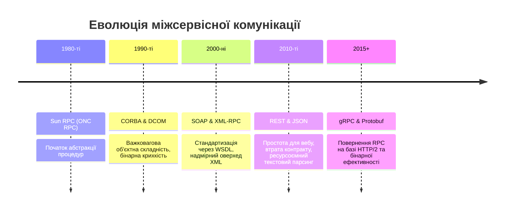
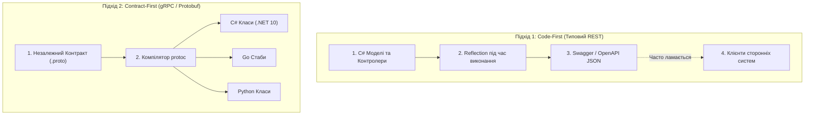

# 📜 Mastery 01: Фундамент Protocol Buffers та контрактне проєктування (Contract-First Design)

[](https://dotnet.microsoft.com/)
[](https://protobuf.dev/)
[]()

> **Мета модуля:** Сформувати глибоке академічне та практичне розуміння парадигми **Contract-First**, вивчити математику та алгоритми низькорівневого бінарного пакування **Protocol Buffers (proto3)**, розібрати механіку серіалізації на рівні окремих бітів і байтів, опанувати правила безконфліктної еволюції розподілених API та налаштувати конвеєр автоматичної кодогенерації в **.NET 10 (C# 14)**.

---

## 📑 Зміст посібника
1. [Історична ретроспектива: Від RPC, CORBA та SOAP до REST та gRPC](#1-історична-ретроспектива-від-rpc-corba-та-soap-до-rest-та-grpc)
2. [Парадигми проєктування: Code-First проти Contract-First](#2-парадигми-проєктування-code-first-проти-contract-first)
3. [Бінарний формат Protobuf під мікроскопом: Як кодуються дані](#3-бінарний-формат-protobuf-під-мікроскопом-як-кодуються-дані)
   * 3.1 [Принцип Tag-Length-Value (TLV) та розрахунок байта тегу](#31-принцип-tag-length-value-tlv-та-розрахунок-байта-тегу)
   * 3.2 [Алгоритм Varint (Змінна довжина цілих чисел)](#32-алгоритм-varint-змінна-довжина-цілих-чисел)
   * 3.3 [Проблема від'ємних чисел та кодування ZigZag](#33-проблема-відємних-чисел-та-кодування-zigzag)
   * 3.4 [Покроковий двійковий аналіз реального повідомлення](#34-покроковий-двійковий-аналіз-реального-повідомлення)
4. [Синтаксис та система типів proto3](#4-синтаксис-та-система-типів-proto3)
   * 4.1 [Базові скалярні типи та відповідність C# 14 (.NET 10)](#41-базові-скалярні-типи-та-відповідність-c-14-net-10)
   * 4.2 [Проблема відсутності типу `decimal` та фінансові розрахунки](#42-проблема-відсутності-типу-decimal-та-фінансові-розрахунки)
   * 4.3 [Перерахування (Enums) та правило нульового значення](#43-перерахування-enums-та-правило-нульового-значення)
   * 4.4 [Колекції (`repeated`), словники (`map`) та об'єднання (`oneof`)](#44-колекції-repeated-словники-map-та-обєднання-oneof)
   * 4.5 [Стандартні типи Google Well-Known Types](#45-стандартні-типи-google-well-known-types)
5. [Стратегія нумерації полів (Field Numbers) та еволюція контракту](#5-стратегія-нумерації-полів-field-numbers-та-еволюція-контракту)
   * 5.1 [Чому діапазон 1..15 є стратегічним активом](#51-чому-діапазон-115-є-стратегічним-активом)
   * 5.2 [Залізні правила зворотної (Backward) та прямої (Forward) сумісності](#52-залізні-правила-зворотної-backward-та-прямої-forward-сумісності)
   * 5.3 [Директива `reserved`: страхування від регресій](#53-директива-reserved-страхування-від-регресій)
   * 5.4 [Невідомі поля (Unknown Fields): механіка збереження](#54-невідомі-поля-unknown-fields-механіка-збереження)
6. [Кодогенерація в .NET 10: MSBuild, Roslyn та Grpc.Tools](#6-кодогенерація-в-net-10-msbuild-roslyn-та-grpctools)
   * 6.1 [Конфігурація проекту `Shared.Contracts`](#61-конфігурація-проекту-sharedcontracts)
   * 6.2 [Анатомія згенерованих C#-класів: повідомлення, клієнти, серверні бази](#62-анатомія-згенерованих-c-класів-повідомлення-клієнти-серверні-бази)
7. [Детальний розбір контрактів навчальної системи](#7-детальний-розбір-контрактів-навчальної-системи)
   * 7.1 [Контракт складу: `inventory.proto`](#71-контракт-складу-inventoryproto)
   * 7.2 [Контракт цін: `pricing.proto`](#72-контракт-цін-pricingproto)
   * 7.3 [Контракт агрегатора: `aggregator.proto`](#73-контракт-агрегатора-aggregatorproto)
8. [Типові помилки, антипатерни та пастки](#8-типові-помилки-антипатерни-та-пастки)
9. [Контрольні запитання для самоперевірки](#9-контрольні-запитання-для-самоперевірки)
10. [Лабораторний практикум для закріплення](#10-лабораторний-практикум-для-закріплення)

---

<a id="1-історична-ретроспектива-від-rpc-corba-та-soap-до-rest-та-grpc"></a>
## 1. Історична ретроспектива: Від RPC, CORBA та SOAP до REST та gRPC

Концепція **Remote Procedure Call (RPC)** була запропонована Брюсом Нельсоном (Bruce Jay Nelson) у 1981 році. Її фундаментальна ідея полягала в абстрагуванні мережі: програміст повинен викликати функцію на віддаленому сервері так само просто й прозоро, як викликає локальну функцію у власному адресному просторі:

$$\text{Local Execution:} \quad y = f(x) \quad \longleftrightarrow \quad \text{Remote RPC Execution:} \quad y = f_{\text{remote}}(x)$$

### Хвилі еволюції розподілених систем:



1. **Епоха CORBA та DCOM (1990-ті):**
   * Спроба зробити розподілені об'єкти з підтримкою стану (Stateful Distributed Objects).
   * **Чому зазнали невдачі:** Надзвичайна складність специфікацій, несумісність між вендорами, крихкість при зміні хоча б одного байта в сигнатурі та нездатність проходити через корпоративні міжмережеві екрани (Firewalls).
2. **Епоха SOAP та XML-RPC (2000-ні):**
   * Перехід на протокол HTTP для подолання брандмауерів. Контракт описувався гігантськими XML-схемами (`WSDL`).
   * **Чому зазнали невдачі:** Величезний обсяг XML-документів (до 80% трафіку займали теги), колосальне навантаження на CPU при розборі рядків через DOM/SAX-парсери.
3. **Епоха REST / JSON (2010-ті):**
   * Спрощення до ресурсного підходу HTTP (GET, POST, PUT, DELETE) та передача неструктурованого або напівструктурованого тексту в JSON.
   * **Проблема REST у мікросервісах:** JSON не має нативної типізації. Немає різниці між `int32`, `int64`, `float` чи `double` — все позначається як `number`. Для передачі мільйонів запитів між сотнями сервісів усередині датацентру витрачати процесорний час на перетворення бінарних чисел C# у текст ASCII/UTF-8 і назад — непростиме марнотратство.
4. **Епоха gRPC та Protocol Buffers (2015 — наш час):**
   * Компанія Google ще на початку 2000-х зіткнулася з проблемою масштабування і створила внутрішню RPC-інфраструктуру **Stubby**.
   * У 2015 році Google стандартизував та відкрив цей досвід світу, створивши **gRPC** на основі відкритого протоколу **HTTP/2** та бінарного серіалізатора **Protocol Buffers**.

---

<a id="2-парадигми-проєктування-code-first-проти-contract-first"></a>
## 2. Парадигми проєктування: Code-First проти Contract-First

У сучасній архітектурі розподілених систем вибір між Code-First та Contract-First визначає стабільність усього проєкту:



### Порівняльна таблиця архітектурних властивостей

| Критерій | Code-First (Класичний Web API) | Contract-First (gRPC Protobuf) |
| :--- | :--- | :--- |
| **Джерело правди** | Вихідний код мовою бекенду (C#) | Мовно-нейтральний файл специфікації (`.proto`) |
| **Міжмовна сумісність** | Складна (залежить від генераторів OpenAPI) | Бездоганна (підтримка десятків мов із коробки) |
| **Виявлення помилок сумісності** | Під час виконання (Runtime) при розборі JSON | На етапі компіляції (Compile-Time) |
| **Еволюція структури даних** | Ризикована (випадкова зміна назви ламає клієнтів) | Суворо регламентована числовими тегами |
| **Швидкість релізу клієнтських бібліотек** | Потребує ручної синхронізації або `nswag` | Автоматична генерація при кожній збірці |

> [!IMPORTANT]
> **Принцип Contract-First:** Контракт розглядається як юридичний договір між командами розробки. Розробник сервера не може в односторонньому порядку змінити сигнатуру або типи, не оновивши файл `.proto`, що гарантує захист від раптових регресій у продакшені.

---

<a id="3-бінарний-формат-protobuf-під-мікроскопом-як-кодуються-дані"></a>
## 3. Бінарний формат Protobuf під мікроскопом: Як кодуються дані

Щоб зрозуміти феноменальну продуктивність gRPC, необхідно спуститися на рівень бінарного представлення.

<a id="31-принцип-tag-length-value-tlv-та-розрахунок-байта-тегу"></a>
### 3.1 Принцип Tag-Length-Value (TLV) та розрахунок байта тегу
У текстовому форматі JSON кожен елемент складається з пари рядків:
`"price": 1299.0` — тут витрачається 7 байтів на ключ `"price"`, 2 байти на двокрапку та пробіл, і 6 байтів на число у вигляді тексту ASCII.

У Protocol Buffers **імена ключів ніколи не передаються мережею**! Кожне поле кодується як пара:
$$\text{Поле} = [\text{Tag}] + [\text{Payload}]$$

Байт тегу містить дві інформаційні сутності: **Номер поля (Field Number)** та **Тип провідного кодування (Wire Type)**:
$$\text{Tag Byte} = (\text{Field Number} \ll 3) \mid \text{Wire Type}$$

Оскільки для збереження Wire Type використовується рівно 3 біти, в один байт (8 бітів) можна одночасно запакувати номер поля від 1 до 15:
```text
Структура байта тегу:
┌───┬───┬───┬───┬───┬───┬───┬───┐
│ 7 │ 6 │ 5 │ 4 │ 3 │ 2 │ 1 │ 0 │
└───┴───┴───┴───┴───┴───┴───┴───┘
│◄── Field Number ─►│◄─Wire Type►│
     (4 біти: 1..15)    (3 біти)
```

#### Таблиця Wire Types у proto3:
| Wire Type (3 біти) | Числове значення | Тип представлення | Відповідні типи Protobuf |
| :---: | :---: | :--- | :--- |
| `000` | `0` | **Varint** | `int32`, `int64`, `uint32`, `uint64`, `sint32`, `sint64`, `bool`, `enum` |
| `001` | `1` | **64-bit Fixed** | `fixed64`, `sfixed64`, `double` |
| `010` | `2` | **Length-delimited** | `string`, `bytes`, вкладені повідомлення (`message`), упаковані списки (`packed repeated`) |
| `101` | `5` | **32-bit Fixed** | `fixed32`, `sfixed32`, `float` |

<a id="32-алгоритм-varint-змінна-довжина-цілих-чисел"></a>
### 3.2 Алгоритм Varint (Змінна довжина цілих чисел)
У звичайній пам'яті комп'ютера тип `int` завжди займає 4 байти (32 біти), навіть якщо число дорівнює `1`:
`0x00000001` — три байти з чотирьох заповнені нулями.

**Varint (Variable-length Quantity)** дозволяє кодувати цілі числа, використовуючи від 1 до 10 байтів залежно від їх абсолютного значення:
* Кожен байт використовує 7 молодших бітів для корисного значення.
* Найстарший 8-й біт називається **MSB (Most Significant Bit)**:
  * Якщо $\text{MSB} = 1$, це означає, що число не помістилося в поточний байт і наступний байт також належить до цього числа.
  * Якщо $\text{MSB} = 0$, це означає, що поточний байт є останнім байтом даного числа.

#### Покроковий приклад: Як число 300 упаковується у Varint:
1. Запишемо число 300 у двійковій системі:
   $$300_{10} = 256 + 32 + 8 + 4 = 00000001 \; 00101100_2$$
2. Розбиваємо двійковий потік на 7-бітні групи (починаючи з молодших розрядів):
   * Група 1 (молодші 7 бітів): `0101100` ($44_{10}$)
   * Група 2 (наступні 7 бітів): `0000010` ($2_{10}$)
3. Розставляємо MSB-біти:
   * Для групи 1 додаємо $\text{MSB} = 1$ (бо є продовження): `1` + `0101100` = `10101100` = `0xAC`.
   * Для групи 2 додаємо $\text{MSB} = 0$ (бо це фінал): `0` + `0000010` = `00000010` = `0x02`.
4. Записуємо в порядку **Little-Endian** (молодший байт попереду):
   $$\mathbf{AC} \quad \mathbf{02}$$
5. **Результат:** 4-байтне число 300 займає в бінарному потоці лише **2 байти**!

<a id="33-проблема-відємних-чисел-та-кодування-zigzag"></a>
### 3.3 Проблема від'ємних чисел та кодування ZigZag
У комп'ютерній архітектурі від'ємні числа зберігаються у форматі доповнення до двійки (Two's Complement). Число `-1` для типу `int32` має вигляд:
$$-1_{10} = \text{0xFFFFFFFF} = 11111111 \; 11111111 \; 11111111 \; 11111111_2$$
Якщо це число закодувати стандартним алгоритмом Varint, через знакові одиниці в усіх розрядах воно займе **повні 10 байтів**! Передавати 10 байтів для маленького числа `-1` — неприпустимо.

Для цього в Protobuf існують типи `sint32` та `sint64`, які перед упаковкою у Varint застосовують **ZigZag-кодування**.
Воно «переплітає» додатні та від'ємні числа, перетворюючи їх на невеликі додатні цілі:

$$\text{ZigZag32}(n) = (n \ll 1) \oplus (n \gg 31)$$

| Початкове число $n$ | Бінарний вигляд | Результат ZigZag ($n \ll 1 \oplus n \gg 31$) | Розмір у Varint |
| :---: | :---: | :---: | :---: |
| `0` | `00000000` | `0` | **1 байт** (`0x00`) |
| `-1` | `11111111` | `1` | **1 байт** (`0x01`) |
| `1` | `00000001` | `2` | **1 байт** (`0x02`) |
| `-2` | `11111110` | `3` | **1 байт** (`0x03`) |
| `2` | `00000010` | `4` | **1 байт** (`0x04`) |

Завдяки ZigZag число `-1` упаковується рівно в **1 байт** замість 10!

<a id="34-покроковий-двійковий-аналіз-реального-повідомлення"></a>
### 3.4 Покроковий двійковий аналіз реального повідомлення

Візьмемо реальне повідомлення з нашого проєкту [`inventory.proto`](../src/Shared.Contracts/Protos/inventory.proto):

```protobuf
message StockItemResponse {
  string sku = 1;              // Tag 1, WireType 2 (Length-delimited)
  string product_name = 2;     // Tag 2, WireType 2 (Length-delimited)
  int32 available_quantity = 3;// Tag 3, WireType 0 (Varint)
  StockStatus status = 6;      // Tag 6, WireType 0 (Varint)
}
```

Нехай об'єкт має значення:
* `sku = "LAPTOP"`
* `available_quantity = 45`
* `status = IN_STOCK (1)`

Поглянемо на побайтову розкладку бінарного потоку, яку генерує серіалізатор:

```text
HEX DUMP:  0A  06  4C 41 50 54 4F 50  18  2D  30  01
```

#### Побайтний розбір:
1. `0A` — Байт тегу для поля `sku`:
   * Поле №1, WireType 2 (Length-delimited: `010`).
   * Розрахунок: $(1 \ll 3) \mid 2 = 8 \mid 2 = 10_{10} = \mathbf{0x0A}$.
2. `06` — Довжина рядка UTF-8: рядок `"LAPTOP"` має 6 символів $\rightarrow \mathbf{0x06}$.
3. `4C 41 50 54 4F 50` — ASCII/UTF-8 байти рядка `"LAPTOP"`.
4. `18` — Байт тегу для поля `available_quantity`:
   * Поле №3, WireType 0 (Varint: `000`).
   * Розрахунок: $(3 \ll 3) \mid 0 = 24 \mid 0 = 24_{10} = \mathbf{0x18}$.
5. `2D` — Значення кількості $45_{10} = \mathbf{0x2D}$ (оскільки $< 128$, займає 1 байт з MSB=0).
6. `30` — Байт тегу для поля `status`:
   * Поле №6, WireType 0 (Varint: `000`).
   * Розрахунок: $(6 \ll 3) \mid 0 = 48 \mid 0 = 48_{10} = \mathbf{0x30}$.
7. `01` — Значення Enum `IN_STOCK = 1` $\rightarrow \mathbf{0x01}$.

**Загальний розмір:** 12 байтів! Для порівняння, аналогічний JSON займе мінімум 75 байтів.

---

<a id="4-синтаксис-та-система-типів-proto3"></a>
## 4. Синтаксис та система типів proto3

<a id="41-базові-скалярні-типи-та-відповідність-c-14-net-10"></a>
### 4.1 Базові скалярні типи та відповідність C# 14 (.NET 10)

| Тип у `.proto` | C# тип у .NET 10 | Wire Type | Коли слід використовувати |
| :--- | :--- | :---: | :--- |
| `int32` | `int` | 0 | Звичайні лічильники, малі цілі додатні числа |
| `int64` | `long` | 0 | Ідентифікатори баз даних, лічильники великих обсягів |
| `uint32` / `uint64` | `uint` / `ulong` | 0 | Беззнакові цілі значення |
| `sint32` / `sint64` | `int` / `long` | 0 | **Обов'язково**, якщо значення часто бувають від'ємними (температура, баланс) |
| `fixed32` | `uint` | 5 | Завжди займає рівно 4 байти. Ефективніше за `int32`, якщо значення регулярно перевищують $2^{28}$ |
| `fixed64` | `ulong` | 1 | Завжди займає рівно 8 байтів |
| `sfixed32` / `sfixed64`| `int` / `long` | 5 / 1 | Фіксовані знакові цілі числа |
| `bool` | `bool` | 0 | Логічні прапорці (1 байт: `0x00` або `0x01`) |
| `string` | `string` | 2 | Текстові дані в кодуванні UTF-8 |
| `bytes` | `Google.Protobuf.ByteString` | 2 | Довільні бінарні масиви (зображення, шифротекст, хеші SHA-256) |
| `float` | `float` | 5 | 32-бітне число з плаваючою крапкою IEEE 754 |
| `double` | `double` | 1 | 64-бітне число з плаваючою крапкою IEEE 754 |

<a id="42-проблема-відсутності-типу-decimal-та-фінансові-розрахунки"></a>
### 4.2 Проблема відсутності типу `decimal` та фінансові розрахунки

> [!CAUTION]
> У специфікації Protocol Buffers **немає типу `decimal`**!  
> Використання типу `double` чи `float` для цін або банківських операцій є **грубою помилкою**, оскільки двійкові дроби IEEE 754 призводять до втрати копійок при округленні ($0.1 + 0.2 = 0.30000000000000004$).

#### Стандартні підходи до фінансів у gRPC:
1. **Підхід «Мінімальна неподільна одиниця» (Рекомендовано для простоти):**
   Ціна передається як ціле число в копійках або центах:
   ```protobuf
   int64 price_in_cents = 1; // $2499.00 передається як 249900
   ```
2. **Патерн `Custom Money Message` (Стандарт Google API):**
   ```protobuf
   message Money {
     string currency_code = 1; // "USD", "UAH", "EUR"
     int64 units = 2;          // Ціла частина ($2499)
     int32 nanos = 3;          // Дробова частина з точністю до 10^-9 (990000000 для 99 центів)
   }
   ```

<a id="43-перерахування-enums-та-правило-нульового-значення"></a>
### 4.3 Перерахування (Enums) та правило нульового значення

У синтаксисі proto3 діє абсолютне правило для перерахувань:
```protobuf
enum StockStatus {
  STOCK_STATUS_UNSPECIFIED = 0; // ОБОВ'ЯЗКОВО ПОВИНЕН БУТИ 0!
  IN_STOCK = 1;
  LOW_STOCK = 2;
  OUT_OF_STOCK = 3;
}
```

#### Чому нульове значення критично важливе:
1. **Значення за замовчуванням (Default Value):** У proto3 нульовий елемент є дефолтним значенням для новоствореного об'єкта в пам'яті.
2. **Оптимізація трафіку:** Якщо поле enum має значення `0`, Protobuf **взагалі не відправляє його мережею** (економія байтів).
3. **Захист від некоректної ініціалізації:** Назва `_UNSPECIFIED` сигналізує, що поле ще не було явно встановлено відправником.

<a id="44-колекції-repeated-словники-map-та-обєднання-oneof"></a>
### 4.4 Колекції (`repeated`), словники (`map`) та об'єднання (`oneof`)

* **Списки (`repeated`):** Аналог `List<T>` у C#.
  ```protobuf
  repeated string warehouse_tags = 1;
  ```
  У proto3 всі числові списки за замовчуванням упаковуються як `packed repeated` (один заголовок типу 2 і послідовність чисел без повторення тегів поля).
* **Словники (`map<key_type, value_type>`):** Аналог `Dictionary<TKey, TValue>`.
  ```protobuf
  map<string, int32> warehouse_inventories = 2;
  ```
* **Об'єднання (`oneof`):** Дозволяє виділити пам'ять під одне й тільки одне значення з переліку. Якщо встановлюється інше поле з блоку, попереднє автоматично очищується. Ідеально підходить для статусів або поліморфізму:
  ```protobuf
  oneof payment_method {
    string credit_card_token = 1;
    string bank_account_iban = 2;
    string crypto_wallet = 3;
  }
  ```

<a id="45-стандартні-типи-google-well-known-types"></a>
### 4.5 Стандартні типи Google Well-Known Types

Google надає набір стандартних контрактів, які компілюються у зручні .NET-типи:
* `google/protobuf/timestamp.proto` $\rightarrow$ `Timestamp`: час за шкалою UTC з наносекундною точністю. Має готові методи розширення у C#: `timestamp.ToDateTime()`, `Timestamp.FromDateTime(DateTime.UtcNow)`.
* `google/protobuf/duration.proto` $\rightarrow$ `Duration`: часовий інтервал (аналог `TimeSpan`).
* `google/protobuf/empty.proto` $\rightarrow$ `Empty`: пусте повідомлення для RPC-методів, які не приймають або не повертають параметрів (`rpc Ping (google.protobuf.Empty) returns (google.protobuf.Empty);`).

---

<a id="5-стратегія-нумерації-полів-field-numbers-та-еволюція-контракту"></a>
## 5. Стратегія нумерації полів (Field Numbers) та еволюція контракту

<a id="51-чому-діапазон-115-є-стратегічним-активом"></a>
### 5.1 Чому діапазон 1..15 є стратегічним активом

Як було показано в розділі 3.1:
* Теги від **1 до 15** кодуються в заголовок розміром **1 байт**.
* Теги від **16 до 2047** кодуються в заголовок розміром **2 байти**.

```text
Тег 1..15:     [ 00010 000 ] -> 1 байт
Тег 16..2047:  [ 10000 000 ] [ 00000001 ] -> 2 байти
```

> [!TIP]
> У великих високонавантажених системах економія 1 байта на кожному полі в мільярдах запитів економить терабайти трафіку. Призначайте теги `1..15` виключно критичним для бізнесу полям.

<a id="52-залізні-правила-зворотної-backward-та-прямої-forward-сумісності"></a>
### 5.2 Залізні правила зворотної (Backward) та прямої (Forward) сумісності

1. **НІКОЛИ не змінюйте числовий номер тегу існуючого поля.**
2. **НЕ змінюйте тип даних.** Якщо змінити `string` на `int32`, бінарний парсер зламається з фатальною помилкою невідповідності Wire Type.
3. **Нові поля повинні додаватися з новими тегами.** Старі клієнти прочитають повідомлення без помилок, а нові поля проігнорують.

<a id="53-директива-reserved-страхування-від-регресій"></a>
### 5.3 Директива `reserved`: страхування від регресій

Якщо поле застаріло, його не можна просто видалити з файлу! Якщо інший розробник через рік використає цей звільнений номер тегу для іншого поля, старі клієнти сприймуть нові дані як старе поле і це призведе до тихого псування даних (Data Corruption).

Для запобігання цьому використовується ключове слово `reserved`:

```protobuf
message StockItemResponse {
  reserved 4, 8 to 11;             // Заборонено повторно використовувати ці номери
  reserved "barcode", "tax_rate";  // Заборонено повторно використовувати ці імена
  
  string sku = 1;
  int32 available_quantity = 3;
}
```

<a id="54-невідомі-поля-unknown-fields-механіка-збереження"></a>
### 5.4 Невідомі поля (Unknown Fields): механіка збереження

Якщо старий сервер (v1) отримує від нового клієнта (v2) повідомлення з новими полями:
* Сервер v1 не падає з помилкою парсингу!
* Сервер зберігає всі невідомі байти у внутрішній колекції `UnknownFieldSet`.
* Якщо сервер v1 ретранслює це повідомлення далі через мережу, він записує збережені невідомі байти назад у потік, завдяки чому нові поля не губляться в ланцюжку мікросервісів!

---

<a id="6-кодогенерація-в-net-10-msbuild-roslyn-та-grpctools"></a>
## 6. Кодогенерація в .NET 10: MSBuild, Roslyn та Grpc.Tools

<a id="61-конфігурація-проекту-sharedcontracts"></a>
### 6.1 Конфігурація проекту `Shared.Contracts`

У проєкті [`src/Shared.Contracts/Shared.Contracts.csproj`](../src/Shared.Contracts/Shared.Contracts.csproj) налаштовано збірку контрактів:

```xml
<Project Sdk="Microsoft.NET.Sdk">

  <PropertyGroup>
    <TargetFramework>net10.0</TargetFramework>
    <ImplicitUsings>enable</ImplicitUsings>
    <Nullable>enable</Nullable>
  </PropertyGroup>

  <ItemGroup>
    <PackageReference Include="Google.Protobuf" Version="3.36.2" />
    <PackageReference Include="Grpc.Net.Client" Version="2.84.0" />
    <PackageReference Include="Grpc.Tools" Version="2.84.0">
      <IncludeAssets>runtime; build; native; contentfiles; analyzers; buildtransitive</IncludeAssets>
      <PrivateAssets>all</PrivateAssets>
    </PackageReference>
  </ItemGroup>

  <ItemGroup>
    <Protobuf Include="Protos\inventory.proto" GrpcServices="Both" ProtoRoot="Protos" />
    <Protobuf Include="Protos\pricing.proto" GrpcServices="Both" ProtoRoot="Protos" />
    <Protobuf Include="Protos\aggregator.proto" GrpcServices="Both" ProtoRoot="Protos" />
  </ItemGroup>

</Project>
```

* `GrpcServices="Both"` генерує серверні базові класи та клієнтські проксі.
* `ProtoRoot="Protos"` дозволяє писати всередині proto-файлів прямі імпорти на зразок `import "inventory.proto";`.

<a id="62-анатомія-згенерованих-c-класів-повідомлення-клієнти-серверні-бази"></a>
### 6.2 Анатомія згенерованих C#-класів: повідомлення, клієнти, серверні бази

Під час збірки компілятор `protoc` створює у папці `obj/Debug/net10.0/`:

1. **`Inventory.cs` (Моделі даних):**
   * Клас `StockItemResponse : pb::IMessage<StockItemResponse>` містить властивості C# з оптимізованими методами бінарного запису `WriteTo(pb::CodedOutputStream output)` та читання `MergeFrom(pb::CodedInputStream input)`.
2. **`InventoryGrpc.cs` (Мережева обв'язка):**
   * **Базовий клас сервера:** `InventoryService.InventoryServiceBase` — містить віртуальні методи, які розробник перевизначає у своєму сервісі (`override Task<StockItemResponse> GetStockItem(...)`).
   * **Клієнтський клас:** `InventoryService.InventoryServiceClient` — містить готові методи відправки HTTP/2 запитів (`GetStockItemAsync(request)`).

---

<a id="7-детальний-розбір-контрактів-навчальної-системи"></a>
## 7. Детальний розбір контрактів навчальної системи

<a id="71-контракт-складу-inventoryproto"></a>
### 7.1 Контракт складу: `inventory.proto`
Розташування: [`src/Shared.Contracts/Protos/inventory.proto`](../src/Shared.Contracts/Protos/inventory.proto)
* Оголошує сервіс `InventoryService`.
* Включає Unary-методи для перевірки наявності `GetStockItem` та зміни залишків `ReserveStock`.
* Включає потоковий метод аудиту `StreamStockUpdates`, який повертає потік `stream StockItemResponse`.

<a id="72-контракт-цін-pricingproto"></a>
### 7.2 Контракт цін: `pricing.proto`
Розташування: [`src/Shared.Contracts/Protos/pricing.proto`](../src/Shared.Contracts/Protos/pricing.proto)
* Оголошує сервіс `PricingService`.
* Unary-метод `GetProductPrice` приймає артикул та категорію лояльності (`customer_tier`).
* Client Streaming метод `UploadBulkDiscountRules` демонструє пакетне завантаження знижок.
* Bi-directional Streaming метод `LiveQuoteNegotiation` демонструє інтерактивні торги.

<a id="73-контракт-агрегатора-aggregatorproto"></a>
### 7.3 Контракт агрегатора: `aggregator.proto`
Розташування: [`src/Shared.Contracts/Protos/aggregator.proto`](../src/Shared.Contracts/Protos/aggregator.proto)
* Імпортує `inventory.proto` та `pricing.proto`.
* Формує зведену Composite DTO `OrderOverviewResponse`, яка містить стан складу, ціни, розраховані знижки та прапорці часткових збоїв (`is_price_estimated`).

---

<a id="8-типові-помилки-антипатерни-та-пастки"></a>
## 8. Типові помилки, антипатерни та пастки

1. **Антипатерн «Використання float для фінансів»:** Призводить до втрати точності грошових розрахунків.
2. **Антипатерн «Зміна номерів тегів у продакшені»:** Миттєво ламає десеріалізацію всіх старих клієнтів.
3. **Антипатерн «Повторне використання видалених номерів»:** Призводить до підміни даних. Завжди використовуйте `reserved`.
4. **Пастка «Забутий GrpcServices у .csproj»:** Якщо вказати `GrpcServices="Client"`, компілятор не згенерує `InventoryServiceBase`, і ви не зможете написати серверний сервіс.

---

<a id="9-контрольні-запитання-для-самоперевірки"></a>
## 9. Контрольні запитання для самоперевірки

1. Чому теги полів від 1 до 15 займають 1 байт у бінарному заголовку, а тег 16 займає 2 байти?
2. Як працює Most Significant Bit (MSB) в алгоритмі Varint?
3. Чому звичайне від'ємне число `-1` у типі `int32` займає 10 байтів і як тип `sint32` вирішує цю проблему за допомогою ZigZag?
4. Що станеться, якщо новий клієнт надішле старішому серверу повідомлення з новим невідомим полем?
5. Чому перший елемент будь-якого `enum` у proto3 зобов'язаний мати числовий номер `0`?

---

<a id="10-лабораторний-практикум-для-закріплення"></a>
## 10. Лабораторний практикум для закріплення

### Завдання 1: Безпечна модифікація моделі
Відкрийте контракт [`inventory.proto`](../src/Shared.Contracts/Protos/inventory.proto). Додайте до `StockItemResponse` нове поле:
```protobuf
string shelf_location = 8; // Номер полиці/сектора на складі
```
Скомпілюйте проєкт через `dotnet build` і переконайтеся, що в C#-класі `StockItemResponse` з'явилася властивість `ShelfLocation`.

### Завдання 2: Тестування захисту `reserved`
Спробуйте додати в `StockItemResponse`:
```protobuf
reserved 9;
int32 warehouse_priority = 9; // Спроба зайняти зарезервований тег
```
Запустіть `dotnet build` і зафіксуйте помилку компілятора `protoc`, який захистить контракт від колізії.
