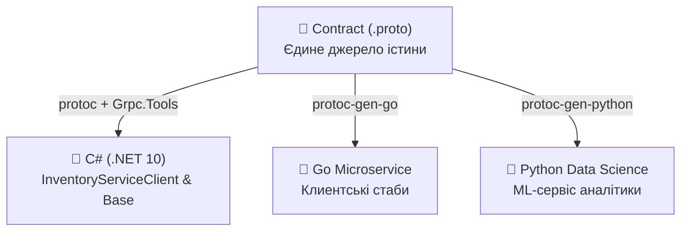
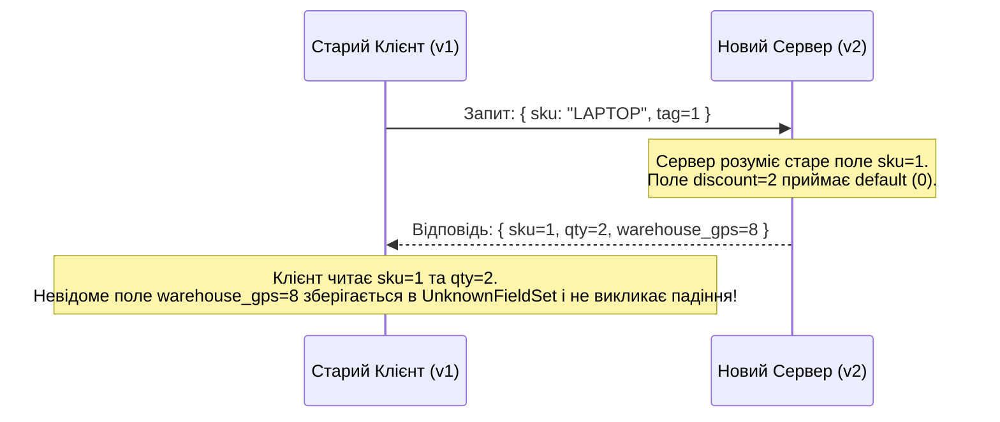

# 📜 Mastery 01: Protobuf & Contracts Foundation (Contract-First Design)

[](https://dotnet.microsoft.com/)
[](https://protobuf.dev/)
[]()

> **Мета модуля:** Опанувати парадигму **Contract-First**, зрозуміти математику та бінарний формат пакування **Protocol Buffers (proto3)**, навчитися проєктувати стійкі контракти для .NET 10 і керувати життєвим циклом еволюції API без ламання клієнтів.

---

## 📑 Зміст посібника
1. [Парадигми проєктування: Code-First проти Contract-First](#1-парадигми-проєктування-code-first-проти-contract-first)
2. [Що таке Protocol Buffers і чому він швидший за JSON](#2-що-таке-protocol-buffers-і-чому-він-швидший-за-json)
3. [Бінарний формат під мікроскопом: Varints, ZigZag та Wire Types](#3-бінарний-формат-під-мікроскопом-varints-zigzag-та-wire-types)
4. [Анатомія файлу `.proto`: детальний розбір синтаксису proto3](#4-анатомія-файлу-proto-детальний-розбір-синтаксису-proto3)
5. [Таблиця типів даних: Protobuf $\leftrightarrow$ .NET 10 (C# 14)](#5-таблиця-типів-даних-protobuf--net-10-c-14)
6. [Нумерація полів (Field Numbers): чому теги 1..15 є стратегічними](#6-нумерація-полів-field-numbers-чому-теги-115-є-стратегічними)
7. [Еволюція контракту: правила зворотної та прямої сумісності](#7-еволюція-контракту-правила-зворотної-та-прямої-сумісності)
8. [Кодогенерація в .NET 10: налаштування MSBuild та Grpc.Tools](#8-кодогенерація-в-net-10-налаштування-msbuild-та-grpctools)
9. [Аналіз згенерованого C#-коду (Stubs, Base Classes, Messages)](#9-аналіз-згенерованого-c-коду-stubs-base-classes-messages)
10. [Практичні лабораторні завдання для закріплення](#10-практичні-лабораторні-завдання-для-закріплення)

---

## 1. Парадигми проєктування: Code-First проти Contract-First

У класичній розробці на ASP.NET Core більшість розробників звикли до підходу **Code-First**:
1. Створюється C#-клас сутності або DTO: `public class ProductDto { ... }`.
2. Пишеться контролер: `[HttpGet] public ActionResult<ProductDto> Get()`.
3. Генератор Swagger/OpenAPI (Swashbuckle/NSwag/Scalar) сканує відкомпільовану збірку через Reflection та створює JSON-схему.

### Чому Code-First дає збій у мікросервісних екосистемах:
* **Мовна прив'язка (Vendor Lock-in):** Якщо мікросервіс логістики пишеться на Go, аналітика — на Python, а бекенд — на C#, підтримувати спільні моделі через C#-класи неможливо.
* **Приховані зміни (Accidental Breaking Changes):** Просте перейменування властивості в C# (`public int Qty { get; set; }` $\rightarrow$ `public int Quantity { get; set; }`) миттєво ламає сторонніх клієнтів при серіалізації в JSON.
* **Слабка типізація JSON:** У JSON немає різниці між `int32`, `int64`, `uint`, `float` чи `double` — усе це просто `number`, що провокує помилки переповнення та округлення.

### Підхід Contract-First у gRPC:
У gRPC **контракт є єдиним першоджерелом істини (Single Source of Truth)**. Спочатку створюється нейтральний файл `.proto`, і лише після цього компілятори генерують код для кожної платформи:



---

## 2. Що таке Protocol Buffers і чому він швидший за JSON

**Protocol Buffers (Protobuf)** — це мовно-нейтральний, платформо-незалежний механізм бінарної серіалізації структурованих даних, розроблений компанією Google.

### Порівняння розміру та швидкості:
Уявімо об'єкт складського залишку товару:

```json
// JSON Payload (78 байтів у текстовому вигляді)
{
  "sku": "LAPTOP-PRO-16",
  "availableQuantity": 45,
  "status": 1
}
```

У Protobuf цей самий об'єкт передається у вигляді **бінарного потоку розміром лише 18 байтів**!

```text
Бінарний потік Protobuf (Hex):
0A 0D 4C 41 50 54 4F 50 2D 50 52 4F 2D 31 36 10 2D 18 01
```

### Чому досягається колосальна перевага:
1. **Відсутність імен ключів:** Текстові рядки `"sku"`, `"availableQuantity"` не передаються мережею. Передаються лише компактні числові теги (1 байт).
2. **Відсутність текстового парсингу:** Серверу не потрібно парсити рядки символів, шукати двокрапки, коми чи лапки. Бінарний десеріалізатор читає байти прямо в оперативну пам'ять без виділення проміжних `string`-об'єктів (Zero Garbage Collection pressure).
3. **Ефективне стиснення чисел (Varints):** Малі числа займають 1 байт замість фіксованих 4 чи 8 байтів.

---

## 3. Бінарний формат під мікроскопом: Varints, ZigZag та Wire Types

Кожне поле в бінарному потоці Protobuf кодується за принципом **Tag-Length-Value (TLV)**. Тег поля поєднує в собі:
$$\text{Tag} = (\text{Field Number} \ll 3) \mid \text{Wire Type}$$

### Wire Types (Типи провідної передачі):
| Wire Type | Значення | Назва | Типи у `.proto` |
| :---: | :---: | :--- | :--- |
| `0` | `000` | **Varint** | `int32`, `int64`, `uint32`, `bool`, `enum` |
| `1` | `001` | **64-bit fixed** | `fixed64`, `sfixed64`, `double` |
| `2` | `010` | **Length-delimited** | `string`, `bytes`, вкладені `message`, списки `repeated` |
| `5` | `101` | **32-bit fixed** | `fixed32`, `sfixed32`, `float` |

### Як працює кодування Varint (Змінна довжина цілих чисел):
Varint дозволяє кодувати цілі числа, використовуючи від 1 до 10 байтів залежно від їх значення. Кожен байт використовує 7 бітів для збереження значення, а найстарший 8-й біт (**MSB — Most Significant Bit**) слугує прапорцем:
* `1` — попереду є наступні байти числа.
* `0` — це останній байт даного числа.

**Приклад: Як число `300` упаковується у Varint:**
1. Двійкове представлення числа 300: `00000001 00101100`.
2. Розбиваємо на групи по 7 бітів (з кінця): `0000010` та `0101100`.
3. Записуємо в порядку **Little-Endian** (молодший байт першим):
   * Перший байт: `10101100` (додали MSB = 1, оскільки є продовження) = `0xAC`.
   * Другий байт: `00000010` (додали MSB = 0, оскільки це кінець) = `0x02`.
4. Результат: замість 4 байтів (`0x0000012C`) число 300 займає лише 2 байти: `AC 02`!

### ZigZag-кодування для від'ємних чисел:
Звичайний `int32` зі значенням `-1` у форматі доповнення до двійки має вигляд `0xFFFFFFFF` (знакові одиниці заповнюють усі розряди) і займає у звичайному Varint аж **10 байтів**!
Для вирішення цієї проблеми Protobuf пропонує типи `sint32` та `sint64`, які використовують **ZigZag-кодування**:
$$\text{ZigZag}(n) = (n \ll 1) \oplus (n \gg 31)$$
Від'ємні та додатні числа чергуються: $0 \rightarrow 0, -1 \rightarrow 1, 1 \rightarrow 2, -2 \rightarrow 3$. Завдяки цьому число `-1` упаковується всього в **1 байт** (`0x01`).

---

## 4. Анатомія файлу `.proto`: детальний розбір синтаксису proto3

Розглянемо контракт нашого сервісу складу [`inventory.proto`](../src/Shared.Contracts/Protos/inventory.proto):

```protobuf
syntax = "proto3";

package mastery.inventory.v1;

option csharp_namespace = "Mastery.Inventory.V1";

import "google/protobuf/timestamp.proto";

// Сервіс управління залишками складу
service InventoryService {
  // 1. Unary: запит-відповідь
  rpc GetStockItem (StockItemRequest) returns (StockItemResponse);

  // 2. Unary: транзакційне резервування
  rpc ReserveStock (ReserveStockRequest) returns (ReserveStockResponse);

  // 3. Server Streaming: потік аудиту складу
  rpc StreamStockUpdates (StockAuditFilter) returns (stream StockItemResponse);
}

// Модель запиту інформації про товар
message StockItemRequest {
  string sku = 1;
}

// Модель повної інформації про товар
message StockItemResponse {
  string sku = 1;
  string product_name = 2;
  int32 available_quantity = 3;
  int32 reserved_quantity = 4;
  string warehouse_code = 5;
  StockStatus status = 6;
  google.protobuf.Timestamp last_restocked_at = 7;
}

// Перерахування статусів товару
enum StockStatus {
  STOCK_STATUS_UNSPECIFIED = 0; // Обов'язкове нульове значення за замовчуванням
  IN_STOCK = 1;
  LOW_STOCK = 2;
  OUT_OF_STOCK = 3;
  DISCONTINUED = 4;
}
```

### Ключові елементи синтаксису:
1. `syntax = "proto3";` — директива обов'язково має бути першим непорожнім рядком файлу.
2. `package mastery.inventory.v1;` — простір імен усередині екосистеми Protobuf. Дозволяє імпортувати один proto-файл в інший без колізій типів.
3. `option csharp_namespace = "Mastery.Inventory.V1";` — директива компілятора, яка вказує генератору створити C#-код саме в цьому `namespace`.
4. `import "google/protobuf/timestamp.proto";` — імпорт офіційних стандартних типів (Well-Known Types) від Google.

---

## 5. Таблиця типів даних: Protobuf $\leftrightarrow$ .NET 10 (C# 14)

| Тип у `.proto` | Тип у C# (.NET 10) | Wire Type | Особливості та використання |
| :--- | :--- | :---: | :--- |
| `double` | `double` | 1 (64-bit) | 64-бітне число з плаваючою крапкою IEEE 754 |
| `float` | `float` | 5 (32-bit) | 32-бітне число з плаваючою крапкою IEEE 754 |
| `int32` | `int` | 0 (varint) | Змінна довжина. Неефективний для великих від'ємних чисел |
| `int64` | `long` | 0 (varint) | 64-бітне ціле число |
| `sint32` / `sint64` | `int` / `long` | 0 (varint) | Використовує **ZigZag**. Ідеальний для чисел, що часто бувають від'ємними |
| `fixed32` / `fixed64` | `uint` / `ulong` | 5 / 1 | Завжди фіксовані 4 / 8 байтів. Ефективніший за `int32`, якщо значення часто $> 2^{28}$ |
| `bool` | `bool` | 0 (varint) | 1 байт (`0` або `1`) |
| `string` | `string` | 2 (length-delimited) | Завжди кодується в UTF-8. Довжина передається першим байтом |
| `bytes` | `Google.Protobuf.ByteString` | 2 (length-delimited) | Бінарні сирі дані (файли, хеші, зображення) |
| `enum` | C# `enum` | 0 (varint) | **Перший елемент зобов'язаний мати номер 0** |
| `google.protobuf.Timestamp` | `Google.Protobuf.WellKnownTypes.Timestamp` | 2 | Стандартний час UTC із точністю до наносекунд |

> [!CAUTION]
> У proto3 немає нативного типу `decimal`. Якщо вам потрібна фінансова точність, ніколи не використовуйте `float` через похибки двійкового представлення! Використовуйте або передачу в мінімальних копійках/центах (`int64 cents`), або спеціальне повідомлення `message DecimalValue { int64 units = 1; int32 nanos = 2; }`.

---

## 6. Нумерація полів (Field Numbers): чому теги 1..15 є стратегічними

У кожному `message` кожне поле має числовий тег `= 1`, `= 2`, `= 3`.
Діапазон доступних номерів: від `1` до $2^{29}-1$ ($536,870,911$), крім зарезервованих Google номерів від $19000$ до $19999$.

### Золоте правило розподілу тегів:
* **Теги від `1` до `15`** займають у бінарному заголовку поля **лише 1 байт** (номер поля поміщається в перші 4 біти байта тегу: `(field_number << 3) | wire_type`).
* **Теги від `16` до `2047`** займають у бінарному заголовку **2 байти**.
* **Теги від `2048` і вище** займають **3 і більше байтів**.

> [!TIP]
> Завжди призначайте номери від `1` до `15` тим полям, які передаються в кожному виклику (ID, SKU, статус, ключові суми). Рідкісні поля, великі текстові описи чи відлагоджувальні метадані виносьте на номери `16` і вище.

---

## 7. Еволюція контракту: правила зворотної та прямої сумісності

Головна перевага Protobuf — можливість оновлювати сервери та клієнти незалежно.



### 4 залізні правила зворотної сумісності:
1. **НІКОЛИ не змінюйте числовий тег поля.** Якщо поле `string sku = 1;` було створено, тег `1` назавжди закріплений за цим сенсом.
2. **НЕ змінюйте тип даних поля.** Зміна `int32` на `string` призведе до падіння бінарного десеріалізатора (`WireType mismatch`).
3. **Використовуйте `reserved` для видалених полів:** Якщо поле застаріло, позначте його як `reserved`:
   ```protobuf
   message StockItemResponse {
     reserved 4, 8 to 12;
     reserved "old_redundant_field";
   }
   ```
   Це гарантує, що інший розробник через рік не займе старий тег `= 4` новим полем, що зламало б старих клієнтів у продакшені.
4. **Невідомі поля (Unknown Fields):** Якщо старий сервіс отримує повідомлення з новими полями, він не викидає виняток, а дбайливо зберігає їх у властивості `UnknownFieldSet`. Якщо він пересилає цей об'єкт далі, нові поля не губляться!

---

## 8. Кодогенерація в .NET 10: налаштування MSBuild та Grpc.Tools

У проєкті [`Shared.Contracts.csproj`](../src/Shared.Contracts/Shared.Contracts.csproj) налаштовано автоматичну компіляцію контрактів засобами MSBuild-пакета `Grpc.Tools`:

```xml
<Project Sdk="Microsoft.NET.Sdk">

  <PropertyGroup>
    <TargetFramework>net10.0</TargetFramework>
    <ImplicitUsings>enable</ImplicitUsings>
    <Nullable>enable</Nullable>
  </PropertyGroup>

  <ItemGroup>
    <PackageReference Include="Google.Protobuf" Version="3.36.2" />
    <PackageReference Include="Grpc.Net.Client" Version="2.84.0" />
    <PackageReference Include="Grpc.Tools" Version="2.84.0">
      <IncludeAssets>runtime; build; native; contentfiles; analyzers; buildtransitive</IncludeAssets>
      <PrivateAssets>all</PrivateAssets>
    </PackageReference>
  </ItemGroup>

  <!-- Підключення протобафів до пайплайну збірки -->
  <ItemGroup>
    <Protobuf Include="Protos\inventory.proto" GrpcServices="Both" ProtoRoot="Protos" />
    <Protobuf Include="Protos\pricing.proto" GrpcServices="Both" ProtoRoot="Protos" />
    <Protobuf Include="Protos\aggregator.proto" GrpcServices="Both" ProtoRoot="Protos" />
  </ItemGroup>

</Project>
```

### Параметри елемента `<Protobuf>`:
* `GrpcServices="Both"` — генерувати як клієнтські класи (`*Client`), так і базові класи для сервера (`*Base`). Можливі значення: `Server`, `Client`, `Both`, `None` (лише DTO-повідомлення без RPC-інтерфейсів).
* `ProtoRoot="Protos"` — вказує базову директорію для резолвінгу відносних шляхів директиви `import`.

---

## 9. Аналіз згенерованого C#-коду (Stubs, Base Classes, Messages)

Після виклику `dotnet build` компілятор `protoc` генерує в папці `obj/Debug/net10.0/` наступні C# артефакти:

1. **`Inventory.cs` (Класи повідомлень):**
   * Клас `StockItemResponse : IMessage<StockItemResponse>, IEquatable<StockItemResponse>, IDeepCloneable<StockItemResponse>`
   * Реалізує швидку серіалізацію через `WriteTo(CodedOutputStream output)`.
   * Для кожного поля створюється типізована C#-властивість з валідацією на `null`.

2. **`InventoryGrpc.cs` (gRPC Сервісна обв'язка):**
   * Абстрактний базовий клас `InventoryServiceBase`:
     ```csharp
     public abstract partial class InventoryServiceBase
     {
         public virtual Task<StockItemResponse> GetStockItem(StockItemRequest request, ServerCallContext context)
         {
             throw new RpcException(new Status(StatusCode.Unimplemented, ""));
         }
     }
     ```
   * Клієнтський клас `InventoryServiceClient : ClientBase<InventoryServiceClient>`:
     ```csharp
     public virtual AsyncUnaryCall<StockItemResponse> GetStockItemAsync(StockItemRequest request, ...)
     ```

Завдяки цьому розробник сервера просто успадковує `InventoryServiceBase` і перевизначає `override Task<...>`, а розробник клієнта викликає готовий типізований метод `client.GetStockItemAsync()`.

---

## 10. Практичні лабораторні завдання для закріплення

Спробуйте самостійно виконати наступні завдання в проєкті [`Shared.Contracts`](../src/Shared.Contracts/):

1. **Додавання нового поля зворотно-сумісним шляхом:**
   * Відкрийте [`inventory.proto`](../src/Shared.Contracts/Protos/inventory.proto).
   * Додайте в `StockItemResponse` нове поле `string shelf_location = 8;` (номер полиці на складі).
   * Виконайте `dotnet build` у терміналі та переконайтеся, що в C#-класі `StockItemResponse` автоматично з'явилася властивість `ShelfLocation`.
2. **Використання директиви `reserved`:**
   * Додайте в `inventory.proto` блок `reserved 9 to 11;`.
   * Спробуйте створити поле `string barcode = 9;` і запустіть `dotnet build`.
   * Подивіться на повідомлення про помилку компілятора `protoc`, який заборонить використання зарезервованого тегу.
3. **Робота з Timestamp:**
   * У C#-клієнті спробуйте конвертувати поточний час `DateTime.UtcNow` у protobuf-тип за допомогою методу розширення `Timestamp.FromDateTime(...)` та назад через `.ToDateTime()`.
