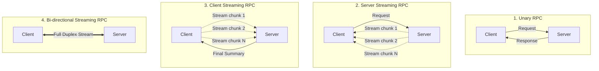

# 🌊 Mastery 02: Streaming In-Depth & Invocation Mechanics

Однією з найбільших переваг gRPC над класичним REST є повноцінна нативна підтримка **потоків (Streaming)**. Завдяки протоколу **HTTP/2**, де з'єднання є мультиплексованим та бінарним, клієнт і сервер можуть передавати серії повідомлень без оверхеду на відкриття нових сокетів, без полінгу і без застарілих веб-сокетових хаків.

У цьому посібнику ми розберемо всі 4 режими комунікації в gRPC та їхню реалізацію в .NET 10.

---

## 1. Чотири режими комунікації в gRPC



---

## 2. Server Streaming (Серверний потік)

### Суть:
Клієнт надсилає один запит (фільтр/підписку), а сервер відповідає нескінченним або довгим потоком повідомлень.

### Реалізація на сервері:
У сервісі складу [`InventoryGrpcService.cs`](../src/InventoryService/Services/InventoryGrpcService.cs):
```csharp
public override async Task StreamStockUpdates(
    StockAuditFilter request,
    IServerStreamWriter<StockItemResponse> responseStream,
    ServerCallContext context)
{
    var items = await _dbContext.StockItems
        .Where(x => x.WarehouseCode == request.WarehouseCode)
        .ToListAsync(context.CancellationToken);

    foreach (var item in items)
    {
        // Перевіряємо токен скасування клієнта
        if (context.CancellationToken.IsCancellationRequested) break;

        var response = MapToResponse(item);
        
        // Запис чергового шматка даних у відкритий HTTP/2 потік
        await responseStream.WriteAsync(response, context.CancellationToken);

        await Task.Delay(250, context.CancellationToken); // штучна пауза
    }
}
```

### Як читати на стороні клієнта:
```csharp
using var call = inventoryClient.StreamStockUpdates(new StockAuditFilter { WarehouseCode = "WH-KYIV-01" });

// Асинхронне читання повідомлень у міру їх надходження від сервера
await foreach (var item in call.ResponseStream.ReadAllAsync())
{
    Console.WriteLine($"[Отримано чанк] {item.Sku} | Залишок: {item.AvailableQuantity}");
}
```

---

## 3. Client Streaming (Клієнтський потік)

### Суть:
Клієнт надсилає потік повідомлень через один RPC-виклик, після чого сигналізує про завершення (`CompleteAsync()`), а сервер повертає одну результуючу відповідь.

### Реалізація на сервері:
У сервісі цін [`PricingGrpcService.cs`](../src/PricingService/Services/PricingGrpcService.cs):
```csharp
public override async Task<BulkUploadSummary> UploadBulkDiscountRules(
    IAsyncStreamReader<DiscountRule> requestStream,
    ServerCallContext context)
{
    int count = 0;
    
    // Асинхронно читаємо правила від клієнта
    await foreach (var rule in requestStream.ReadAllAsync(context.CancellationToken))
    {
        count++;
        // застосування знижки в базі...
    }

    // Сервер повертає єдиний звіт після завершення клієнтського потоку
    return new BulkUploadSummary { RulesProcessed = count, StatusMessage = "Успішно" };
}
```

### Як відправляти з клієнта:
```csharp
using var call = pricingClient.UploadBulkDiscountRules();

foreach (var rule in rulesToUpload)
{
    await call.RequestStream.WriteAsync(rule);
}

// Обов'язково повідомляємо сервер, що потік завершено!
await call.RequestStream.CompleteAsync();

// Отримуємо підсумкову відповідь
var summary = await call.ResponseAsync;
```

---

## 4. Bi-directional Streaming (Двосторонній потік)

### Суть:
Обидві сторони одночасно та асинхронно читають і пишуть у потік. Повна відсутність блокувань: сервер може відповідати миттєво на кожен запит клієнта, або надсилати 5 відповідей на 1 запит, або накопичувати пакет.

### Реалізація на сервері:
```csharp
public override async Task LiveQuoteNegotiation(
    IAsyncStreamReader<QuoteRequest> requestStream,
    IServerStreamWriter<QuoteResponse> responseStream,
    ServerCallContext context)
{
    await foreach (var req in requestStream.ReadAllAsync(context.CancellationToken))
    {
        var counterOffer = EvaluateQuote(req);
        
        // Відправляємо відповідь миттєво назад у потік
        await responseStream.WriteAsync(counterOffer, context.CancellationToken);
    }
}
```

---

## 5. Deadlines & Cancellation: Як не повісити мікросервіси

У REST запити часто зависають через відсутність таймаутів або клієнт відключається, а бекенд продовжує марнувати ресурси.
У gRPC **Deadlines (Крайній термін виконання)** — це вбудована першокласна концепція.

### Встановлення Deadline на клієнті:
```csharp
var deadline = DateTime.UtcNow.AddMilliseconds(500);

try
{
    var response = await client.GetStockItemAsync(
        new StockItemRequest { Sku = "LAPTOP-PRO-16" },
        deadline: deadline);
}
catch (RpcException ex) when (ex.StatusCode == StatusCode.DeadlineExceeded)
{
    Console.WriteLine("Сервер не встиг відповісти за 500 мс!");
}
```

> [!TIP]
> Коли в gRPC спливає Deadline, клієнтська бібліотека автоматично відправляє HTTP/2 фрейм `RST_STREAM` (Reset Stream). Серверний Kestrel негайно активує `context.CancellationToken`, перериваючи SQL-запити в базі даних та зупиняючи потоки.
