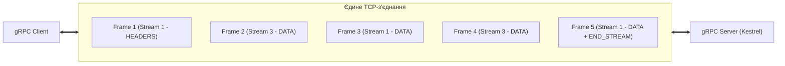
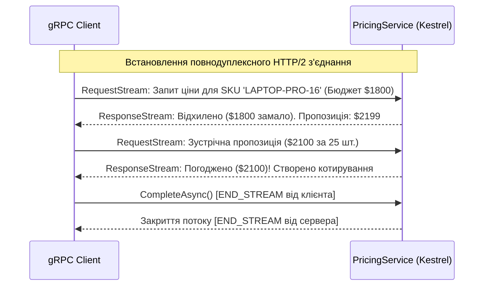

# 🌊 Mastery 02: Streaming In-Depth & Invocation Mechanics

[](https://dotnet.microsoft.com/)
[](https://httpwg.org/specs/rfc7540.html)
[]()

> **Мета модуля:** Глибоко зрозуміти мережевий фундамент протоколу **HTTP/2** (фрейми, потоки, мультиплексування, HPACK), опанувати всі **чотири режими передачі даних у gRPC** в .NET 10, навчитися керувати життєвим циклом потоків, керувати зворотним тиском (**Backpressure**) та реалізувати надійні механізми **Deadlines & Cancellation**.

---

## 📑 Зміст посібника
1. [Чому REST не вміє справжній стрімінг: обмеження HTTP/1.1](#1-чому-rest-не-вміє-справжній-стрімінг-обмеження-http11)
2. [Мережева анатомія HTTP/2: Фрейми, Мультиплексування та Потоки](#2-мережева-анатомія-http2-фрейми-мультиплексування-та-потоки)
3. [HPACK: як стискаються заголовки та чому gRPC майже не має overhead](#3-hpack-як-стискаються-заголовки-та-чому-grpc-майже-не-має-overhead)
4. [Чотири патерни комунікації в gRPC](#4-чотири-патерни-комунікації-в-grpc)
5. [Server Streaming (Серверний потік): архітектура та реалізація](#5-server-streaming-серверний-потік-архітектура-та-реалізація)
6. [Client Streaming (Клієнтський потік): пакетна передача даних](#6-client-streaming-клієнтський-потік-пакетна-передача-даних)
7. [Bi-directional Streaming (Двосторонній потік): повнодуплексний діалог](#7-bi-directional-streaming-двосторонній-потік-повнодуплексний-діалог)
8. [Керування потоком і зворотний тиск (Backpressure & Flow Control)](#8-керування-потоком-і-зворотний-тиск-backpressure--flow-control)
9. [Deadlines та каскадне скасування (CancellationTokens & RST_STREAM)](#9-deadlines-та-каскадне-скасування-cancellationtokens--rst_stream)
10. [Практичні лабораторні завдання для закріплення](#10-практичні-лабораторні-завдання-для-закріплення)

---

## 1. Чому REST не вміє справжній стрімінг: обмеження HTTP/1.1

У класичній веб-розробці на основі протоколу HTTP/1.1 передача даних у реальному часі завжди стикалася з фундаментальними архітектурними обмеженнями:
* **Head-of-Line Blocking на рівні TCP:** Одне TCP-з'єднання може обробляти лише один HTTP-запит у певний момент часу. Щоб завантажити 10 ресурсів паралельно, браузер вимушений відкривати 6–8 паралельних TCP-сокетів.
* **REST-полінг (Polling):** Клієнт кожні 2 секунди шле `GET /api/status`, витрачаючи ресурси процесора та мережі на постійні TCP/TLS рукостискання.
* **Server-Sent Events (SSE) та WebSockets:** SSE підтримує передачу лише від сервера до клієнта у текстовому форматі. WebSockets потребують окремого порту/протоколу `ws://`, виходять за межі стандартного HTTP-конвеєра, не підтримують стандартну автентифікацію заголовками та позбавлені вбудованого контролю потоку.

gRPC вирішує ці проблеми, спираючись на нативні можливості **HTTP/2**.

---

## 2. Мережева анатомія HTTP/2: Фрейми, Мультиплексування та Потоки

У HTTP/2 базовою одиницею передачі є **Фрейм (Frame)**. Кілька фреймів об'єднуються у логічний **Потік (Stream)**.



### Основні типи фреймів HTTP/2, які використовує gRPC:
1. **`HEADERS` (Тип 0x01):** Відкриває потік і передає метадані виклику (назву RPC-методу, тайм-аут, схему).
2. **`DATA` (Тип 0x00):** Передає фрагменти серіалізованого бінарного Protobuf-повідомлення.
3. **`SETTINGS` (Тип 0x04):** Узгоджує параметри з'єднання (максимальний розмір фрейму, розмір буфера потоку).
4. **`RST_STREAM` (Тип 0x03):** Негайно аварійно завершує конкретний потік (використовується при скасуванні запиту або перевищенні Deadline).
5. **`WINDOW_UPDATE` (Тип 0x08):** Керує зворотним тиском (Flow Control), дозволяючи отримувачу повідомляти, скільки ще байтів він готовий прийняти.
6. **`PING` (Тип 0x06):** Перевірка живості з'єднання (Keep-Alive) та вимірювання затримки мережі (RTT).

> [!IMPORTANT]
> **Мультиплексування (Multiplexing):** Клієнт може відкрити 100 одночасних gRPC-викликів до сервера, і всі вони передаватимуться **через один-єдиний відкритий TCP-сокет** у вигляді почергових фреймів. Жодного блокування запитів!

---

## 3. HPACK: як стискаються заголовки та чому gRPC майже не має overhead

У REST/HTTP/1.1 кожен повторний запит передає кілобайти однакових текстових заголовків (`User-Agent`, `Authorization: Bearer eyJ...`, `Accept`, `Host`).

У gRPC використовується алгоритм **HPACK (RFC 7541)**:
* Сервер і клієнт підтримують спільну динамічну таблицю заголовків у пам'яті.
* При першому запиті передається повний заголовок авторизації `authorization: Bearer XYZ`. Обидві сторони зберігають його в таблиці під числовим індексом (наприклад, `#62`).
* У всіх наступних викликах клієнт передає **лише числовий індекс `#62` (1 байт)** замість повторного передавання 500 байтів токена JWT!

---

## 4. Чотири патерни комунікації в gRPC

| Патерн | Клієнт шле | Сервер відповідає | Сигнатура методу в `.proto` | Типовий юзкейс |
| :--- | :---: | :---: | :--- | :--- |
| **1. Unary** | 1 повідомлення | 1 повідомлення | `rpc Call (Req) returns (Resp);` | CRUD-операції, перевірка залишку |
| **2. Server Streaming** | 1 повідомлення | Потік повідомлень | `rpc Call (Req) returns (stream Resp);` | Вивантаження великих звітів, підписка на події |
| **3. Client Streaming** | Потік повідомлень | 1 повідомлення | `rpc Call (stream Req) returns (Resp);` | Пакетне оновлення цін, завантаження файлів |
| **4. Bi-directional** | Потік повідомлень | Потік повідомлень | `rpc Call (stream Req) returns (stream Resp);` | Живий чат, торги, телеметрія дронів |

---

## 5. Server Streaming (Серверний потік): архітектура та реалізація

Клієнт надсилає один запит-фільтр, а сервер повертає послідовність результатів через інтерфейс `IServerStreamWriter<T>`.

### Реалізація на сервері ([`InventoryGrpcService.cs`](../src/InventoryService/Services/InventoryGrpcService.cs)):

```csharp
public override async Task StreamStockUpdates(
    StockAuditFilter request,
    IServerStreamWriter<StockItemResponse> responseStream,
    ServerCallContext context)
{
    _logger.LogInformation("Початок потоку аудиту для складу: {Warehouse}", request.WarehouseCode);

    var query = _dbContext.StockItems.AsNoTracking().AsQueryable();
    if (!string.IsNullOrWhiteSpace(request.WarehouseCode))
    {
        query = query.Where(x => x.WarehouseCode == request.WarehouseCode);
    }

    var items = await query.ToListAsync(context.CancellationToken);

    foreach (var item in items)
    {
        // 1. Обов'язкова перевірка токена скасування клієнта
        if (context.CancellationToken.IsCancellationRequested)
        {
            _logger.LogWarning("Клієнт скасував підписку на аудит.");
            break;
        }

        var response = MapToResponse(item);

        // 2. Відправка чергового фрейму в HTTP/2 потік
        await responseStream.WriteAsync(response, context.CancellationToken);

        // Штучна пауза для емуляції надходження оновлень у часі
        await Task.Delay(250, context.CancellationToken);
    }
}
```

### Читання на стороні клієнта ([`02_StreamingScenario.cs`](../src/ClientApp/Scenarios/02_StreamingScenario.cs)):

У .NET 10 клієнт використовує стандартний інтерфейс `IAsyncEnumerable<T>` за допомогою методу розширення `ReadAllAsync()`:

```csharp
using var call = inventoryClient.StreamStockUpdates(new StockAuditFilter { WarehouseCode = "WH-KYIV-01" });

// Асинхронне читання повідомлень за мірою їх прибуття
await foreach (var item in call.ResponseStream.ReadAllAsync())
{
    Console.WriteLine($"[Отримано чанк] SKU: {item.Sku} | Залишок: {item.AvailableQuantity} шт.");
}
```

---

## 6. Client Streaming (Клієнтський потік): пакетна передача даних

Клієнт надсилає потік повідомлень через `IClientStreamWriter<T>`, а сервер читає їх через `IAsyncStreamReader<T>`. Після надсилання всіх елементів клієнт зобов'язаний закрити свою частину потоку викликом `CompleteAsync()`.

### Реалізація на сервері ([`PricingGrpcService.cs`](../src/PricingService/Services/PricingGrpcService.cs)):

```csharp
public override async Task<BulkUploadSummary> UploadBulkDiscountRules(
    IAsyncStreamReader<DiscountRule> requestStream,
    ServerCallContext context)
{
    int processed = 0;
    int applied = 0;

    // Асинхронно вичитуємо кожне правило з клієнтського потоку
    await foreach (var rule in requestStream.ReadAllAsync(context.CancellationToken))
    {
        processed++;
        var item = await _dbContext.Prices.FirstOrDefaultAsync(x => x.Sku == rule.Sku, context.CancellationToken);
        if (item is not null)
        {
            item.StandardDiscountPercent = rule.DiscountPercent;
            applied++;
        }
    }

    // Зберігаємо пакетні зміни в базі даних
    await _dbContext.SaveChangesAsync(context.CancellationToken);

    // Повертаємо єдиний підсумковий результат
    return new BulkUploadSummary
    {
        RulesProcessed = processed,
        RulesApplied = applied,
        StatusMessage = "Пакетне оновлення знижок успішно виконано."
    };
}
```

### Відправка з клієнта:
```csharp
using var call = pricingClient.UploadBulkDiscountRules();

foreach (var rule in rules)
{
    // Запис повідомлення в клієнтський потік
    await call.RequestStream.WriteAsync(rule);
}

// Повідомляємо сервер, що потік завершено (відправка прапорця END_STREAM)
await call.RequestStream.CompleteAsync();

// Очікуємо підсумкову відповідь сервера
var summary = await call.ResponseAsync;
Console.WriteLine($"Результат: {summary.StatusMessage} (Оновлено: {summary.RulesApplied})");
```

---

## 7. Bi-directional Streaming (Двосторонній потік): повнодуплексний діалог

У двосторонньому потоці клієнт і сервер читають та пишуть у потік абсолютно **незалежно та асинхронно**. Потік залишається відкритим, доки обидві сторони не закриють свої кінці з'єднання.



### Код сервера ([`PricingGrpcService.cs`](../src/PricingService/Services/PricingGrpcService.cs)):
```csharp
public override async Task LiveQuoteNegotiation(
    IAsyncStreamReader<QuoteRequest> requestStream,
    IServerStreamWriter<QuoteResponse> responseStream,
    ServerCallContext context)
{
    await foreach (var req in requestStream.ReadAllAsync(context.CancellationToken))
    {
        var response = EvaluateQuote(req);
        // Миттєва відповідь у зворотний потік
        await responseStream.WriteAsync(response, context.CancellationToken);
    }
}
```

---

## 8. Керування потоком і зворотний тиск (Backpressure & Flow Control)

Що станеться, якщо сервер генерує $10\,000$ повідомлень на секунду, а мобільний клієнт на слабкому 3G встигає обробляти лише $50$?
У WebSockets або невдалих самописних протоколах це призводить до переповнення оперативної пам'яті клієнта (Out of Memory) або буферного блокування.

У gRPC на рівні HTTP/2 діє **Credit-Based Flow Control**:
1. Кожна сторона оголошує розмір свого буфера прийому (за замовчуванням $65\,535$ байтів) у фреймі `SETTINGS`.
2. Коли сервер надсилає `DATA`-фрейми, розмір вікна зменшується.
3. Коли вікно досягає 0, серверний метод `await responseStream.WriteAsync()` **фізично зупиняє виконання (пауза)** і не виділяє пам'ять, поки клієнт не прочитає повідомлення і не надішле фрейм `WINDOW_UPDATE`.

---

## 9. Deadlines та каскадне скасування (CancellationTokens & RST_STREAM)

У REST таймаут зазвичай реалізується на стороні клієнта (`HttpClient.Timeout`). Якщо таймаут спливає, клієнт викидає виняток, але **сервер про це не знає** і продовжує навантажувати базу даних та процесор.

У gRPC **Deadlines** передаються у спеціальному HTTP/2 заголовку `grpc-timeout`:

```csharp
// Встановлюємо жорсткий дедлайн: 500 мс від поточного моменту
var deadline = DateTime.UtcNow.AddMilliseconds(500);

try
{
    var response = await client.GetStockItemAsync(
        new StockItemRequest { Sku = "LAPTOP-PRO-16" },
        deadline: deadline);
}
catch (RpcException ex) when (ex.StatusCode == StatusCode.DeadlineExceeded)
{
    Console.WriteLine("⚠️ Сервер не встиг завершити запит за виділені 500 мс!");
}
```

### Що відбувається під капотом при перевищенні дедлайну:
1. Клієнтська бібліотека gRPC надсилає HTTP/2 фрейм `RST_STREAM` із кодом помилки `CANCEL (0x08)`.
2. Серверний Kestrel негайно переводить `context.CancellationToken` у сигнальний стан (`IsCancellationRequested = true`).
3. Усі асинхронні операції в коді сервера (`await _dbContext.SaveChangesAsync(ct)`, `await Task.Delay(..., ct)`) негайно перериваються і вивільняють сокет та потоки пулу.

---

## 10. Практичні лабораторні завдання для закріплення

1. **Реалізація клієнтського скасування стрімінгу:**
   * Відкрийте [`02_StreamingScenario.cs`](../src/ClientApp/Scenarios/02_StreamingScenario.cs).
   * Створіть `var cts = new CancellationTokenSource(TimeSpan.FromMilliseconds(400));`.
   * Передайте токен у виклик `StreamStockUpdates(..., cancellationToken: cts.Token)`.
   * Переконайтеся в логах сервера `InventoryService`, що виклик перервався повідомленням: *"Клієнт скасував підписку на аудит"*.
2. **Фільтрація у двосторонньому потоці:**
   * Додайте у клієнтський цикл сценарію переговорів умову: якщо сервер повертає `is_accepted == true`, клієнт одразу викликає `CompleteAsync()`, не відправляючи наступні пропозиції.
