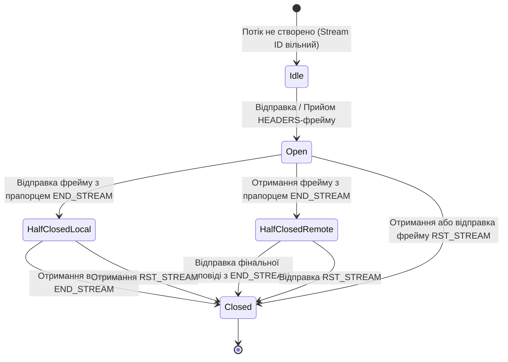
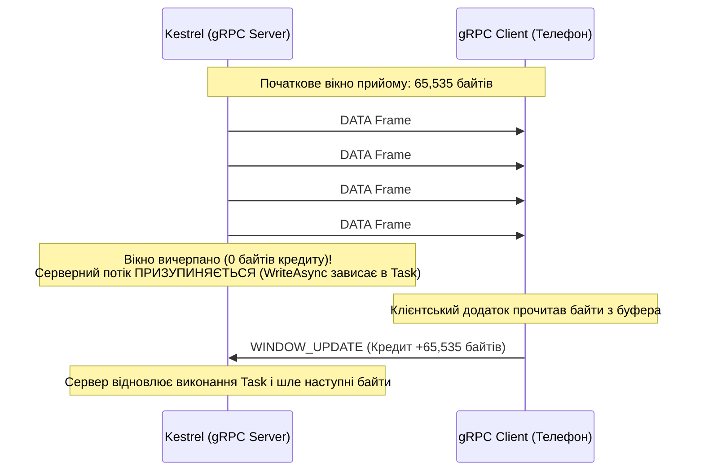
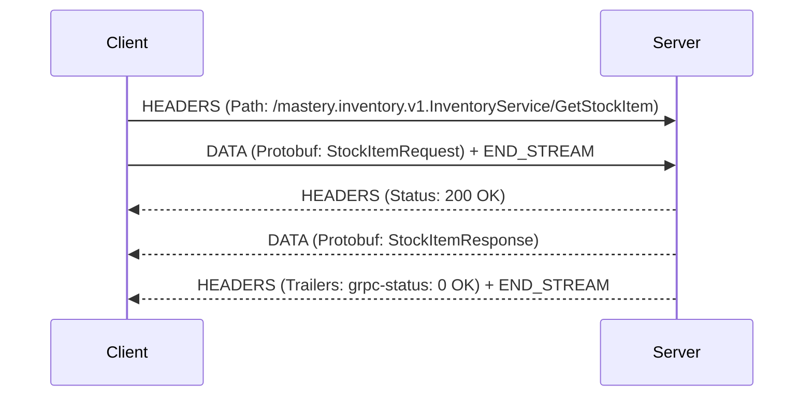
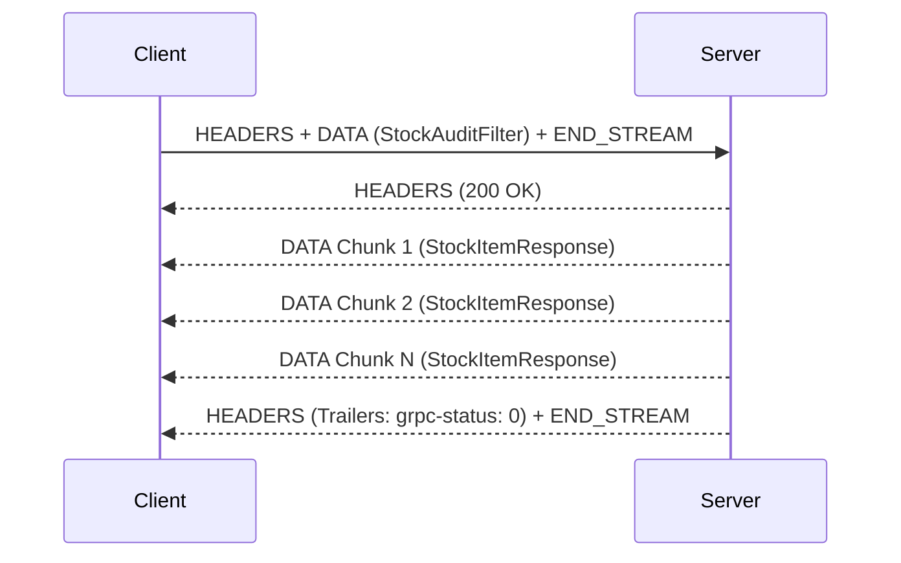
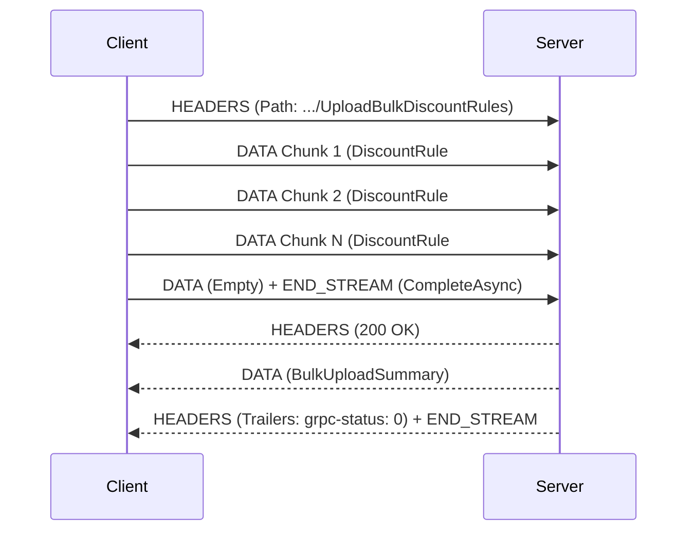
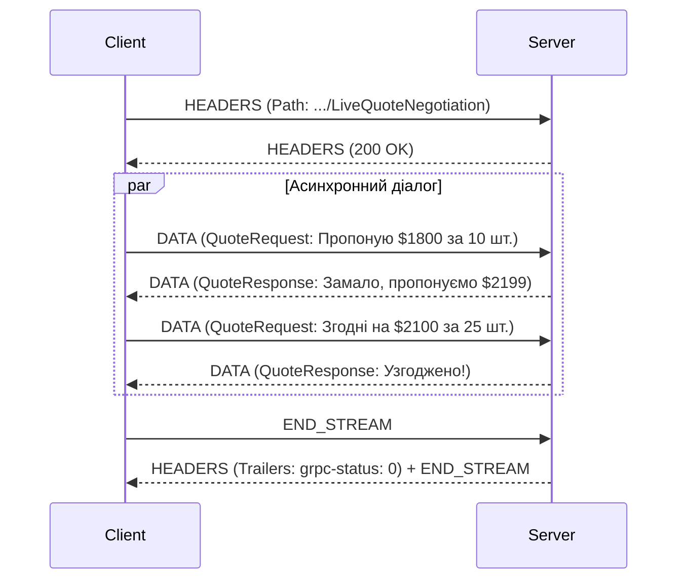

# 🌊 Mastery 02: Потокові режими та механіка виконання викликів у gRPC

[](https://dotnet.microsoft.com/)
[](https://httpwg.org/specs/rfc7540.html)
[]()

> **Мета модуля:** Детально розібрати мережеву анатомію протоколу **HTTP/2**, зрозуміти структуру бінарних **фреймів**, алгоритм компресії **HPACK**, кредитний контроль потоку (**Flow Control / Backpressure**), опанувати всі **чотири патерни комунікації gRPC** в .NET 10 та реалізувати надійне каскадне скасування через **Deadlines & RST_STREAM**.

---

## 📑 Зміст посібника
1. [Чому HTTP/1.1 не здатний забезпечити справжній повнодуплексний стрімінг](#1-чому-http11-не-здатний-забезпечити-справжній-повнодуплексний-стрімінг)
2. [Мережева анатомія HTTP/2: Двійковий шар фреймінгу (Binary Framing Layer)](#2-мережева-анатомія-http2-двійковий-шар-фреймінгу-binary-framing-layer)
   * 2.1 [Анатомія заголовка HTTP/2 фрейму (9 байтів)](#21-анатомія-заголовка-http2-фрейму-9-байтів)
   * 2.2 [Типи фреймів, що обслуговують gRPC](#22-типи-фреймів-що-обслуговують-grpc)
   * 2.3 [Життєвий цикл HTTP/2 потоку (Stream State Machine)](#23-життєвий-цикл-http2-потоку-stream-state-machine)
3. [Алгоритм компресії заголовків HPACK (RFC 7541)](#3-алгоритм-компресії-заголовків-hpack-rfc-7541)
4. [Кредитний контроль потоку (Flow Control) та зворотний тиск (Backpressure)](#4-кредитний-контроль-потоку-flow-control-та-зворотний-тиск-backpressure)
5. [Чотири режими взаємодії gRPC: Архітектура та послідовність фреймів](#5-чотири-режими-взаємодії-grpc-архітектура-та-послідовність-фреймів)
   * 5.1 [Патерн 1: Unary RPC (Один запит — одна відповідь)](#51-патерн-1-unary-rpc-один-запит--одна-відповідь)
   * 5.2 [Патерн 2: Server Streaming (Один запит — потік відповідей)](#52-патерн-2-server-streaming-один-запит--потік-відповідей)
   * 5.3 [Патерн 3: Client Streaming (Потік запитів — один підсумок)](#53-патерн-3-client-streaming-потік-запитів--один-підсумок)
   * 5.4 [Патерн 4: Bi-directional Streaming (Повнодуплексний діалог)](#54-патерн-4-bi-directional-streaming-повнодуплексний-діалог)
6. [Реалізація в C# 14 (.NET 10): Асинхронні потоки та інтерфейси](#6-реалізація-в-c-14-net-10-асинхронні-потоки-та-інтерфейси)
7. [Deadlines та каскадне скасування: Внутрішня механіка `RST_STREAM`](#7-deadlines-та-каскадне-скасування-внутрішня-механіка-rst_stream)
8. [Покроковий розбір коду сервісів репозиторію](#8-покроковий-розбір-коду-сервісів-репозиторію)
9. [Типові інженерні помилки та антипатерни стрімінгу](#9-типові-інженерні-помилки-та-антипатерни-стрімінгу)
10. [Контрольні запитання та лабораторні завдання](#10-контрольні-запитання-та-лабораторні-завдання)

---

<a id="1-чому-http11-не-здатний-забезпечити-справжній-повнодуплексний-стрімінг"></a>
## 1. Чому HTTP/1.1 не здатний забезпечити справжній повнодуплексний стрімінг

Протокол HTTP/1.1 (створений у 1997 році) базується на текстовому форматі передачі. Кожен запит та відповідь є суцільним блоком символів ASCII, розділених символами повернення каретки `\r\n`.

### Головні архітектурні вади HTTP/1.1:
1. **Head-of-Line (HoL) Blocking на рівні застосунку:**
   * В одному TCP-з'єднанні клієнт не може надіслати другий запит, поки сервер повністю не поверне відповідь на перший.
   * Якщо перший запит — це важкий звіт на 10 секунд, усі наступні запити «зависають» у черзі.
2. **Марнотратство TCP-з'єднань:**
   * Щоб завантажити 10 ресурсів паралельно, браузери змушені відкривати до 6–8 паралельних TCP-сокетів до одного домену.
   * Кожне нове TCP-з'єднання потребує 3-стороннього рукостискання (3-Way Handshake: SYN $\rightarrow$ SYN-ACK $\rightarrow$ ACK), фази повільного старту (TCP Slow Start) та важкого узгодження ключів TLS.
3. **Псевдо-стрімінг (Long-Polling, WebSockets, SSE):**
   * **Long-Polling:** Клієнт постійно відкриває та закриває сокети — це оверхед на заголовки.
   * **WebSockets:** Окремий протокол, який потребує окремого порту, не підтримує стандартне кешування, заголовки безпеки, мультиплексування та контроль потоку.

gRPC базується на **HTTP/2**, позбавляючись усіх цих недоліків на рівні специфікації.

---

<a id="2-мережева-анатомія-http2-двійковий-шар-фреймінгу-binary-framing-layer"></a>
## 2. Мережева анатомія HTTP/2: Двійковий шар фреймінгу (Binary Framing Layer)

Фундаментальна відмінність HTTP/2 — впровадження бінарного шару фреймінгу між сокетом TCP та прикладним рівнем застосунку.

<a id="21-анатомія-заголовка-http2-фрейму-9-байтів"></a>
### 2.1 Анатомія заголовка HTTP/2 фрейму (9 байтів)

Будь-яка інформація в HTTP/2 (заголовки, бінарні Protobuf-повідомлення, сигнали скасування) передається у вигляді **Фреймів (Frames)**.
Кожен фрейм починається зі стандартного фіксованого заголовка розміром рівно **9 байтів**:

```text
 0                   1                   2                   3
 0 1 2 3 4 5 6 7 8 9 0 1 2 3 4 5 6 7 8 9 0 1 2 3 4 5 6 7 8 9 0 1
+-+-+-+-+-+-+-+-+-+-+-+-+-+-+-+-+-+-+-+-+-+-+-+-+-+-+-+-+-+-+-+-+
|                 Length (24 біти)              |  Type (8)     |
+-+-+-+-+-+-+-+-+-+-+-+-+-+-+-+-+-+-+-+-+-+-+-+-+-+-+-+-+-+-+-+-+
|   Flags (8)   |R|               Stream ID (31 біт)            |
+-+-+-+-+-+-+-+-+-+-+-+-+-+-+-+-+-+-+-+-+-+-+-+-+-+-+-+-+-+-+-+-+
|                     Frame Payload (Довжина з поля Length)    ...
```

#### Поля заголовка фрейму:
1. **Length (24 біти):** Довжина корисного навантаження (Payload) фрейму (за замовчуванням максимум $2^{14} = 16\,384$ байти).
2. **Type (8 бітів):** Тип фрейму (визначає, як інтерпретувати корисне навантаження).
3. **Flags (8 бітів):** Булеві прапорці:
   * `END_STREAM (0x01)` — сигналізує, що відправник завершив надсилати дані в даному потоці (аналог `CompleteAsync()`).
   * `END_HEADERS (0x04)` — сигналізує про завершення передачі блоку заголовків.
4. **Stream ID (31 біт):** Унікальний числовий ідентифікатор логічного потоку:
   * Непарні номери (`1, 3, 5...`) призначаються потокам, ініційованим **клієнтом**.
   * Парні номери (`2, 4, 6...`) призначаються потокам, ініційованим **сервером** (Server Push).
   * Номер `0x00` закріплений за керуючими фреймами всього з'єднання (Connection-level control).

<a id="22-типи-фреймів-що-обслуговують-grpc"></a>
### 2.2 Типи фреймів, що обслуговують gRPC

| Назва фрейму | Код типу | Призначення в роботі gRPC |
| :--- | :---: | :--- |
| **`HEADERS`** | `0x01` | Відкриває новий RPC-потік, передає шлях до методу, схему та gRPC-метадані |
| **`DATA`** | `0x00` | Передає серіалізовані бінарні повідомлення Protocol Buffers |
| **`SETTINGS`** | `0x04` | Узгоджує параметри з'єднання (розмір вікна прийому, максимальний фрейм) |
| **`RST_STREAM`**| `0x03` | Аварійне скасування потоку (викликається при таймауті або CancellationToken) |
| **`WINDOW_UPDATE`** | `0x08`| Керує зворотним тиском (Flow Control), дозволяючи передати наступну порцію байтів |
| **`PING`** | `0x06` | Перевірка живості з'єднання (Keep-Alive) та вимірювання затримки RTT |
| **`GOAWAY`** | `0x07` | Сигнал коректного закриття з'єднання (сервер завершує роботу) |

<a id="23-життєвий-цикл-http2-потоку-stream-state-machine"></a>
### 2.3 Життєвий цикл HTTP/2 потоку (Stream State Machine)

Кожен gRPC-виклик живе всередині окремого потоку HTTP/2, який проходить суворий скінченний автомат станів:



* **Idle:** Початковий стан. Потік ще не існує.
* **Open:** Потік відкрито відправкою фрейму `HEADERS`. Обидві сторони можуть надсилати `DATA`-фрейми (повнодуплексний стрімінг).
* **Half-Closed:** Одна зі сторін надіслала фрейм із прапорцем `END_STREAM`. Наприклад, клієнт завершив передачу даних (`CompleteAsync()`), але продовжує очікувати відповідь від сервера.
* **Closed:** Обидві сторони закрили потік або отримали фрейм `RST_STREAM`. Номер потоку звільняється.

---

<a id="3-алгоритм-компресії-заголовків-hpack-rfc-7541"></a>
## 3. Алгоритм компресії заголовків HPACK (RFC 7541)

У REST/HTTP/1.1 кожен повторний запит надсилає кілобайти текстових заголовків (`User-Agent`, `Authorization: Bearer ...`, `Accept`).

У gRPC завдяки **HPACK**:
1. Сервер і клієнт підтримують дві таблиці:
   * **Статична таблиця (Static Table):** 61 стандартний заголовок HTTP/2 (наприклад, `:method: POST` має фіксований числовий індекс `#3`).
   * **Динамічна таблиця (Dynamic Table):** Формується динамічно під час сесії.
2. При першому gRPC-виклику клієнт відправляє повний заголовок:
   `content-type: application/grpc`.
   Обидві сторони зберігають його в динамічній таблиці під індексом `#62`.
3. У всіх наступних викликах клієнт передає лише **1 байт: `#62`** замість 30 байтів тексту!
4. Невідомі рядки стискаються алгоритмом Хаффмана (Huffman Coding).

---

<a id="4-кредитний-контроль-потоку-flow-control-та-зворотний-тиск-backpressure"></a>
## 4. Кредитний контроль потоку (Flow Control) та зворотний тиск (Backpressure)

Уявімо ситуацію: сервер транслює складський аудит зі швидкістю 10 000 повідомлень на секунду, а клієнтський мобільний телефон встигає обробляти лише 100 повідомлень на секунду через повільний процесор.
У неконтрольованих системах це призводить до переповнення оперативної пам'яті клієнта (Out Of Memory) та аварійного падіння.

У HTTP/2 реалізовано **Кредитний контроль потоку (Credit-Based Flow Control)**:



### Як це працює в коді:
Коли буфер клієнта заповнений, метод сервера `await responseStream.WriteAsync(item)` **не повертає керування**. Серверний потік стає на асинхронну паузу і не навантажує пам'ять, поки клієнт не звільнить свій буфер і не надішле фрейм `WINDOW_UPDATE`.

---

<a id="5-чотири-режими-взаємодії-grpc-архітектура-та-послідовність-фреймів"></a>
## 5. Чотири режими взаємодії gRPC: Архітектура та послідовність фреймів

<a id="51-патерн-1-unary-rpc-один-запит--одна-відповідь"></a>
### 5.1 Патерн 1: Unary RPC (Один запит — одна відповідь)

Класична модель «запит-відповідь». На відміну від REST, виконується строго через HTTP/2 POST.



> [!NOTE]
> Зверніть увагу: статус виконання gRPC передається не в HTTP-заголовках, а в **HTTP/2 Трейлерах (Trailers)** у кінці відповіді (`grpc-status: 0`).

<a id="52-патерн-2-server-streaming-один-запит--потік-відповідей"></a>
### 5.2 Патерн 2: Server Streaming (Один запит — потік відповідей)

Клієнт надсилає один запит (наприклад, фільтр складу), а сервер тримає потік відкритим і шле послідовність `DATA`-фреймів.



Застосовується для: вивантаження великих наборів даних з бази, нотифікацій у реальному часі, фінансових котирувань.

<a id="53-патерн-3-client-streaming-потік-запитів--один-підсумок"></a>
### 5.3 Патерн 3: Client Streaming (Потік запитів — один підсумок)

Клієнт відправляє потік повідомлень, після чого закриває потік (`CompleteAsync()`), а сервер повертає одну результуючу відповідь.



Застосовується для: пакетного імпорту замовлень, телеметрії IoT датчиків, завантаження великих файлів частинами.

<a id="54-патерн-4-bi-directional-streaming-повнодуплексний-діалог"></a>
### 5.4 Патерн 4: Bi-directional Streaming (Повнодуплексний діалог)

Клієнт і сервер читають та пишуть у потік абсолютно **незалежно**. Повна відсутність блокувань: на 1 запит клієнта сервер може надіслати 0, 1 або 10 відповідей.



---

<a id="6-реалізація-в-c-14-net-10-асинхронні-потоки-та-інтерфейси"></a>
## 6. Реалізація в C# 14 (.NET 10): Асинхронні потоки та інтерфейси

У бібліотеці `Grpc.Core.Api` взаємодія з потоками інкапсульована в інтерфейси:

1. **`IAsyncStreamReader<T>` (Читання з потоку):**
   * Метод `MoveNext(CancellationToken)`: переміщує курсор до наступного повідомлення.
   * У .NET 10 підтримує нативний синтаксис `await foreach (var item in stream.ReadAllAsync(ct))`.
2. **`IServerStreamWriter<T>` та `IClientStreamWriter<T>` (Запис у потік):**
   * Метод `WriteAsync(T message, CancellationToken)`: асинхронно записує чергове повідомлення у фрейм HTTP/2.
   * Метод `CompleteAsync()` (лише на клієнті): надсилає фрейм з прапорцем `END_STREAM`.

---

<a id="7-deadlines-та-каскадне-скасування-внутрішня-механіка-rst_stream"></a>
## 7. Deadlines та каскадне скасування: Внутрішня механіка `RST_STREAM`

У класичному REST якщо клієнт встановлює таймаут, клієнтська бібліотека просто викидає виняток, а сервер продовжує марнувати процесорний час.

У gRPC діє механізм **Deadlines**:
1. Клієнт обчислює дедлайн: `var deadline = DateTime.UtcNow.AddMilliseconds(500);`.
2. Клієнтська бібліотека транслює цей час у відносний інтервал і додає HTTP/2 заголовок:
   `grpc-timeout: 500m` (де `m` означає мілісекунди).
3. Якщо час вичерпано до отримання відповіді:
   * Клієнт миттєво відправляє HTTP/2 фрейм `RST_STREAM` з кодом помилки `CANCEL (0x08)`.
   * Kestrel на сервері ловить цей фрейм і негайно переводить `context.CancellationToken` у стан `IsCancellationRequested = true`.
   * Усі SQL-запити в базі даних негайно скасовуються драйвером!

---

<a id="8-покроковий-розбір-коду-сервісів-репозиторію"></a>
## 8. Покроковий розбір коду сервісів репозиторію

### 8.1 Серверний потік: [`InventoryGrpcService.cs`](../src/InventoryService/Services/InventoryGrpcService.cs)
```csharp
public override async Task StreamStockUpdates(
    StockAuditFilter request,
    IServerStreamWriter<StockItemResponse> responseStream,
    ServerCallContext context)
{
    // Отримуємо записи з бази
    var items = await _dbContext.StockItems.ToListAsync(context.CancellationToken);

    foreach (var item in items)
    {
        // 1. Обов'язкова перевірка токена скасування клієнта
        if (context.CancellationToken.IsCancellationRequested) break;

        // 2. Відправка в потік
        await responseStream.WriteAsync(MapToResponse(item), context.CancellationToken);
        await Task.Delay(250, context.CancellationToken);
    }
}
```

### 8.2 Клієнтський потік: [`PricingGrpcService.cs`](../src/PricingService/Services/PricingGrpcService.cs)
```csharp
public override async Task<BulkUploadSummary> UploadBulkDiscountRules(
    IAsyncStreamReader<DiscountRule> requestStream,
    ServerCallContext context)
{
    int applied = 0;
    // Асинхронно вичитуємо потік від клієнта
    await foreach (var rule in requestStream.ReadAllAsync(context.CancellationToken))
    {
        // застосування знижки в базі...
        applied++;
    }
    await _dbContext.SaveChangesAsync(context.CancellationToken);

    return new BulkUploadSummary { RulesApplied = applied };
}
```

---

<a id="9-типові-інженерні-помилки-та-антипатерни-стрімінгу"></a>
## 9. Типові інженерні помилки та антипатерни стрімінгу

1. **Антипатерн «Забутий CompleteAsync на клієнті»:** Клієнт відправив усі повідомлення в `UploadBulkDiscountRules`, але не викликав `CompleteAsync()`. Сервер вічно висить у циклі `await foreach`, очікуючи наступний фрейм.
2. **Антипатерн «Паралельний виклик WriteAsync на одному стрімі»:** Інтерфейс `IServerStreamWriter` **не є потокобезпечним**! Не можна одночасно з двох різних Task викликати `WriteAsync()` у той самий потік — це призведе до збою `InvalidOperationException`.
3. **Ігнорування `context.CancellationToken`:** Якщо сервер не передає токен у `WriteAsync()` або операції бази даних, фонова робота продовжуватиметься навіть після відключення клієнта.

---

<a id="10-контрольні-запитання-та-лабораторні-завдання"></a>
## 10. Контрольні запитання та лабораторні завдання

### Контрольні запитання:
1. Що таке Head-of-Line Blocking і на якому рівні (HTTP чи TCP) gRPC вирішує цю проблему?
2. З яких полів складається 9-байтний заголовок HTTP/2 фрейму?
3. Що означає прапорець `END_STREAM` у фреймі `DATA`?
4. Чому статус виконання RPC-методу передається в HTTP/2 Трейлерах (`Trailers`), а не в початкових заголовках?
5. Як алгоритм компресії HPACK уникає повторної передачі однакових заголовків?

### Лабораторні завдання:
1. **Тестування клієнтського скасування:**
   У файлі [`02_StreamingScenario.cs`](../src/ClientApp/Scenarios/02_StreamingScenario.cs) додайте таймаут скасування через 500 мс після старту `StreamStockUpdates`. Зафіксуйте в консолі сервера повідомлення про зупинку стрімінгу.
2. **Реалізація пакетної обробки у клієнтському потоці:**
   Модифікуйте `UploadBulkDiscountRules` так, щоб сервер викликав `_dbContext.SaveChangesAsync()` кожні 10 отриманих повідомлень (batch size = 10).
