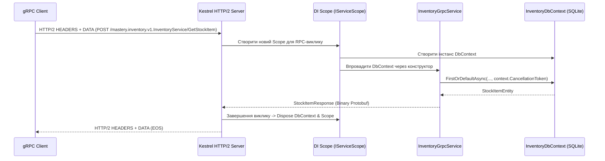

# 🗄️ Mastery 03: Data-Driven gRPC з Entity Framework Core

У багатьох навчальних прикладах gRPC сервіси часто обмежуються статичними моковими списками `List<T>` у пам'яті. Однак у реальних виробничих мікросервісах gRPC-сервіс — це повноцінний серверний вузол, який взаємодіє з реляційною базою даних через **Entity Framework Core**.

У цьому модулі ми розберемо, як правильно інтегрувати EF Core в ASP.NET Core 10 gRPC-сервіси, дотримуючись принципів високої продуктивності, безпеки транзакцій та нульових зайвих алокацій пам'яті.

---

## 1. Життєвий цикл сервісів та DbContext у gRPC

Кожен вхідний gRPC-виклик у Kestrel обробляється у власному **DI-скоупі (Scoped Lifetime)**:



Реєстрація у [`Program.cs`](../src/InventoryService/Program.cs):
```csharp
builder.Services.AddDbContext<InventoryDbContext>(options =>
{
    options.UseSqlite("Data Source=inventory.db");
});
```

---

## 2. Золоті правила роботи з EF Core у gRPC

### Правило 1: Завжди передавайте `context.CancellationToken` у методи EF Core
Усі асинхронні методи EF Core (`FirstOrDefaultAsync`, `ToListAsync`, `SaveChangesAsync`) приймають `CancellationToken`. Якщо клієнт розірвав з'єднання або спрацював Deadline, gRPC сигналізує про це через `context.CancellationToken`:

```csharp
var item = await _dbContext.StockItems
    .AsNoTracking()
    .FirstOrDefaultAsync(x => x.Sku == request.Sku, context.CancellationToken); // <-- Обов'язково!
```
> [!IMPORTANT]
> Якщо ви не передасте токен, база даних продовжуватиме виконувати важкий SQL-запит навіть тоді, коли клієнт уже давно відключився і не чекає на відповідь.

### Правило 2: Використовуйте `.AsNoTracking()` для операцій читання
При Unary викликах на читання (`GetStockItem`, `GetProductPrice`) сутності не змінюватимуться. Вимкнення відстеження змін у Change Tracker суттєво економить оперативну пам'ять та такти процесора:

```csharp
var priceEntity = await _dbContext.Prices
    .AsNoTracking()
    .FirstOrDefaultAsync(x => x.Sku == request.Sku, context.CancellationToken);
```

### Правило 3: Прямий мапінг Entity $\rightarrow$ Protobuf DTO (Zero Intermediate Allocations)
У класичному REST часто роблять так: `Entity -> Domain Model -> ViewModel -> JSON-рядок -> Network Buffer`.
У gRPC ми мапимо сутність EF Core **безпосередньо** у згенерований Protobuf-об'єкт:

```csharp
private static StockItemResponse MapToResponse(StockItemEntity item)
{
    return new StockItemResponse
    {
        Sku = item.Sku,
        ProductName = item.ProductName,
        AvailableQuantity = item.AvailableQuantity,
        ReservedQuantity = item.ReservedQuantity,
        WarehouseCode = item.WarehouseCode,
        Status = (StockStatus)item.Status,
        LastRestockedAt = Timestamp.FromDateTime(DateTime.SpecifyKind(item.LastRestockedAt, DateTimeKind.Utc))
    };
}
```

---

## 3. Мапінг статусів та помилок бази даних у `RpcException`

У REST при виникненні помилки зазвичай повертають JSON з `ProblemDetails` і HTTP-статус (`404`, `400`, `409`).
У gRPC веб-сервер **ніколи не повертає HTTP 404** на рівні протоколу (на рівні HTTP/2 статус завжди `200 OK`), а помилка передається у gRPC-трейлері `grpc-status`:

| Ситуація в базі даних (EF Core) | REST HTTP статус | gRPC StatusCode у .NET |
| :--- | :--- | :--- |
| Запис не знайдено (`item is null`) | `404 Not Found` | `StatusCode.NotFound` |
| Порушення валідації (наприклад, залишок < 0) | `400 Bad Request` | `StatusCode.InvalidArgument` |
| Порушення бізнес-передумови (немає стільки на складі) | `422 Unprocessable` | `StatusCode.FailedPrecondition` |
| Конфлікт оптимістичного блокування (`DbUpdateConcurrencyException`) | `409 Conflict` | `StatusCode.Aborted` |
| Непередбачений збій бази даних | `500 Internal Error` | `StatusCode.Internal` |

### Приклад обробки бізнес-помилки:
```csharp
if (item.AvailableQuantity < request.QuantityToReserve)
{
    throw new RpcException(new Status(
        StatusCode.FailedPrecondition,
        $"Недостатньо залишку на складі. Доступно: {item.AvailableQuantity}, запитано: {request.QuantityToReserve}."));
}
```

---

## 4. Патерн транзакційного резервування (EF Core `SaveChangesAsync`)

У [`InventoryGrpcService.cs`](../src/InventoryService/Services/InventoryGrpcService.cs) продемонстровано транзакційну зміну балансу:
1. Завантаження запису товару з відстеженням (`AsTracking`).
2. Перевірка наявності потрібного обсягу.
3. Зменшення `AvailableQuantity` та збільшення `ReservedQuantity`.
4. Збереження `await _dbContext.SaveChangesAsync(context.CancellationToken)`.
5. Повернення підтвердження `ReserveStockResponse`.

Завдяки SQLite WAL (Write-Ahead Logging) або будь-якому SQL Server це гарантує атомарність операцій резервування навіть під навантаженням.
