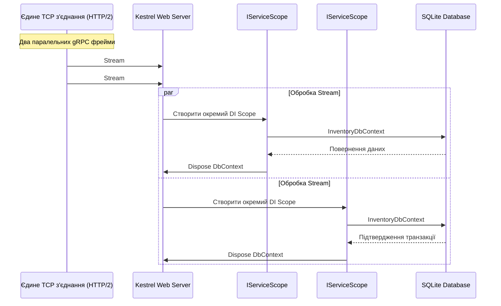

# 🗄️ Mastery 03: Data-Driven gRPC з Entity Framework Core

[](https://dotnet.microsoft.com/)
[](https://learn.microsoft.com/ef/core/)
[]()

> **Мета модуля:** Опанувати інтеграцію **Entity Framework Core 10** у gRPC-сервіси, зрозуміти життєвий цикл **DbContext у мультиплексованому HTTP/2 середовищі**, навчитися будувати безвитратні (**Zero-Allocation**) проєкції сутностей у Protobuf DTO, забезпечувати **транзакційну цілісність** та коректно транслювати збої бази даних у статуси **RpcException**.

---

## 📑 Зміст посібника
1. [Чому мокових списків недостатньо: виклики реального Data Access у gRPC](#1-чому-мокових-списків-недостатньо-виклики-реального-data-access-у-grpc)
2. [Життєвий цикл DbContext: як Kestrel ізолює RPC-запити в DI Scope](#2-життєвий-цикл-dbcontext-як-kestrel-ізолює-rpc-запити-в-di-scope)
3. [Архітектура бази даних: SQLite WAL та підготовка структури](#3-архітектура-бази-даних-sqlite-wal-та-підготовка-структури)
4. [Оптимізація читання: `.AsNoTracking()` та нульові алокації пам'яті](#4-оптимізація-читання-asnotracking-та-нульові-алокації-памяті)
5. [Прокидання `CancellationToken`: захист бази даних від клієнтських розривів](#5-прокидання-cancellationtoken-захист-бази-даних-від-клієнтських-розривів)
6. [Транзакційне резервування та захист від Race Conditions](#6-транзакційне-резервування-та-захист-від-race-conditions)
7. [Трансляція винятків EF Core у стандартні статус-коди `RpcException`](#7-трансляція-винятків-ef-core-у-стандартні-статус-коди-rpcexception)
8. [Покроковий аналіз коду сервісу InventoryGrpcService](#8-покроковий-аналіз-коду-сервісу-inventorygrpcservice)
9. [Практичні лабораторні завдання для закріплення](#9-практичні-лабораторні-завдання-для-закріплення)

---

## 1. Чому мокових списків недостатньо: виклики реального Data Access у gRPC

Більшість туторіалів по gRPC демонструють роботу зі статичними списками на зразок `private static readonly List<Item> _items = new();`.
У реальних комерційних додатках такий підхід приховує фундаментальні інженерні проблеми:
* **Багатопоточність (Thread-Safety):** Всі gRPC-запити виконуються паралельно в пулі потоків. Робота з небезпечними до потоків колекціями веде до розсинхронізації пам'яті.
* **Керування пам'яттю (Memory Allocations):** Якщо для кожного запиту виділяти зайві проміжні моделі, збирач сміття (Garbage Collector) спричинятиме мікропаузи (GC pauses), що нівелює переваги gRPC у швидкості.
* **Транзакційність:** Операції зняття залишків зі складу чи нарахування коштів повинні бути атомарними.

У нашому рішенні кожен мікросервіс спирається на повноцінний **Entity Framework Core 10** із реальною базою даних **SQLite**.

---

## 2. Життєвий цикл DbContext: як Kestrel ізолює RPC-запити в DI Scope

У HTTP/2 через одне TCP-з'єднання можуть одночасно летіти сотні RPC-викликів. Як ASP.NET Core гарантує, що `DbContext` одного запиту не перетнеться з іншим?



### Принцип ізоляції:
Для кожного вхідного gRPC-виклику Kestrel автоматично створює новий `IServiceScope`.
Оскільки `DbContext` реєструється як `Scoped` (`builder.Services.AddDbContext<InventoryDbContext>()`), кожен паралельний виклик отримує **свій власний екземпляр DbContext**, що повністю виключає конфлікти багатопотоковості.

---

## 3. Архітектура бази даних: SQLite WAL та підготовка структури

У нашому сервісі складу [`InventoryService`](../src/InventoryService/) використовується SQLite з журналюванням **WAL (Write-Ahead Logging)**:
* Дозволяє паралельним процесам одночасно читати базу даних, навіть коли інший процес записує в неї зміни.
* Не потребує встановлення сторонніх серверів — база розгортається автономно з першого запуску.

### Сутність товару на складі ([`StockItemEntity.cs`](../src/InventoryService/Data/StockItemEntity.cs)):
```csharp
public class StockItemEntity
{
    public int Id { get; set; }
    public string Sku { get; set; } = string.Empty;
    public string ProductName { get; set; } = string.Empty;
    public int AvailableQuantity { get; set; }
    public int ReservedQuantity { get; set; }
    public string WarehouseCode { get; set; } = string.Empty;
    public int Status { get; set; } // 1: InStock, 2: LowStock, 3: OutOfStock
    public DateTime LastRestockedAt { get; set; } = DateTime.UtcNow;
}
```

Конфігурація у [`InventoryDbContext.cs`](../src/InventoryService/Data/InventoryDbContext.cs):
```csharp
modelBuilder.Entity<StockItemEntity>(entity =>
{
    entity.HasKey(e => e.Id);
    entity.HasIndex(e => e.Sku).IsUnique(); // Унікальний індекс для швидкого пошуку за мікросекунди
    entity.Property(e => e.Sku).IsRequired().HasMaxLength(64);
});
```

---

## 4. Оптимізація читання: `.AsNoTracking()` та нульові алокації пам'яті

Коли сервіс виконує операцію читання (наприклад, метод `GetStockItem` або стрімінг аудиту `StreamStockUpdates`), зміна сутностей не передбачається.

### Чому обов'язково використовувати `.AsNoTracking()`:
1. За замовчуванням Change Tracker у EF Core створює знімки сутностей у внутрішній пам'яті (Identity Map), щоб відстежувати зміни.
2. Виклик `.AsNoTracking()` вимикає цей механізм, економлячи до 50% оперативної пам'яті та прискорюючи виконання SQL-запиту в 2–3 рази!

```csharp
var item = await _dbContext.StockItems
    .AsNoTracking() // Вимикаємо відстеження
    .FirstOrDefaultAsync(x => x.Sku == request.Sku, context.CancellationToken);
```

### Прямий мапінг Entity $\rightarrow$ Protobuf Response:
Ніколи не створюйте проміжних об'єктів! Мапіть властивості безпосередньо у згенерований Protobuf-об'єкт:
```csharp
private static StockItemResponse MapToResponse(StockItemEntity item)
{
    return new StockItemResponse
    {
        Sku = item.Sku,
        ProductName = item.ProductName,
        AvailableQuantity = item.AvailableQuantity,
        ReservedQuantity = item.ReservedQuantity,
        WarehouseCode = item.WarehouseCode,
        Status = (StockStatus)item.Status,
        LastRestockedAt = Timestamp.FromDateTime(DateTime.SpecifyKind(item.LastRestockedAt, DateTimeKind.Utc))
    };
}
```

---

## 5. Прокидання `CancellationToken`: захист бази даних від клієнтських розривів

> [!WARNING]
> Найпоширеніша помилка початківців: забувати передавати `context.CancellationToken` у виклики EF Core (`FirstOrDefaultAsync`, `SaveChangesAsync`, `ToListAsync`).

Якщо клієнт ініціював важкий запит на вибірку 50 000 записів і раптово закрив додаток:
* **Без передачі токена:** База даних продовжує виконувати важкий SQL-запит, тримаючи блокування та забиваючи диск і пам'ять.
* **З передачею `context.CancellationToken`:** Kestrel фіксує закриття HTTP/2 потоку, токен скасовується, драйвер бази даних миттєво відправляє команді SQLite/Postgres переривання операції, зберігаючи ресурси сервера.

---

## 6. Транзакційне резервування та захист від Race Conditions

Розглянемо бізнес-метод `ReserveStock` у [`InventoryGrpcService.cs`](../src/InventoryService/Services/InventoryGrpcService.cs):

```csharp
public override async Task<ReserveStockResponse> ReserveStock(ReserveStockRequest request, ServerCallContext context)
{
    // 1. Валідація вхідних даних
    if (request.QuantityToReserve <= 0)
    {
        throw new RpcException(new Status(StatusCode.InvalidArgument, "Кількість має бути більшою за 0."));
    }

    // 2. Читання сутності З ВІДСТЕЖЕННЯМ (Tracking для подальшого оновлення)
    var item = await _dbContext.StockItems
        .FirstOrDefaultAsync(x => x.Sku == request.Sku, context.CancellationToken);

    if (item is null)
    {
        throw new RpcException(new Status(StatusCode.NotFound, $"Товар '{request.Sku}' не знайдено."));
    }

    // 3. Атомарна бізнес-перевірка достатності залишку
    if (item.AvailableQuantity < request.QuantityToReserve)
    {
        throw new RpcException(new Status(
            StatusCode.FailedPrecondition,
            $"Недостатньо залишку на складі. Доступно: {item.AvailableQuantity}, запитано: {request.QuantityToReserve}."));
    }

    // 4. Модифікація стану
    item.AvailableQuantity -= request.QuantityToReserve;
    item.ReservedQuantity += request.QuantityToReserve;
    if (item.AvailableQuantity == 0)
    {
        item.Status = 3; // OutOfStock
    }

    // 5. Атомарне збереження транзакції
    await _dbContext.SaveChangesAsync(context.CancellationToken);

    return new ReserveStockResponse
    {
        IsSuccess = true,
        Sku = item.Sku,
        ReservedQuantity = request.QuantityToReserve,
        Message = $"Успішно зарезервовано {request.QuantityToReserve} шт.",
        ReservationExpiresAt = Timestamp.FromDateTime(DateTime.UtcNow.AddHours(2))
    };
}
```

---

## 7. Трансляція винятків EF Core у стандартні статус-коди `RpcException`

У gRPC неприпустимо, щоб помилки бази даних вилітали назовні у вигляді сирих `SqliteException` чи `DbUpdateException` (це призводить до аварійного закриття з'єднання з неінформативним `StatusCode.Unknown`).

| Ситуація в базі даних (EF Core) | Відповідний gRPC StatusCode | Пояснення для студента |
| :--- | :--- | :--- |
| Запис відсутній (`item is null`) | `StatusCode.NotFound` | Ресурс з даним ідентифікатором відсутній |
| Порушення формату аргументу | `StatusCode.InvalidArgument` | Некоректний SKU, від'ємна кількість |
| Недостатньо залишку для операції | `StatusCode.FailedPrecondition` | Система знаходиться у стані, де операція неприпустима |
| Конфлікт блокування (`DbUpdateConcurrencyException`) | `StatusCode.Aborted` | Конфлікт паралельних змін, клієнт має повторити спробу |
| Порушення унікального індексу | `StatusCode.AlreadyExists` | Спроба створити дублікат існуючого SKU |
| Аварія з'єднання з диском/СУБД | `StatusCode.Unavailable` | База даних тимчасово не відповідає |

---

## 8. Покроковий аналіз коду сервісу InventoryGrpcService

Повний робочий код сервісу знаходиться у файлі [`InventoryGrpcService.cs`](../src/InventoryService/Services/InventoryGrpcService.cs):
1. **Інжекція залежностей:** У конструктор через DI надходять `InventoryDbContext` та типізований логер `ILogger<InventoryGrpcService>`.
2. **Асинхронний пайплайн:** Усі методи мають сигнатуру `async Task<...>`. Жодного блокуючого виклику `.Result` чи `.Wait()`!
3. **Статуси Protobuf:** Числові статуси з бази мапляться у строго типізований перелік `(StockStatus)item.Status`, що унеможливлює передачу некоректного значення.

---

## 9. Практичні лабораторні завдання для закріплення

1. **Додавання нової сутності складського руху (StockMovementLog):**
   * Створіть нову сутність `StockMovementLog` (`Id`, `Sku`, `DeltaQuantity`, `Timestamp`, `OrderId`).
   * Додайте `DbSet<StockMovementLog>` до `InventoryDbContext`.
   * Модифікуйте метод `ReserveStock`, щоб при кожному успішному резервуванні в тій самій транзакції створювався запис в аудит-лозі зі знаком мінус (`-QuantityToReserve`).
2. **Перевірка відкату транзакції при збої:**
   * Спробуйте штучно викинути виняток після зміни `item.AvailableQuantity`, але до виклику `SaveChangesAsync`.
   * Переконайтеся через клієнт, що залишки товару в базі не змінилися.
