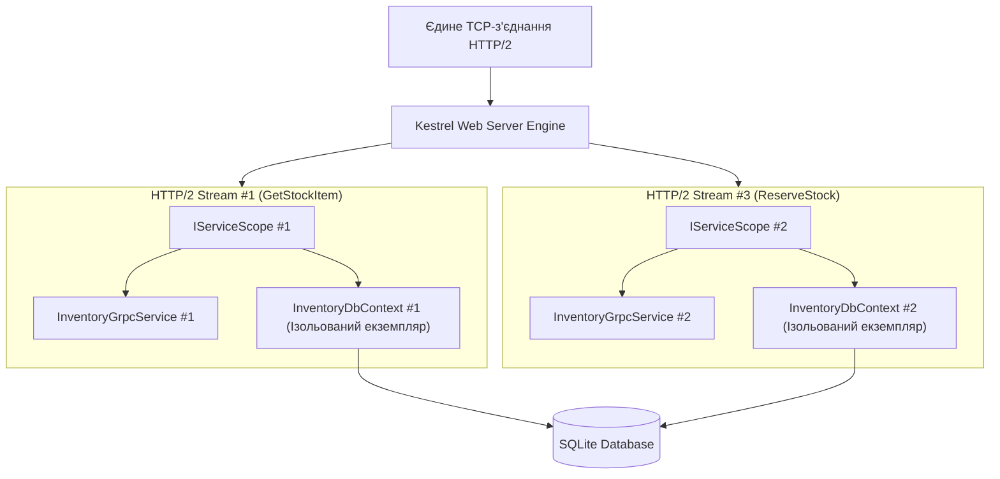
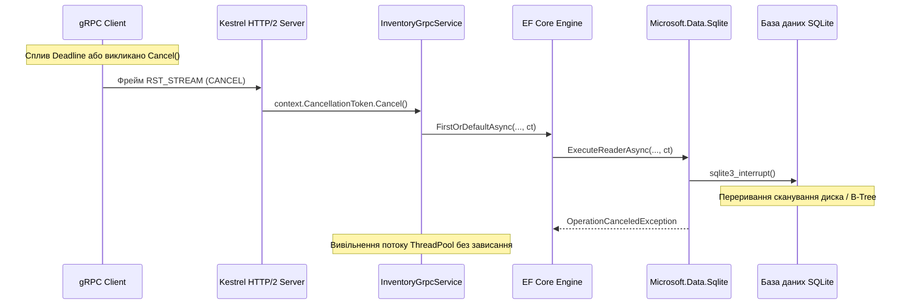

# 🗄️ Mastery 03: Data-Driven gRPC з Entity Framework Core 10

[](https://dotnet.microsoft.com/)
[](https://learn.microsoft.com/ef/core/)
[]()

> **Мета модуля:** Детально розібрати архітектуру **доступу до даних у gRPC-сервісах**, зрозуміти життєвий цикл **DbContext у мультиплексованому середовищі HTTP/2**, навчитися будувати безвитратні (**Zero-Allocation**) проєкції сутностей у Protobuf DTO, забезпечувати **транзакційну цілісність** та коректно транслювати збої бази даних у статуси **RpcException**.

---

## 📑 Зміст посібника
1. [Реальність доступу до даних у мікросервісах: чому мокові списки оманливі](#1-реальність-доступу-до-даних-у-мікросервісах-чому-мокові-списки-оманливі)
2. [Потокобезпека та DI-скоупи в умовах мультиплексування HTTP/2](#2-потокобезпека-та-di-скоупи-в-умовах-мультиплексування-http2)
   * 2.1 [Анатомія створення `IServiceScope` на кожен RPC-виклик](#21-анатомія-створення-iservicescope-на-кожен-rpc-виклик)
   * 2.2 [Фатальна помилка: спроба спільного використання DbContext між потоками](#22-фатальна-помилка-спроба-спільного-використання-dbcontext-між-потоками)
3. [Оптимізація продуктивності: `.AsNoTracking()` та внутрішній Snapshot Tracker](#3-оптимізація-продуктивності-asnotracking-та-внутрішній-snapshot-tracker)
4. [Каскад скасування (Cancellation Pipeline): від HTTP/2 RST_STREAM до СУБД](#4-каскад-скасування-cancellation-pipeline-від-http2-rst_stream-до-субд)
5. [Конкурентність та транзакційне резервування залишків](#5-конкурентність-та-транзакційне-резервування-залишків)
   * 5.1 [Запобігання стану гонитви (Race Condition)](#51-запобігання-стану-гонитви-race-condition)
   * 5.2 [Оптимістичне блокування та статус `StatusCode.Aborted`](#52-оптимістичне-блокування-та-статус-statuscodeaborted)
6. [Матриця трансляції винятків EF Core у стандартні статус-коди `RpcException`](#6-матриця-трансляції-винятків-ef-core-у-стандартні-статус-коди-rpcexception)
7. [Покроковий аналіз коду сервісів `InventoryService` та `PricingService`](#7-покроковий-аналіз-коду-сервісів-inventoryservice-та-pricingservice)
8. [Типові помилки та антипатерни роботи з базою у gRPC](#8-типові-помилки-та-антипатерни-роботи-з-базою-у-grpc)
9. [Контрольні запитання для самоперевірки](#9-контрольні-запитання-для-самоперевірки)
10. [Лабораторний практикум для закріплення](#10-лабораторний-практикум-для-закріплення)

---

<a id="1-реальність-доступу-до-даних-у-мікросервісах-чому-мокові-списки-оманливі"></a>
## 1. Реальність доступу до даних у мікросервісах: чому мокові списки оманливі

У навчальних матеріалах часто зустрічається антипатерн: зберігання даних у статичних колекціях `List<T>`.
У високопродуктивному gRPC-сервісі такий підхід приховує фундаментальні проблеми:
* **Багатопотокова конкуренція:** Кожен вхідний виклик gRPC обробляється окремим потоком із пулу потоків .NET (ThreadPool). Звичайні колекції ламаються при одночасному читанні та записі.
* **Навантаження на Garbage Collector:** Якщо на кожен виклик виділяти проміжні об'єкти DTO, збирач сміття змушений виконувати блокуючі паузи поколінь Gen 1 / Gen 2.
* **Транзакційна атомарність:** У реальному складі списання залишку повинно відбуватися з перевіркою наявності в межах єдиної транзакції (ACID).

У нашому рішенні кожен мікросервіс має власну ізольовану базу даних **SQLite** під керуванням **Entity Framework Core 10**.

---

<a id="2-потокобезпека-та-di-скоупи-в-умовах-мультиплексування-http2"></a>
## 2. Потокобезпека та DI-скоупи в умовах мультиплексування HTTP/2

У класичному HTTP/1.1 кожен запит займав окремий TCP-сокет. У HTTP/2 сотні RPC-викликів летять **паралельно через один і той самий сокет** у вигляді перемішаних бінарних фреймів.

<a id="21-анатомія-створення-iservicescope-на-кожен-rpc-виклик"></a>
### 2.1 Анатомія створення `IServiceScope` на кожен RPC-виклик

Як ASP.NET Core гарантує ізоляцію стану між паралельними викликами:



1. Коли Kestrel отримує фрейм `HEADERS`, який відкриває новий потік HTTP/2 (Stream ID = 1), викликається внутрішній метод `IServiceScopeFactory.CreateScope()`.
2. Усі сервіси з часом життя **Scoped** (включно з `InventoryDbContext` та `InventoryGrpcService`) інстанціюються саме для цього потоку.
3. Коли потік закривається (надсилаються трейлери `grpc-status`), Kestrel викликає `scope.Dispose()`, що коректно закриває з'єднання з базою даних та повертає ресурси в пул.

<a id="22-фатальна-помилка-спроба-спільного-використання-dbcontext-між-потоками"></a>
### 2.2 Фатальна помилка: спроба спільного використання DbContext між потоками

> [!CAUTION]
> Клас `DbContext` в Entity Framework Core **НЕ Є ПОТОКОБЕЗПЕЧНИМ** (Not Thread-Safe)!  
> Ніколи не реєструйте `DbContext` як `Singleton` і ніколи не передавайте його екземпляр у фонові задачі `Task.Run()` без створення окремого `IServiceScope`.

Спроба одночасного звернення з двох потоків до одного `DbContext` призведе до фатального винятку:
`InvalidOperationException: A second operation was started on this context instance before a previous operation completed. This is usually caused by different threads concurrently using the same instance of DbContext.`

---

<a id="3-оптимізація-продуктивності-asnotracking-та-внутрішній-snapshot-tracker"></a>
## 3. Оптимізація продуктивності: `.AsNoTracking()` та внутрішній Snapshot Tracker

Коли ви виконуєте звичайний запит `_dbContext.StockItems.FirstOrDefaultAsync()`, EF Core виконує наступні внутрішні операції:
1. Виконує SQL-запит до СУБД.
2. Створює екземпляр класу `StockItemEntity` для вашого коду.
3. **Створює прихований об'єкт-двійник (Snapshot)** усіх початкових значень у ChangeTracker (Identity Map).

При читанні даних для gRPC-відповіді (наприклад, у методі `GetStockItem` або стрімінгу аудиту) ці знімки пам'яті ніколи не будуть використані, оскільки сутність не змінюватиметься!

### Ефект від використання `.AsNoTracking()`:
```csharp
var item = await _dbContext.StockItems
    .AsNoTracking() // Вимикає ChangeTracker
    .FirstOrDefaultAsync(x => x.Sku == request.Sku, context.CancellationToken);
```
* **Швидкість:** Зменшення часу виконання запиту на $30\text{--}40\%$.
* **Пам'ять:** Зниження споживання оперативної пам'яті на $50\%$ на кожен запит.
* **Збирач сміття:** Повна відсутність проміжних об'єктів відстеження у Gen 0 / Gen 1.

---

<a id="4-каскад-скасування-cancellation-pipeline-від-http2-rst_stream-до-субд"></a>
## 4. Каскад скасування (Cancellation Pipeline): від HTTP/2 RST_STREAM до СУБД

Розглянемо повний ланцюжок передачі сигналу переривання:



> [!IMPORTANT]
> Якщо ви не передасте `context.CancellationToken` у метод `FirstOrDefaultAsync(x => x.Sku == request.Sku, context.CancellationToken)`, база даних продовжуватиме виконувати важке сканування таблиці навіть після того, як клієнт відключився!

---

<a id="5-конкурентність-та-транзакційне-резервування-залишків"></a>
## 5. Конкурентність та транзакційне резервування залишків

<a id="51-запобігання-стану-гонитви-race-condition"></a>
### 5.1 Запобігання стану гонитви (Race Condition)

Уявімо склад, де залишилася остання одиниця товару (`AvailableQuantity = 1`).
Одночасно надходять два паралельні gRPC-запити від різних клієнтів на резервування 1 одиниці.

У нашому методі [`ReserveStock`](../src/InventoryService/Services/InventoryGrpcService.cs):
```csharp
var item = await _dbContext.StockItems
    .FirstOrDefaultAsync(x => x.Sku == request.Sku, context.CancellationToken);

if (item.AvailableQuantity < request.QuantityToReserve)
{
    throw new RpcException(new Status(
        StatusCode.FailedPrecondition,
        $"Недостатньо залишку на складі. Доступно: {item.AvailableQuantity}, запитано: {request.QuantityToReserve}."));
}

item.AvailableQuantity -= request.QuantityToReserve;
item.ReservedQuantity += request.QuantityToReserve;

await _dbContext.SaveChangesAsync(context.CancellationToken);
```

Завдяки SQLite WAL (Write-Ahead Logging) транзакція оновлення `SaveChangesAsync()` виконується атомарно. Другий клієнт побачить залишок `0` і отримає бізнес-помилку `StatusCode.FailedPrecondition`.

<a id="52-оптимістичне-блокування-та-статус-statuscodeaborted"></a>
### 5.2 Оптимістичне блокування та статус `StatusCode.Aborted`

У розподілених системах для високонавантажених сутностей використовують **оптимістичне блокування (Optimistic Concurrency Control)** через властивість `[Timestamp]` або `RowVersion`:
```csharp
public class StockItemEntity {
    [Timestamp]
    public byte[] Version { get; set; } = null!;
}
```
Якщо під час операції запису інший потік встиг змінити запис, EF Core викидає `DbUpdateConcurrencyException`.
У gRPC цей виняток транслюється у статус `StatusCode.Aborted`:
```csharp
catch (DbUpdateConcurrencyException)
{
    throw new RpcException(new Status(StatusCode.Aborted, "Конфлікт паралельного оновлення залишку. Повторіть спробу."));
}
```
Статус `Aborted` сигналізує клієнтській бібліотеці, що запит можна автоматично повторити (Retry Policy).

---

<a id="6-матриця-трансляції-винятків-ef-core-у-стандартні-статус-коди-rpcexception"></a>
## 6. Матриця трансляції винятків EF Core у стандартні статус-коди `RpcException`

Ніколи не дозволяйте сирим виняткам EF Core вилітати в конвеєр gRPC. Завжди транслюйте їх у стандартні статус-коди:

| Ситуація на рівні EF Core / СУБД | Відповідний gRPC StatusCode | Приклад опису в Detail |
| :--- | :--- | :--- |
| Запис не знайдено (`item is null`) | `StatusCode.NotFound` | *"Товар з артикулом 'SKU-1' не знайдено."* |
| Порушення валідації аргументів | `StatusCode.InvalidArgument` | *"Кількість для резерву має бути більшою за 0."* |
| Недостатній баланс / залишок | `StatusCode.FailedPrecondition` | *"Недостатньо залишку: доступно 5, запитано 10."* |
| Конфлікт блокування / Concurrency | `StatusCode.Aborted` | *"Конфлікт паралельної зміни даних (Optimistic Lock)."* |
| Порушення унікального ключа/індексу | `StatusCode.AlreadyExists` | *"Товар із таким SKU вже зареєстровано в базі."* |
| Клієнт розірвав з'єднання | `StatusCode.Cancelled` | Операцію скасовано через `CancellationToken` |
| СУБД недоступна / відмова мережі | `StatusCode.Unavailable` | *"База даних тимчасово не відповідає."* |
| Непередбачений збій | `StatusCode.Internal` | *"Внутрішня помилка виконання транзакції."* |

---

<a id="7-покроковий-аналіз-коду-сервісів-inventoryservice-та-pricingservice"></a>
## 7. Покроковий аналіз коду сервісів `InventoryService` та `PricingService`

### 7.1 Сервіс складу ([`InventoryGrpcService.cs`](../src/InventoryService/Services/InventoryGrpcService.cs)):
* **Рядки 25–40:** Метод `GetStockItem` демонструє ідеальний шаблон читання: валідація аргументу $\rightarrow$ пошук через `.AsNoTracking()` $\rightarrow$ перевірка на `null` з викиданням `StatusCode.NotFound` $\rightarrow$ чистий мапінг у Protobuf DTO.
* **Рядки 45–95:** Метод `ReserveStock` реалізує транзакційну перевірку залишків та атомарне оновлення статусу товару на `OutOfStock` / `LowStock`.
* **Рядки 100–145:** Метод `StreamStockUpdates` транслює дані порціями через `IServerStreamWriter`, перевіряючи `context.CancellationToken` перед кожним записом фрейму.

### 7.2 Сервіс цін ([`PricingGrpcService.cs`](../src/PricingService/Services/PricingGrpcService.cs)):
* **Рядки 65–110:** Метод `UploadBulkDiscountRules` демонструє обробку клієнтського потоку: накопичення змін у пам'яті $\rightarrow$ єдиний виклик `SaveChangesAsync()` у кінці потоку $\rightarrow$ повернення звіту `BulkUploadSummary`.

---

<a id="8-типові-помилки-та-антипатерни-роботи-з-базою-у-grpc"></a>
## 8. Типові помилки та антипатерни роботи з базою у gRPC

1. **Антипатерн «N+1 у gRPC-стрімінгу»:** Вичитування списку ID у стрімі та окремий SQL-запит на кожну ітерацію циклу. Використовуйте жадібне завантаження `.Include()` або пряму проєкцію.
2. **Антипатерн «Витік DbContext через Task.Run»:** Запуск асинхронної фонової задачі без створення нового `IServiceScope`.
3. **Ігнорування `AsNoTracking` на вибірках понад 1000 записів:** Призводить до вичерпання пулу пам'яті Gen 2.

---

<a id="9-контрольні-запитання-для-самоперевірки"></a>
## 9. Контрольні запитання для самоперевірки

1. Чому `DbContext` у gRPC-сервісах обов'язково повинен мати час життя `Scoped`?
2. Яким чином Kestrel ізолює паралельні виклики в межах одного TCP-з'єднання HTTP/2?
3. Що станеться, якщо не передати `context.CancellationToken` у метод `SaveChangesAsync()` під час розриву з'єднання клієнтом?
4. У чому полягає різниця між статусами `StatusCode.InvalidArgument` та `StatusCode.FailedPrecondition`?
5. Чому `.AsNoTracking()` критично важливий для високонавантажених gRPC операцій читання?

---

<a id="10-лабораторний-практикум-для-закріплення"></a>
## 10. Лабораторний практикум для закріплення

### Завдання 1: Додавання оптимізованої проєкції
Модифікуйте метод `GetStockItem` так, щоб замість повного завантаження сутності виконувалася вибіркова проєкція полів безпосередньо в запиті:
```csharp
var response = await _dbContext.StockItems
    .AsNoTracking()
    .Where(x => x.Sku == request.Sku)
    .Select(x => new StockItemResponse { Sku = x.Sku, ProductName = x.ProductName, AvailableQuantity = x.AvailableQuantity })
    .FirstOrDefaultAsync(context.CancellationToken);
```
Зафіксуйте у профілювальнику SQL зменшення кількості обраних стовпців.

### Завдання 2: Тестування каскадного скасування операції бази даних
Додайте у метод `StreamStockUpdates` перед читанням бази штучну затримку `await Task.Delay(3000, context.CancellationToken);`. Запустіть клієнт із таймаутом у 500 мс і переконайтеся в логах, що операція переривається через `OperationCanceledException` без завантаження сервера.
