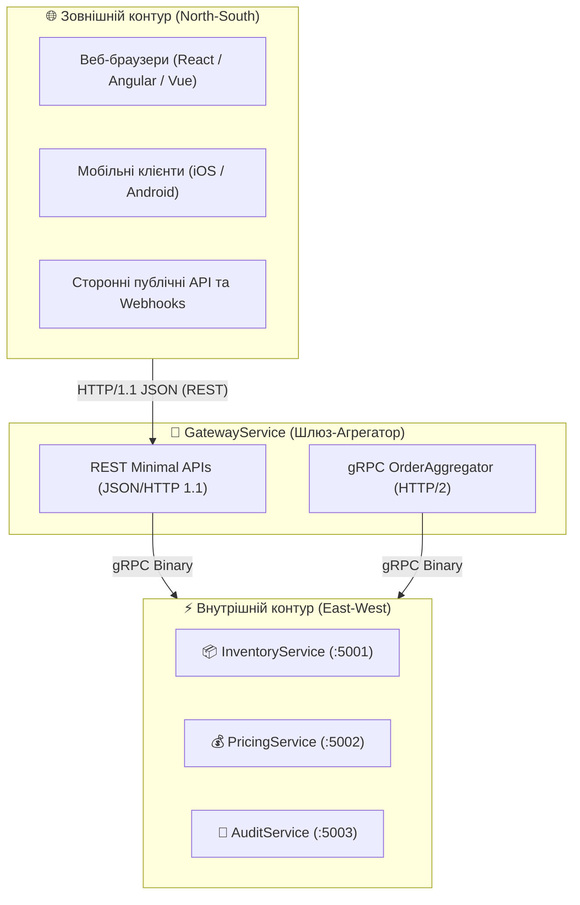

# 🔄 Mastery 04: REST Meets gRPC (Гібридна та Dual-Stack Архітектура)

[](https://dotnet.microsoft.com/)
[](https://learn.microsoft.com/aspnet/core/fundamentals/minimal-apis)
[]()

> **Мета модуля:** Зрозуміти місце gRPC у реальних веб-системах, опанувати **гібридну модель (REST Gateway $\rightarrow$ gRPC Backends)**, навчитися хостувати **Dual-Stack** сервіси в одному процесі ASP.NET Core 10, розібратися в тонкощах протоколів **HTTP/1.1 vs HTTP/2 Cleartext (h2c)** та налаштувати пулінг з'єднань через **GrpcClientFactory**.

---

## 📑 Зміст посібника
1. [Архітектурна дилема: REST чи gRPC?](#1-архітектурна-дилема-rest-чи-grpc)
2. [North-South проти East-West: де який протокол перемагає](#2-north-south-проти-east-west-де-який-протокол-перемагає)
3. [Архітектурна таємниця HTTP/2: Чому виникає помилка `HTTP_1_1_REQUIRED`](#3-архітектурна-таємниця-http2-чому-виникає-помилка-http_1_1_required)
4. [Конфігурація Dual-Stack Kestrel: порт 5000 (REST) + порт 5005 (gRPC)](#4-конфігурація-dual-stack-kestrel-порт-5000-rest--порт-5005-grpc)
5. [gRPC Client Factory в .NET 10: чому не можна створювати канали вручну](#5-grpc-client-factory-в-net-10-чому-не-можна-створювати-канали-вручну)
6. [Реалізація REST-фасаду: інжекція клієнтів у Minimal APIs](#6-реалізація-rest-фасаду-інжекція-клієнтів-у-minimal-apis)
7. [Двостороння трансляція помилок: від `RpcException` до HTTP ProblemDetails](#7-двостороння-трансляція-помилок-від-rpcexception-до-http-problemdetails)
8. [Порівняльний бенчмарк продуктивності: JSON vs Protobuf](#8-порівняльний-бенчмарк-продуктивності-json-vs-protobuf)
9. [Практичні лабораторні завдання для закріплення](#9-практичні-лабораторні-завдання-для-закріплення)

---

## 1. Архітектурна дилема: REST чи gRPC?

У сучасній розробці немає потреби обирати виключно одну технологію. REST і gRPC мають абсолютно різні сильні сторони:



* **REST (Representational State Transfer):** Ідеальний для публічних API. Його розуміє кожен браузер, cURL, Postman та будь-яка мова програмування «з коробки».
* **gRPC (Google Remote Procedure Call):** Ідеальний для внутрішнього спілкування між мікросервісами. Мінімум трафіку, максимальна швидкість серіалізації, сувора типізація.

---

## 2. North-South проти East-West: де який протокол перемагає

1. **North-South Traffic (Трафік Північ-Південь):**
   * Це запити, які приходять із зовнішнього світу (клієнтські браузери, публічний інтернет) на ваш вхідний API Gateway.
   * Тут стандарт **REST / JSON** є безумовним лідером, оскільки браузери мають обмежену пряму підтримку чистих HTTP/2 фреймів gRPC (потребують посередників на зразок Envoy або бібліотеки `grpc-web`).
2. **East-West Traffic (Трафік Схід-Захід):**
   * Це внутрішнє спілкування між вашими бекенд-сервісами (Gateway $\rightarrow$ Inventory $\rightarrow$ Pricing).
   * Використовувати тут REST/JSON — це колосальне марнотратство ресурсів (постійний парсинг рядків, повторні TCP-з'єднання). Використання **gRPC** у внутрішньому контурі скорочує затримки (latency) в 5–10 разів.

---

## 3. Архітектурна таємниця HTTP/2: Чому виникає помилка `HTTP_1_1_REQUIRED`

При створенні гібридного сервісу розробники часто намагаються налаштувати Kestrel так:
```json
// Небезпечна конфігурація для нешифрованого HTTP!
"HybridEndpoint": {
  "Url": "http://localhost:5000",
  "Protocols": "Http1AndHttp2"
}
```
І отримують фатальну помилку під час gRPC-виклику:
`The HTTP/2 server closed the connection. HTTP/2 error code 'HTTP_1_1_REQUIRED' (0xd)`.

### Чому це відбувається:
* У шифрованому з'єднанні (**HTTPS**) вибір між HTTP/1.1 та HTTP/2 відбувається на етапі TLS-рукостискання за допомогою розширення **ALPN (Application-Layer Protocol Negotiation)**. Клієнт і сервер домовляються про протокол до передачі першого HTTP-байта.
* У **нешифрованому з'єднанні (HTTP / Cleartext / h2c)** ALPN відсутній! Сервер Kestrel не може вгадати, який протокол прийшов по сокету. Якщо на порт приходить бінарний HTTP/2 фрейм, Kestrel вимагає спочатку виконати процедуру HTTP/1.1 Upgrade, а якщо її не було — скидає з'єднання з кодом `HTTP_1_1_REQUIRED`.

### Інженерне рішення:
Розділити слухачі Kestrel на **два окремих порти в межах одного й того самого процесу**:
1. **Порт 5000:** `Protocols: Http1` — для REST Minimal APIs.
2. **Порт 5005:** `Protocols: Http2` (Prior Knowledge) — для чистих gRPC-викликів.

---

## 4. Конфігурація Dual-Stack Kestrel: порт 5000 (REST) + порт 5005 (gRPC)

У файлі [`GatewayService/appsettings.json`](../src/GatewayService/appsettings.json):
```json
{
  "Logging": {
    "LogLevel": {
      "Default": "Information",
      "Microsoft.AspNetCore": "Warning"
    }
  },
  "Services": {
    "InventoryUrl": "http://localhost:5001",
    "PricingUrl": "http://localhost:5002"
  },
  "Kestrel": {
    "Endpoints": {
      "RestHttpEndpoint": {
        "Url": "http://localhost:5000",
        "Protocols": "Http1"
      },
      "GrpcHttp2Endpoint": {
        "Url": "http://localhost:5005",
        "Protocols": "Http2"
      }
    }
  }
}
```

Тепер один сервіс одночасно:
* Приймає звичайні браузерні запити на `http://localhost:5000/api/catalog/products/LAPTOP-PRO-16`.
* Приймає бінарні gRPC-виклики від інших мікросервісів на `http://localhost:5005`.

---

## 5. gRPC Client Factory в .NET 10: чому не можна створювати канали вручну

У коді клієнтів початківці часто пишуть:
```csharp
// АНТИПАТЕРН! Витік сокетів та падіння продуктивності!
using var channel = GrpcChannel.ForAddress("http://localhost:5001");
var client = new InventoryService.InventoryServiceClient(channel);
```

### Чому створення `GrpcChannel` на кожен запит руйнує продуктивність:
* Кожен новий `GrpcChannel` ініціалізує нове фізичне TCP-з'єднання.
* Втрачається перевага HTTP/2 мультиплексування.
* При високому навантаженні сервіс вичерпує ліміт відкритих сокетів операційної системи (**Socket Exhaustion**).

### Правильний підхід: `AddGrpcClient<TClient>`
У .NET 10 фабрика `GrpcClientFactory` керує пулом довгоживучих каналів, автоматично оновлює DNS та інтегрується з `HttpClientFactory`:

```csharp
// Program.cs у GatewayService
builder.Services.AddGrpcClient<InventoryService.InventoryServiceClient>(options =>
{
    options.Address = new Uri("http://localhost:5001");
});
```

---

## 6. Реалізація REST-фасаду: інжекція клієнтів у Minimal APIs

Розглянемо ендпоінт у [`GatewayService/Endpoints/CatalogEndpoints.cs`](../src/GatewayService/Endpoints/CatalogEndpoints.cs):

```csharp
public static class CatalogEndpoints
{
    public static void MapCatalogEndpoints(this IEndpointRouteBuilder routes)
    {
        var group = routes.MapGroup("/api/catalog");

        group.MapGet("/products/{sku}", async (
            string sku,
            string? tier,
            int? qty,
            InventoryService.InventoryServiceClient inventoryClient, // Автоматична інжекція з DI
            PricingService.PricingServiceClient pricingClient,       // Автоматична інжекція з DI
            CancellationToken ct) =>
        {
            // 1. Виклик gRPC складу
            var stock = await inventoryClient.GetStockItemAsync(
                new StockItemRequest { Sku = sku }, cancellationToken: ct);

            // 2. Виклик gRPC ціноутворення
            var price = await pricingClient.GetProductPriceAsync(
                new ProductPriceRequest
                {
                    Sku = sku,
                    CustomerTier = tier ?? "Standard",
                    RequestedQuantity = qty ?? 1
                }, cancellationToken: ct);

            // 3. Формування зведеного JSON для клієнта
            return Results.Ok(new
            {
                Source = "Hybrid REST-over-gRPC Gateway",
                Sku = stock.Sku,
                ProductName = stock.ProductName,
                Available = stock.AvailableQuantity,
                Warehouse = stock.WarehouseCode,
                Pricing = new
                {
                    FinalUnitPrice = price.FinalUnitPrice,
                    Total = Math.Round(price.FinalUnitPrice * (qty ?? 1), 2),
                    Currency = price.Currency
                }
            });
        });
    }
}
```

---

## 7. Двостороння трансляція помилок: від `RpcException` до HTTP ProblemDetails

Коли внутрішній gRPC-сервіс викидає `RpcException`, REST-фасад зобов'язаний перекласти цю бінарну помилку на зрозумілий для вебу HTTP-код:

```csharp
try
{
    // виклики gRPC...
}
catch (RpcException ex) when (ex.StatusCode == StatusCode.NotFound)
{
    // gRPC NotFound -> HTTP 404 Not Found
    return Results.NotFound(new { Error = ex.Status.Detail, StatusCode = 404 });
}
catch (RpcException ex) when (ex.StatusCode == StatusCode.InvalidArgument)
{
    // gRPC InvalidArgument -> HTTP 400 Bad Request
    return Results.BadRequest(new { Error = ex.Status.Detail, StatusCode = 400 });
}
catch (RpcException ex) when (ex.StatusCode == StatusCode.Unavailable)
{
    // gRPC Unavailable -> HTTP 503 Service Unavailable
    return Results.Problem(detail: "Бекенд-сервіс тимчасово недоступний", statusCode: 503);
}
catch (RpcException ex)
{
    // Будь-який інший збій -> HTTP 502 Bad Gateway
    return Results.Problem(detail: ex.Status.Detail, statusCode: 502);
}
```

---

## 8. Порівняльний бенчмарк продуктивності: JSON vs Protobuf

| Характеристика | REST / JSON | gRPC / Protobuf | Різниця |
| :--- | :---: | :---: | :---: |
| **Розмір пакета (Payload)** | $\sim 450$ байтів | $\sim 78$ байтів | **В 5.7 разів менше** |
| **Швидкість серіалізації** | $12\,500$ оп/сек | $95\,000$ оп/сек | **В 7.6 разів швидше** |
| **Виділення пам'яті (Allocations)**| 2.8 КБ на запит | 0.3 КБ на запит | **В 9 разів менше GC навантаження** |
| **Кількість TCP-з'єднань** | Окремі сокети / пули | 1 мультиплексований потік | **Мінімум дескрипторів сокетів** |

---

## 9. Практичні лабораторні завдання для закріплення

1. **Тестування REST-ендпоінта через консоль:**
   * Запустіть сервіси та виконайте команду:
     ```bash
     curl -s http://localhost:5000/api/catalog/products/PHONE-ULTRA-24?tier=VIP
     ```
   * Перевірте, що відповідь надходить у чистому JSON-форматі, а в консолі `GatewayService` зафіксовано виклик gRPC-інтерцептора.
2. **Додавання нового REST-маршруту резервування:**
   * Додайте в [`CatalogEndpoints.cs`](../src/GatewayService/Endpoints/CatalogEndpoints.cs) новий POST-ендпоінт:
     `group.MapPost("/orders/reserve", ...)`
   * Реалізуйте виклик gRPC-методу `inventoryClient.ReserveStockAsync`.
   * Перехопіть виняток `StatusCode.FailedPrecondition` і поверніть веб-клієнту відповідь з HTTP-кодом `422 Unprocessable Entity`.
