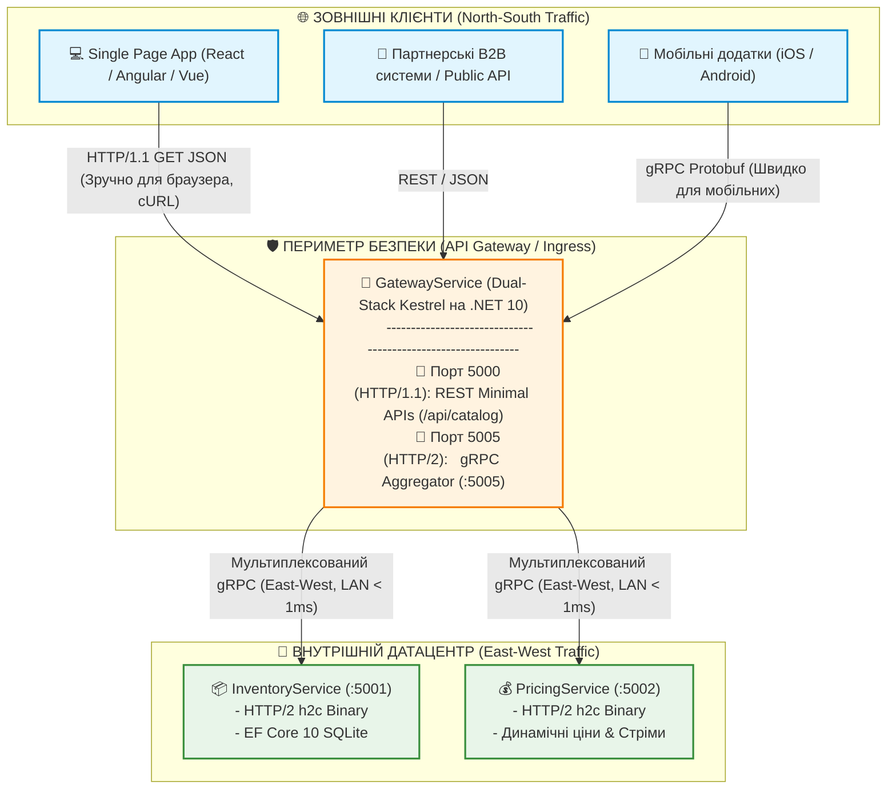
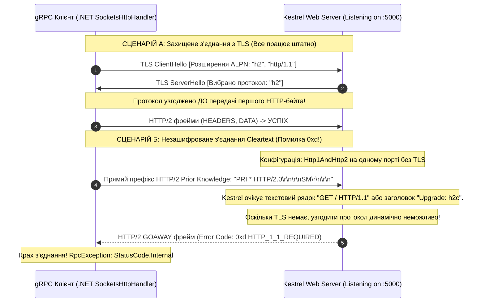
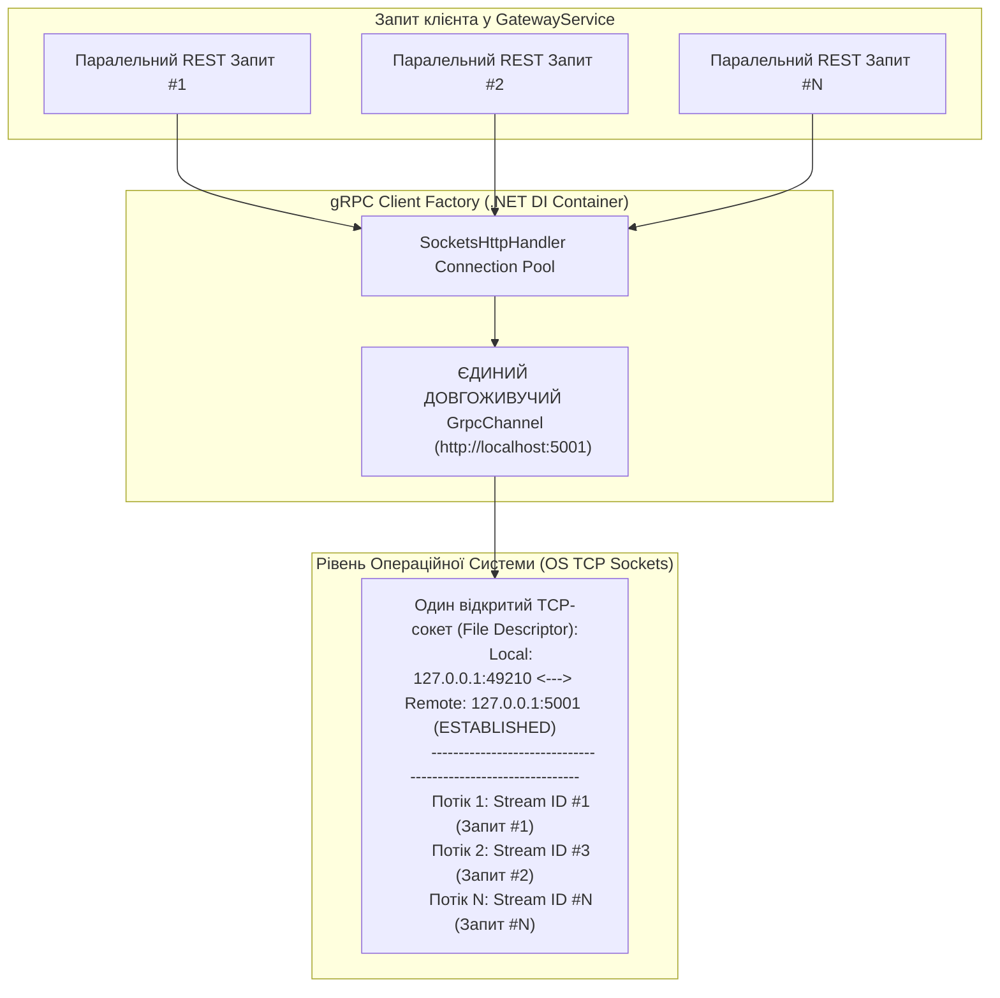
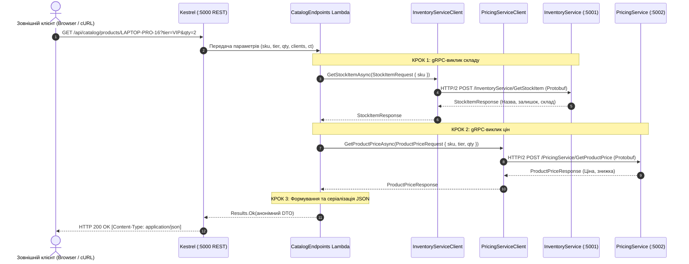

# 🔄 Mastery 04: REST Meets gRPC (Гібридна та Dual-Stack Архітектура)

[](https://dotnet.microsoft.com/)
[](https://learn.microsoft.com/aspnet/core/)
[]()

> **Мета модуля:** Глибоко розібратися в архітектурі **гібридних систем**, детально порівняти **REST та gRPC на рівні фізичних пакетів та стеків ОС**, навчитися будувати **високопродуктивний REST-фасад над внутрішньою gRPC-мережею**, опанувати тонкощі **Dual-Stack хостування в Kestrel** (одночасна ізольована підтримка HTTP/1.1 та бінарного HTTP/2 Prior Knowledge), досконально зрозуміти фізичну причину мережевої помилки **`HTTP_1_1_REQUIRED (0xd)`** та освоїти надійний пулінг каналів через **`GrpcClientFactory`** у .NET 10.

---

## 📑 Зміст посібника
1. [Глибоке порівняння REST та gRPC: від бінарних фреймів до пам'яті](#1-глибоке-порівняння-rest-та-grpc-від-бінарних-фреймів-до-памяті)
   * 1.1 [Діаграма: Фізичне порівняння HTTP/1.1 (REST) проти HTTP/2 (gRPC)](#11-діаграма-фізичне-порівняння-http11-rest-проти-http2-grpc)
   * 1.2 [Порівняльна таблиця інженерних метрик та оверхеду](#12-порівняльна-таблиця-інженерних-метрик-та-оверхеду)
   * 1.3 [Чому JSON повільний: парсинг рядків, виділення пам'яті та GC Pressure](#13-чому-json-повільний-парсинг-рядків-виділення-памяті-та-gc-pressure)
2. [Гібридна парадигма: Трафік North-South проти East-West](#2-гібридна-парадигма-трафік-north-south-проти-east-west)
   * 2.1 [Архітектурна топологія enterprise-мережі](#21-архітектурна-топологія-enterprise-мережі)
   * 2.2 [Чому браузери не можуть повністю замінити REST на чистий gRPC](#22-чому-браузери-не-можуть-повністю-замінити-rest-на-чистий-grpc)
3. [Мережева анатомія помилки `HTTP_1_1_REQUIRED (0xd)`](#3-мережева-анатомія-помилки-http_1_1_required-0xd)
   * 3.1 [Діаграма: TLS ALPN Handshake проти Cleartext (h2c) конфлікту](#31-діаграма-tls-alpn-handshake-проти-cleartext-h2c-конфлікту)
   * 3.2 [Що відбувається на рівні байтів у TCP-сокеті Kestrel](#32-що-відбувається-на-рівні-байтів-у-tcp-сокеті-kestrel)
   * 3.3 [Інженерне вирішення: подвійний стек портів Kestrel](#33-інженерне-вирішення-подвійний-стек-портів-kestrel)
4. [Конфігурація Dual-Stack Kestrel у .NET 10](#4-конфігурація-dual-stack-kestrel-у-net-10)
   * 4.1 [Аналіз appsettings.json: ізоляція протоколів за портами](#41-аналіз-appsettingsjson-ізоляція-протоколів-за-портами)
   * 4.2 [Перемикач `SocketsHttpHandler.Http2UnencryptedSupport`](#42-перемикач-socketshttphandlerhttp2unencryptedsupport)
5. [gRPC Client Factory в .NET 10: Архітектура пулінгу та захист від Socket Exhaustion](#5-grpc-client-factory-в-net-10-архітектура-пулінгу-та-захист-від-socket-exhaustion)
   * 5.1 [Діаграма життєвого циклу HTTP/2 каналу в пулі](#51-діаграма-життєвого-циклу-http2-каналу-в-пулі)
   * 5.2 [Чому ручний `new GrpcChannel` вбиває операційну систему](#52-чому-ручний-new-grpcchannel-вбиває-операційну-систему)
   * 5.3 [Декларативне налаштування `AddGrpcClient` у DI](#53-декларативне-налаштування-addgrpcclient-у-di)
6. [Повний розбір реалізації REST-фасаду (`CatalogEndpoints.cs`)](#6-повний-розбір-реалізації-rest-фасаду-catalogendpointscs)
   * 6.1 [Діаграма: Потік обробки запиту від HTTP GET до Protobuf і назад](#61-діаграма-потік-обробки-запиту-від-http-get-до-protobuf-і-назад)
   * 6.2 [Порядковий аналіз вихідного коду ендпоінта](#62-порядковий-аналіз-вихідного-коду-ендпоінта)
   * 6.3 [Прокидання CancellationToken між HTTP/1.1 та HTTP/2](#63-прокидання-cancellationtoken-між-http11-та-http2)
7. [Двостороння трансляція статусів: RpcException у HTTP RFC 7807 ProblemDetails](#7-двостороння-трансляція-статусів-rpcexception-у-http-rfc-7807-problemdetails)
   * 7.1 [Таблиця точної відповідності gRPC StatusCode і HTTP Status](#71-таблиця-точної-відповідності-grpc-statuscode-і-http-status)
   * 7.2 [Повний аналіз блоків перехоплення помилок](#72-повний-аналіз-блоків-перехоплення-помилок)
8. [Покроковий аналіз сервісу `GatewayService`](#8-покроковий-аналіз-сервісу-gatewayservice)
9. [Типові помилки та антипатерни гібридної архітектури](#9-типові-помилки-та-антипатерни-гібридної-архітектури)
10. [Контрольні запитання та лабораторні завдання](#10-контрольні-запитання-та-лабораторні-завдання)

---

<a id="1-глибоке-порівняння-rest-та-grpc-від-бінарних-фреймів-до-памяті"></a>
## 1. Глибоке порівняння REST та gRPC: від бінарних фреймів до пам'яті

Для студента критично важливо розуміти: різниця між REST та gRPC полягає не лише у зручності написання коду на C#, а у **кардинально різних фізичних шарах мережевого транспорту та форматів серіалізації**.

<a id="11-діаграма-фізичне-порівняння-http11-rest-проти-http2-grpc"></a>
### 1.1 Діаграма: Фізичне порівняння HTTP/1.1 (REST) проти HTTP/2 (gRPC)

Нижче наведено пошарове порівняння того, як один і той самий логічний запит передається по дротах у REST/JSON та gRPC/Protobuf:

```mermaid
flowchart TB
    subgraph REST_Stack ["Стек REST (HTTP/1.1 + JSON)"]
        direction TB
        R_Conn["1. TCP-з'єднання: Окремий сокет під запит (або черга Keep-Alive)"]
        R_Head["2. Заголовки: Чистий ASCII текст без стиснення (500-1000 байт)
        'GET /api/catalog/products/LAPTOP HTTP/1.1\r\nHost: ...\r\nUser-Agent: ...'"]
        R_Body["3. Корисне навантаження: Текстовий JSON у кодуванні UTF-8
        '{ \"sku\": \"LAPTOP-16\", \"price\": 2499.00, \"qty\": 45 }'
        (Потребує парсингу ком, лапок, ескейпінгу, виділяє десятки об'єктів у GC Heap)"]
        R_Perf["🔴 Недоліки: Head-of-Line Blocking, текстовий оверхед, навантаження на GC"]

        R_Conn --> R_Head --> R_Body --> R_Perf
    end

    subgraph gRPC_Stack ["Стек gRPC (HTTP/2 + Protobuf)"]
        direction TB
        G_Conn["1. TCP-з'єднання: Єдиний довгоживучий сокет (Multiplexing)
        Сотні запитів передаються паралельно через Stream ID 1, 3, 5..."]
        G_Head["2. Заголовки: Бінарні фрейми HEADERS із компресією HPACK
        (Індексовані таблиці, замість тексту передаються числові індекси ~15-30 байт)"]
        G_Body["3. Корисне навантаження: Бінарні фрейми DATA (Protobuf 3)
        [Tag 1: Varint][Tag 2: Fixed64][Tag 3: Varint]
        (Пряме копіювання байтів у пам'ять без текстового парсингу та нульовий оверхед)"]
        G_Perf["🟢 Переваги: Паралелізм без черг, у 5-8 разів менший трафік, у 7-10 разів швидший CPU"]

        G_Conn --> G_Head --> G_Body --> G_Perf
    end
```

<a id="12-порівняльна-таблиця-інженерних-метрик-та-оверхеду"></a>
### 1.2 Порівняльна таблиця інженерних метрик та оверхеду

| Інженерний критерій | REST (JSON над HTTP/1.1) | gRPC (Protobuf над HTTP/2) | Глибоке пояснення механізму |
| :--- | :--- | :--- | :--- |
| **Формат даних (Wire Format)** | Текстовий рядок (ASCII / UTF-8) | Двійковий потік байтів (Protobuf TLV) | JSON передає назви полів `"available_quantity"` у кожному пакеті; Protobuf кодує поле одним байтом тегу `0x18`. |
| **Витрати CPU на обробку** | **Високі** (лексичний аналізатор, перетворення рядка в `double`/`int`) | **Мінімальні** (пряме бінарне читання зі зсувом вказівника пам'яті) | .NET `System.Text.Json` повинен просканувати кожен символ, перевірити валідність UTF-8 та ескейп-послідовності. |
| **Виділення пам'яті (Allocations)** | Багато тимчасових рядків, навантаження на Gen0 GC | Zero/Low Allocations завдяки пулінгу байтових буферів | gRPC десеріалізує поля безпосередньо у поля структури без створення проміжних рядкових об'єктів. |
| **Стиснення заголовків** | **Відсутнє** (передаються повні рядки `User-Agent`, `Accept` тощо) | **HPACK (RFC 7541)** (статична та динамічна таблиці індексів) | Заголовок, який повторюється, займає усього 1 байт (індекс у таблиці) замість 100 байт тексту. |
| **Модель мультиплексування** | Послідовна обробка в сокеті (Head-of-Line Blocking) | Паралельні незалежні потоки (Streams) у межах 1 TCP-з'єднання | Якщо один важкий запит у REST завис, наступні запити в черзі сокета чекають його завершення. У gRPC запити чергуються фреймами. |
| **Контракт системи** | Опціональний, постфактум (Swagger/OpenAPI) | **Суворий Contract-First** (`.proto`) | Виключає ситуацію, коли бекенд змінив тип поля, а фронтенд впав під час виконання (Runtime Exception). |
| **Браузерне середовище** | Працює нативно (Fetch API, XHR) | Потребує шлюзу Envoy / `grpc-web` | Браузерний JavaScript не має доступу до низькорівневих фреймів HTTP/2 (RST_STREAM, Trailers). |

<a id="13-чому-json-повільний-парсинг-рядків-виділення-памяті-та-gc-pressure"></a>
### 1.3 Чому JSON повільний: парсинг рядків, виділення пам'яті та GC Pressure

Розглянемо числове поле зі значенням ціни `2499.50`:
1. **У REST/JSON:**
   - Передається як 7 ASCII-символів: `'2'`, `'4'`, `'9'`, `'9'`, `'.' `'5'`, `'0'` (7 байтів).
   - Парсеру потрібно виділити буфер, прочитати символи, перевірити відсутність некоректних знаків, врахувати локаль (крапка чи кома), помножити розряди на степені 10 і перетворити на IEEE 754 `double`.
   - Разом із назвою поля `"unit_price": 2499.50` це займає **23 байти**.
2. **У gRPC/Protobuf:**
   - Поле типу `double` кодується фіксованими 8 байтами у форматі little-endian плюс 1 байт тегу.
   - Процесор копіює 8 байт прямо в регістр FPU/SSE за одну машинну команду `movsd`.
   - Жодного парсингу тексту, жодної перевірки локалей!

---

<a id="2-гібридна-парадигма-трафік-north-south-проти-east-west"></a>
## 2. Гібридна парадигма: Трафік North-South проти East-West

В індустрії розподілених систем архітектура рідко будується на одній-єдиній технології. Сучасний стандарт великих компаній (Netflix, Uber, Google, Microsoft) — це **гібридна модель**.

<a id="21-архітектурна-топологія-enterprise-мережі"></a>
### 2.1 Архітектурна топологія enterprise-мережі



<a id="22-чому-браузери-не-можуть-повністю-замінити-rest-на-чистий-grpc"></a>
### 2.2 Чому браузери не можуть повністю замінити REST на чистий gRPC
Студенти часто запитують: *«Якщо gRPC такий швидкий, чому не використовувати його скрізь, включаючи браузери?»*

Причина криється в обмеженнях стандартів вебу:
1. **Неможливість керувати HTTP/2 фреймами з JavaScript:** Стандартний `fetch()` або `XMLHttpRequest` у браузері не дозволяє JS-коду відправити `RST_STREAM`, прочитати бінарні трейлери HTTP/2 або самостійно розібрати фрейми `DATA`. Браузерний мережевий стек приховує це під абстракцією звичайного HTTP-потоку.
2. **Відсутність gRPC Trailers у багатьох проксі:** gRPC повідомляє статус завершення через трейлери (HTTP/2 Trailers) — заголовки, які надсилаються **після** тіла відповіді. Багато корпоративних проксі-серверів та CDN історично відкидають трейлери.
3. **Необхідність проксі Envoy (`grpc-web`):** Щоб змусити gRPC працювати в браузері, доводиться ставити посередник Envoy, який кодує бінарні фрейми у Base64. Це нівелює виграш у швидкості.

**Висновок:** REST на зовнішньому контурі (North-South) залишається незамінним через універсальність, а gRPC на внутрішньому контурі (East-West) забезпечує максимальну пропускну здатність мікросервісів.

---

<a id="3-мережева-анатомія-помилки-http_1_1_required-0xd"></a>
## 3. Мережева анатомія помилки `HTTP_1_1_REQUIRED (0xd)`

При спробі поєднати REST і gRPC на одному TCP-порті в режимі без шифрування (Cleartext / h2c) розробники стикаються з фатальною помилкою:
```text
Grpc.Core.RpcException: Status(StatusCode="Internal", Detail="Error starting gRPC call. 
HttpRequestException: The HTTP/2 server closed the connection. HTTP/2 error code 'HTTP_1_1_REQUIRED' (0xd).")
```

<a id="31-діаграма-tls-alpn-handshake-проти-cleartext-h2c-конфлікту"></a>
### 3.1 Діаграма: TLS ALPN Handshake проти Cleartext (h2c) конфлікту



<a id="32-що-відбувається-на-рівні-байтів-у-tcp-сокеті-kestrel"></a>
### 3.2 Що відбувається на рівні байтів у TCP-сокеті Kestrel

1. У захищеному HTTPS-з'єднанні використовується розширення **ALPN (Application-Layer Protocol Negotiation)**. Клієнт і сервер домовляються про протокол усередині TLS-рукостискання до того, як Kestrel починає парсити HTTP.
2. У незашифрованому TCP-з'єднанні (**h2c**) рукостискання TLS немає. Kestrel слухає вхідний сокет і бачить перші 24 байти магічного префіксу HTTP/2:
   ```text
   0x50 0x52 0x49 0x20 0x2a 0x20 0x48 0x54 0x54 0x50 0x2f 0x32 0x2e 0x30 ... ("PRI * HTTP/2.0...")
   ```
3. Згідно зі специфікацією **RFC 7540 (Section 3.4)**, якщо сервер налаштовано на змішаний режим `Http1AndHttp2` без TLS, він зобов'язаний вимагати стандартного HTTP/1.1 Upgrade-запиту:
   ```http
   GET / HTTP/1.1
   Host: server.example.com
   Connection: Upgrade, HTTP2-Settings
   Upgrade: h2c
   ```
4. gRPC-клієнти (.NET `GrpcChannel`, Go, Java) для швидкодії не роблять попереднього Upgrade-запиту, а одразу починають розмовляти HTTP/2 (**Prior Knowledge**). Побачивши Prior Knowledge на порті, де очікувався Upgrade, Kestrel відкидає сокет з кодом `0xd (HTTP_1_1_REQUIRED)`.

<a id="33-інженерне-вирішення-подвійний-стек-портів-kestrel"></a>
### 3.3 Інженерне вирішення: подвійний стек портів Kestrel

Вирішення проблеми — це **розділення мережевих портів у межах одного процесу**:
* **Порт 5000:** Жорстко зафіксовано протокол `Http1` (для REST / Swagger / браузерів).
* **Порт 5005:** Жорстко зафіксовано протокол `Http2` (для бінарного gRPC Prior Knowledge).

---

<a id="4-конфігурація-dual-stack-kestrel-у-net-10"></a>
## 4. Конфігурація Dual-Stack Kestrel у .NET 10

<a id="41-аналіз-appsettingsjson-ізоляція-протоколів-за-портами"></a>
### 4.1 Аналіз appsettings.json: ізоляція протоколів за портами

У файлі [`src/GatewayService/appsettings.json`](../src/GatewayService/appsettings.json) конфігурація Kestrel виглядає так:

```json
{
  "Logging": {
    "LogLevel": {
      "Default": "Information",
      "Microsoft.AspNetCore": "Warning"
    }
  },
  "AllowedHosts": "*",
  "Services": {
    "InventoryUrl": "http://localhost:5001",
    "PricingUrl": "http://localhost:5002"
  },
  "Kestrel": {
    "Endpoints": {
      "RestHttpEndpoint": {
        "Url": "http://localhost:5000",
        "Protocols": "Http1"
      },
      "GrpcHttp2Endpoint": {
        "Url": "http://localhost:5005",
        "Protocols": "Http2"
      }
    }
  }
}
```

#### Чому це працює:
- Секція `RestHttpEndpoint` піднімає обробник сокетів на порту `5000`, який знає, що всі вхідні байти — це текст HTTP/1.1. Браузери та `HttpClient` отримують швидку і стабільну відповідь без спроб апгрейду.
- Секція `GrpcHttp2Endpoint` відкриває порт `5005` виключно для `Http2`. Kestrel очікує префікс Prior Knowledge і миттєво ініціалізує HTTP/2 сесію без виклику помилки `0xd`.

<a id="42-перемикач-socketshttphandlerhttp2unencryptedsupport"></a>
### 4.2 Перемикач `SocketsHttpHandler.Http2UnencryptedSupport`

У .NET за замовчуванням клієнт `HttpClient` забороняє відправку незашифрованого HTTP/2 Prior Knowledge на адреси `http://`, вважаючи це небезпечним з точки зору безпеки відкритого інтернету.

Для роботи мікросервісів у локальній мережі або Docker/K8s на самому початку файлу [`GatewayService/Program.cs`](../src/GatewayService/Program.cs) та [`ClientApp/Program.cs`](../src/ClientApp/Program.cs) встановлюється спеціальний AppContext-перемикач:

```csharp
// Дозволяє клієнтському SocketsHttpHandler встановлювати нешифровані HTTP/2 з'єднання (h2c)
AppContext.SetSwitch("System.Net.Http.SocketsHttpHandler.Http2UnencryptedSupport", true);
```

---

<a id="5-grpc-client-factory-в-net-10-пулінг-каналів-та-захист-від-socket-exhaustion"></a>
## 5. gRPC Client Factory в .NET 10: Архітектура пулінгу та захист від Socket Exhaustion

<a id="51-діаграма-життєвого-циклу-http2-каналу-в-пулі"></a>
### 5.1 Діаграма життєвого циклу HTTP/2 каналу в пулі



<a id="52-чому-ручний-new-grpcchannel-вбиває-операційну-систему"></a>
### 5.2 Чому ручний `new GrpcChannel` вбиває операційну систему

Типова помилка початківців:
```csharp
// ❌ ГРУБА ПОМИЛКА! Не робіть так у production!
using var channel = GrpcChannel.ForAddress("http://localhost:5001");
var client = new InventoryService.InventoryServiceClient(channel);
var response = await client.GetStockItemAsync(req);
```

#### Що відбувається при високому навантаженні:
1. Для кожного запиту створюється новий екземпляр `GrpcChannel` і новий сокет ОС.
2. При виході з блоку `using` канал закривається, але TCP-сокет операційної системи переходить у стан **`TIME_WAIT`** (на $60\text{--}120$ секунд згідно зі специфікацією TCP).
3. Після 5000–10000 одночасних запитів пул доступних TCP-портів ОС вичерпується (**Socket Exhaustion**). Застосунок перестає відповідати з системною помилкою `SocketException: Only one usage of each socket address is normally permitted`.

<a id="53-декларативне-налаштування-addgrpcclient-у-di"></a>
### 5.3 Декларативне налаштування `AddGrpcClient` у DI

У файлі [`GatewayService/Program.cs`](../src/GatewayService/Program.cs) реєстрація клієнтів виконується через пакет `Grpc.Net.ClientFactory`:

```csharp
// Реєстрація типізованого gRPC-клієнта Складу
builder.Services.AddGrpcClient<Mastery.Inventory.V1.InventoryService.InventoryServiceClient>(options =>
{
    var url = builder.Configuration["Services:InventoryUrl"] ?? "http://localhost:5001";
    options.Address = new Uri(url);
}).AddInterceptor<ClientTracingInterceptor>(); // Автоматичне підключення перехоплювача наскрізного трасування

// Реєстрація типізованого gRPC-клієнта Цін
builder.Services.AddGrpcClient<Mastery.Pricing.V1.PricingService.PricingServiceClient>(options =>
{
    var url = builder.Configuration["Services:PricingUrl"] ?? "http://localhost:5002";
    options.Address = new Uri(url);
}).AddInterceptor<ClientTracingInterceptor>();
```

#### Переваги цього підходу:
- Клієнти реєструються як `Transient`, але внутрішній канал `GrpcChannel` кешується та перевикористовується.
- Пул сокетів автоматично перевіряє стан здоров'я з'єднання через HTTP/2 `PING` фрейми (Keep-Alive).
- Якщо бекенд перезапуститься і змінить IP-адресу, фабрика автоматично виконає DNS-резолвінг.

---

<a id="6-повний-розбір-реалізації-rest-фасаду-catalogendpointscs"></a>
## 6. Повний розбір реалізації REST-фасаду (`CatalogEndpoints.cs`)

<a id="61-діаграма-потік-обробки-запиту-від-http-get-до-protobuf-і-назад"></a>
### 6.1 Діаграма: Потік обробки запиту від HTTP GET до Protobuf і назад



<a id="62-порядковий-аналіз-вихідного-коду-ендпоінта"></a>
### 6.2 Порядковий аналіз вихідного коду ендпоінта

Розглянемо реалізацію у файлі [`src/GatewayService/Endpoints/CatalogEndpoints.cs`](../src/GatewayService/Endpoints/CatalogEndpoints.cs):

```csharp
public static void MapCatalogEndpoints(this IEndpointRouteBuilder routes)
{
    // Створюємо групу маршрутів для зручного версіонування та OpenAPI-документування
    var group = routes.MapGroup("/api/catalog").WithTags("Catalog REST API");

    group.MapGet("/products/{sku}", async (
        string sku,                                              // 1. Зчитується з маршруту URL
        string? tier,                                            // 2. Зчитується з Query String (?tier=VIP)
        int? qty,                                                // 3. Зчитується з Query String (?qty=2)
        InventoryService.InventoryServiceClient inventoryClient, // 4. Інжектується з DI через GrpcClientFactory
        PricingService.PricingServiceClient pricingClient,       // 5. Інжектується з DI через GrpcClientFactory
        CancellationToken ct) =>                                 // 6. Токен скасування клієнтського HTTP-запиту
    {
        try
        {
            // КРОК 1: Виклик gRPC мікросервісу складу
            // Передаємо токен 'ct': якщо користувач перерве HTTP-запит,
            // клієнт gRPC негайно відправить RST_STREAM на InventoryService.
            var stockResponse = await inventoryClient.GetStockItemAsync(
                new StockItemRequest { Sku = sku },
                cancellationToken: ct);

            // КРОК 2: Виклик gRPC мікросервісу цін
            var priceResponse = await pricingClient.GetProductPriceAsync(
                new ProductPriceRequest
                {
                    Sku = sku,
                    CustomerTier = tier ?? "Standard",
                    RequestedQuantity = qty ?? 1
                },
                cancellationToken: ct);

            // КРОК 3: Проєкція двох бінарних відповідей у зрозумілий зовнішньому вебу JSON
            var result = new
            {
                Source = "Hybrid REST-over-gRPC Gateway",
                Sku = stockResponse.Sku,
                ProductName = stockResponse.ProductName,
                Warehouse = stockResponse.WarehouseCode,
                StockStatus = stockResponse.Status.ToString(),
                AvailableUnits = stockResponse.AvailableQuantity,
                Pricing = new
                {
                    BasePrice = priceResponse.BaseUnitPrice,
                    FinalUnitPrice = priceResponse.FinalUnitPrice,
                    DiscountPercent = priceResponse.DiscountPercentage,
                    Campaign = priceResponse.AppliedDiscountCampaign,
                    Currency = priceResponse.Currency,
                    CalculatedTotal = Math.Round(priceResponse.FinalUnitPrice * (qty ?? 1), 2)
                }
            };

            return Results.Ok(result);
        }
        // Обробка помилок та трансляція винятків...
```

<a id="63-прокидання-cancellationtoken-між-http11-та-http2"></a>
### 6.3 Прокидання CancellationToken між HTTP/1.1 та HTTP/2

Зверніть увагу на параметр `CancellationToken ct`:
- Коли веб-клієнт надсилає запит через браузер і натискає кнопку «Зупинити» (або закриває вкладку), Kestrel виявляє обрив TCP-з'єднання і переводить `HttpContext.RequestAborted` у стан *Cancelled*.
- Завдяки тому, що ми передаємо `ct` у `cancellationToken: ct` обох gRPC-викликів, клієнт `SocketsHttpHandler` негайно відправляє бінарний HTTP/2 фрейм **`RST_STREAM` (код CANCEL)** бекенд-сервісам.
- База даних SQLite на бекенді зупиняє виконання SQL-запиту, заощаджуючи процесорний час сервера.

---

<a id="7-двостороння-трансляція-статусів-rpcexception-у-http-rfc-7807-problemdetails"></a>
## 7. Двостороння трансляція статусів: RpcException у HTTP RFC 7807 ProblemDetails

Зовнішній світ (браузери, мобільні додатки, партнери) нічого не знає про клас `RpcException` чи статус-код `StatusCode.NotFound`. Якщо викинути його назовні, клієнт отримає неінформативну помилку `500 Internal Server Error`.

Шлюз зобов'язаний виступати **перекладачем статусів**.

<a id="71-таблиця-точної-відповідності-grpc-statuscode-і-http-status"></a>
### 7.1 Таблиця точної відповідності gRPC StatusCode і HTTP Status

| gRPC StatusCode | Значення у gRPC | Відповідний HTTP-код | Семантичний опис для REST-клієнта |
| :--- | :--- | :---: | :--- |
| `StatusCode.OK` | Успішне виконання | **`200 OK`** | Операція завершилась успішно. |
| `StatusCode.InvalidArgument` | Некоректні вхідні дані | **`400 Bad Request`** | Клієнт передав порожній SKU або некоректні параметри. |
| `StatusCode.NotFound` | Ресурс не знайдено | **`404 Not Found`** | Товар з таким SKU відсутній у базі складу. |
| `StatusCode.AlreadyExists` | Ресурс уже існує | **`409 Conflict`** | Спроба створити сутність із зайнятим ключем. |
| `StatusCode.PermissionDenied` | Недостатньо прав | **`403 Forbidden`** | Клієнт авторизований, але не має доступу до ресурсу. |
| `StatusCode.Unauthenticated` | Немає автентифікації | **`401 Unauthorized`** | Відсутній або прострочений JWT токен. |
| `StatusCode.FailedPrecondition` | Порушено бізнес-правило | **`422 Unprocessable`** | Недостатньо залишку на складі для виконання резерву. |
| `StatusCode.DeadlineExceeded` | Сплив ліміт часу | **`504 Gateway Timeout`**| Бекенд не відповів за виділений дедлайн. |
| `StatusCode.Unavailable` | Сервіс тимчасово ліг | **`503 Service Unavail`**| Бекенд-мікросервіс недоступний або в процесі перезапуску.|
| `StatusCode.Internal` | Внутрішній крах | **`502 Bad Gateway`** | Неочікуваний збій підлеглого сервісу за шлюзом. |

<a id="72-повний-аналіз-блоків-перехоплення-помилок"></a>
### 7.2 Повний аналіз блоків перехоплення помилок

Розглянемо блок `catch` у файлі [`CatalogEndpoints.cs`](../src/GatewayService/Endpoints/CatalogEndpoints.cs):

```csharp
// 1. Трансляція відсутності сутності (NotFound -> HTTP 404)
catch (RpcException ex) when (ex.StatusCode == StatusCode.NotFound)
{
    // Повертаємо стандартизований JSON із описом причини
    return Results.NotFound(new { Error = ex.Status.Detail, StatusCode = 404 });
}
// 2. Трансляція помилки вхідних параметрів (InvalidArgument -> HTTP 400)
catch (RpcException ex) when (ex.StatusCode == StatusCode.InvalidArgument)
{
    return Results.BadRequest(new { Error = ex.Status.Detail, StatusCode = 400 });
}
// 3. Будь-які внутрішні мережеві або критичні збої бекендів (Unavailable, Internal тощо)
catch (RpcException ex)
{
    // Шлюз повертає саме 502 Bad Gateway (а не 500!), оскільки проблема виникла
    // не у самому коді Gateway, а у підлеглому мікросервісі за ним!
    return Results.Problem(
        detail: $"Внутрішній gRPC збій бекенду: {ex.Status.Detail} ({ex.StatusCode})",
        statusCode: StatusCodes.Status502BadGateway);
}
```

---

<a id="8-покроковий-аналіз-сервісу-gatewayservice"></a>
## 8. Покроковий аналіз сервісу `GatewayService`

Файл [`src/GatewayService/Program.cs`](../src/GatewayService/Program.cs) поєднує в собі обидва світи:

1. **Рядок 17:** `AppContext.SetSwitch("System.Net.Http.SocketsHttpHandler.Http2UnencryptedSupport", true);`  
   Дозволяє вихідним gRPC-клієнтам Gateway спілкуватися з сервісами `InventoryService` (:5001) та `PricingService` (:5002) через відкритий HTTP/2 (h2c).
2. **Рядки 22–24:** Реєстрація інтерцепторів `ServerLoggingInterceptor` та `ClientTracingInterceptor` як `Singleton`.
3. **Рядки 27–31:** Реєстрація gRPC-сервера з додаванням глобального перехоплювача логування.
4. **Рядки 34–45:** Налаштування типізованих клієнтів через `AddGrpcClient` із прив'язкою клієнтського перехоплювача трасування.
5. **Рядок 50:** `app.MapCatalogEndpoints();` — монтування REST Minimal API, що слухає на порту 5000.
6. **Рядок 53:** `app.MapGrpcService<OrderAggregatorService>();` — монтування чистого gRPC сервісу-агрегатора, що слухає на порту 5005.

---

<a id="9-типові-помилки-та-антипатерни-гібридної-архітектури"></a>
## 9. Типові помилки та антипатерни гібридної архітектури

1. **Спроба повісити REST і gRPC на один незашифрований порт:** Завжди призводить до помилки `HTTP_1_1_REQUIRED (0xd)`. Запам'ятайте правило: *«Без TLS — різні порти для HTTP/1.1 та HTTP/2»*.
2. **Ігнорування CancellationToken:** Якщо не передавати `ct` у виклики gRPC-клієнта, бекенди продовжуватимуть виконувати важкі розрахунки навіть після того, як користувач закрив браузер.
3. **Трансляція всіх помилок у 500 Internal Server Error:** Приховує від фронтенду справжню природу проблеми (відсутність товару, невалідні вхідні дані, чи тайм-аут мережі).
4. **Створення каналу вручну замість GrpcClientFactory:** Призводить до вичерпання дескрипторів сокетів ОС (Socket Exhaustion).

---

<a id="10-контрольні-запитання-та-лабораторні-завдання"></a>
## 10. Контрольні запитання та лабораторні завдання

### Контрольні запитання:
1. Чому gRPC серіалізація через Protobuf у 7–10 разів швидша за JSON-парсинг?
2. Яка фізична причина виникнення помилки `HTTP_1_1_REQUIRED (0xd)` при роботі через HTTP Cleartext?
3. Чому браузерні додатки не можуть безпосередньо використовувати чистий gRPC без додаткових шлюзів?
4. Що таке Socket Exhaustion і як `GrpcClientFactory` захищає систему від цієї проблеми?
5. У який HTTP-код шлюз повинен транслювати статус `StatusCode.FailedPrecondition` і чому?

### Лабораторні завдання:
1. **Тестування REST-фасаду за допомогою curl / PowerShell:**
   Виконайте успішний запит через термінал:
   ```powershell
   Invoke-RestMethod -Uri "http://localhost:5000/api/catalog/products/LAPTOP-PRO-16?tier=VIP&qty=2"
   ```
   Перевірте отриманий JSON-об'єкт та переконайтеся, що дані успішно зведені з двох бекендів.
2. **Перевірка трансляції помилки 404:**
   Виконайте запит до неіснуючого товару:
   ```powershell
   try { Invoke-RestMethod -Uri "http://localhost:5000/api/catalog/products/NON-EXISTING-SKU" } catch { $_.Exception.Response.StatusCode }
   ```
   Переконайтеся, що сервер повернув саме код `NotFound (404)`.
3. **Експеримент із відключенням бекенду (Тест 502 Bad Gateway):**
   - Тимчасово зупиніть `PricingService` (порт 5002).
   - Повторіть запит до REST-ендпоінта.
   - Переконайтеся, що шлюз повернув статус `502 Bad Gateway` із детальним описом збою.
