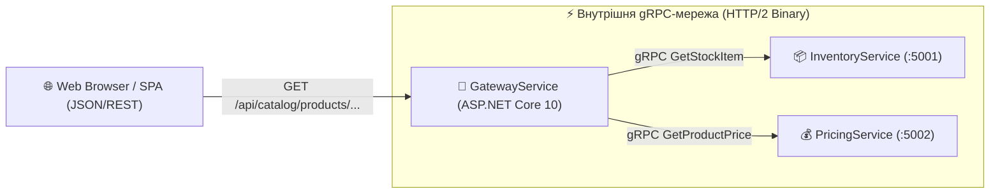

# 🔄 Mastery 04: REST Meets gRPC (Гібридна та Dual-Stack Архітектура)

У середовищі розробників часто виникає хибна дилема: *«Що обрати для проєкту: REST чи gRPC?»*.

В індустрії перемагає не радикальний вибір одного протоколу, а **прагматичний гібридний підхід**:
1. **Зовнішній контур (North-South Traffic):** Класичний **REST/JSON** або OpenAPI для взаємодії з публічним інтернетом, браузерами (Single Page Applications), мобільними додатками та сторонніми інтеграціями.
2. **Внутрішній контур (East-West Traffic):** Високошвидкісний, двійковий, строго типізований **gRPC** для зв'язку між бекенд-мікросервісами.

---

## 1. Архітектурна схема гібридної моделі



---

## 2. Як реалізовано REST-фасад над gRPC-сервісами

У нашому проєкті [`GatewayService/Endpoints/CatalogEndpoints.cs`](../src/GatewayService/Endpoints/CatalogEndpoints.cs) ми реєструємо звичайний Minimal API endpoint:

```csharp
group.MapGet("/products/{sku}", async (
    string sku,
    string? tier,
    int? qty,
    InventoryService.InventoryServiceClient inventoryClient,
    PricingService.PricingServiceClient pricingClient,
    CancellationToken ct) =>
{
    // Виклик gRPC внутрішнього сервісу 1
    var stock = await inventoryClient.GetStockItemAsync(new StockItemRequest { Sku = sku }, cancellationToken: ct);

    // Виклик gRPC внутрішнього сервісу 2
    var price = await pricingClient.GetProductPriceAsync(new ProductPriceRequest
    {
        Sku = sku,
        CustomerTier = tier ?? "Standard",
        RequestedQuantity = qty ?? 1
    }, cancellationToken: ct);

    // Повернення зведеного JSON для веб-клієнта
    return Results.Ok(new { Sku = stock.Sku, Name = stock.ProductName, FinalPrice = price.FinalUnitPrice });
});
```

### Переваги для бізнесу:
* Фронтенд-розробники продовжують працювати зі звичним `fetch()` або Axios та отримувати JSON.
* Серверний шлюз обмінюється даними з внутрішніми мікросервісами через бінарний HTTP/2 без затримок на багаторазове підключення сокетів.

---

## 3. Dual-Stack хостування в одному застосунку ASP.NET Core 10

Чи може один процес ASP.NET Core одночасно приймати і REST, і gRPC запити? **Так!**

У Kestrel для цього налаштовується прапорець `Http1AndHttp2`:
```json
"Kestrel": {
  "Endpoints": {
    "HybridEndpoint": {
      "Url": "http://localhost:5000",
      "Protocols": "Http1AndHttp2"
    }
  }
}
```

У конвеєрі [`Program.cs`](../src/GatewayService/Program.cs) ми просто монтуємо обидва типи обробників:
```csharp
// 1. REST Minimal APIs
app.MapCatalogEndpoints();

// 2. gRPC Сервіси
app.MapGrpcService<OrderAggregatorService>();
```

Коли клієнт звертається за HTTP/1.1 (наприклад, `curl -X GET http://localhost:5000/api/catalog/products/LAPTOP-PRO-16`), Kestrel направляє запит у REST-маршрут.
Коли звертається gRPC клієнт з заголовком `content-type: application/grpc` за протоколом HTTP/2, Kestrel спрямовує виклик у відповідний gRPC-сервіс.

---

## 4. Мапінг винятків `RpcException` у HTTP Status Codes

При створенні REST-фасаду над gRPC критично важливо правильно транслювати внутрішні `RpcException` у відповідні HTTP-статуси:

```csharp
catch (RpcException ex) when (ex.StatusCode == StatusCode.NotFound)
{
    return Results.NotFound(new { Error = ex.Status.Detail, StatusCode = 404 });
}
catch (RpcException ex) when (ex.StatusCode == StatusCode.InvalidArgument)
{
    return Results.BadRequest(new { Error = ex.Status.Detail, StatusCode = 400 });
}
catch (RpcException ex) when (ex.StatusCode == StatusCode.Unavailable)
{
    return Results.Problem(detail: "Бекенд-мікросервіс тимчасово недоступний", statusCode: 503);
}
catch (RpcException ex)
{
    return Results.Problem(detail: ex.Status.Detail, statusCode: 502);
}
```

---

## 5. Порівняльна таблиця: REST vs gRPC

| Критерій | REST / JSON | gRPC / Protobuf |
| :--- | :--- | :--- |
| **Формат корисного навантаження** | Текстовий (JSON / XML) | Бінарний (Protobuf) |
| **Протокол передачі** | HTTP/1.1 або HTTP/2 | Строго HTTP/2 (або HTTP/3) |
| **Контракт** | Опціональний (OpenAPI/Swagger) | Обов'язковий (`.proto` файл) |
| **Продуктивність серіалізації** | Високе споживання CPU на парсинг тексту | В 5-10 разів швидше, мінімальне виділення пам'яті |
| **Стрімінг** | Лише односторонній (SSE, Chunked) | Повноцінний двосторонній (Bi-directional) |
| **Браузерна підтримка** | Нативна (працює скрізь) | Потребує gRPC-Web або проксі (Envoy/YARP) |
| **Ідеальна сфера застосування** | Публічні API, Web/Mobile клієнти | Внутрішні мікросервіси, IoT, high-load сервіси |
