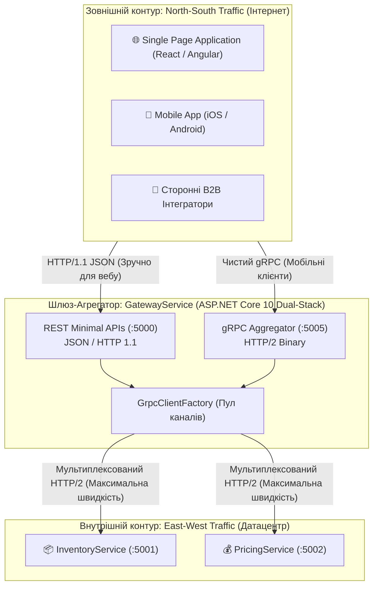

# 🔄 Mastery 04: REST Meets gRPC (Гібридна та Dual-Stack Архітектура)

[](https://dotnet.microsoft.com/)
[](https://learn.microsoft.com/aspnet/core/)
[]()

> **Мета модуля:** Глибоко розібратися в архітектурі **гібридних систем**, навчитися будувати **REST-фасад над внутрішньою gRPC-мережею**, опанувати налаштування **Dual-Stack хостування в Kestrel** (одночасна підтримка HTTP/1.1 та бінарного HTTP/2 Prior Knowledge), зрозуміти мережеву причину помилки **`HTTP_1_1_REQUIRED`** та освоїти пулінг з'єднань через **GrpcClientFactory** у .NET 10.

---

## 📑 Зміст посібника
1. [Архітектурне порівняння: REST проти gRPC за всіма інженерними критеріями](#1-архітектурне-порівняння-rest-проти-grpc-за-всіма-інженерними-критеріями)
2. [Гібридна парадигма: Трафік North-South проти East-West](#2-гібридна-парадигма-трафік-north-south-проти-east-west)
3. [Мережева анатомія помилки `HTTP_1_1_REQUIRED (0xd)`](#3-мережева-анатомія-помилки-http_1_1_required-0xd)
   * 3.1 [ALPN (Application-Layer Protocol Negotiation) у TLS](#31-alpn-application-layer-protocol-negotiation-у-tls)
   * 3.2 [Чому Cleartext (h2c) вимагає Prior Knowledge](#32-чому-cleartext-h2c-вимагає-prior-knowledge)
4. [Конфігурація Dual-Stack Kestrel: Порт 5000 (REST) + Порт 5005 (gRPC)](#4-конфігурація-dual-stack-kestrel-порт-5000-rest--порт-5005-grpc)
5. [gRPC Client Factory в .NET 10: Пулінг каналів та захист від Socket Exhaustion](#5-grpc-client-factory-в-net-10-пулінг-каналів-та-захист-від-socket-exhaustion)
6. [Реалізація REST-фасаду: інжекція gRPC-клієнтів у Minimal APIs](#6-реалізація-rest-фасаду-інжекція-grpc-клієнтів-у-minimal-apis)
7. [Двостороння трансляція винятків: від `RpcException` до HTTP ProblemDetails](#7-двостороння-трансляція-винятків-від-rpcexception-до-http-problemdetails)
8. [Покроковий аналіз сервісу `GatewayService`](#8-покроковий-аналіз-сервісу-gatewayservice)
9. [Типові помилки та антипатерни гібридної архітектури](#9-типові-помилки-та-антипатерни-гібридної-архітектури)
10. [Контрольні запитання та лабораторні завдання](#10-контрольні-запитання-та-лабораторні-завдання)

---

<a id="1-архітектурне-порівняння-rest-проти-grpc-за-всіма-інженерними-критеріями"></a>
## 1. Архітектурне порівняння: REST проти gRPC за всіма інженерними критеріями

| Інженерний критерій | REST (JSON над HTTP/1.1) | gRPC (Protobuf над HTTP/2) | Пояснення для студента |
| :--- | :--- | :--- | :--- |
| **Формат даних (Payload)** | Текстовий (ASCII / UTF-8) | Бінарний строго типізований (Protobuf) | gRPC пакет у $5\text{--}8$ разів компактніший |
| **Витрати CPU на парсинг** | Високі (розбір лапок, пошук ком, парсинг чисел) | Мінімальні (читання байтів прямо в пам'ять) | gRPC серіалізує дані в $7\text{--}10$ разів швидше |
| **Транспортний рівень** | HTTP/1.1 (окремі сокети, черги HoL Blocking) | HTTP/2 (єдине з'єднання, мультиплексування) | Нуль оверхеду на повторні TCP/TLS рукостискання |
| **Контракт системи** | Опціональний (Swagger/OpenAPI генерується постфактум) | Обов'язковий (Contract-First на `.proto`) | Повна міжмовна строгість на етапі компіляції |
| **Підтримка потоків (Streaming)**| Обмежена (Server-Sent Events лише в один бік) | Повна (Server, Client, Bi-directional) | Можливість справжнього повнодуплексного обміну |
| **Браузерна сумісність** | Абсолютна (працює в будь-якому браузері нативно) | Обмежена (потребує `grpc-web` або Envoy шлюзу) | Браузери не мають прямого доступу до HTTP/2 фреймів |
| **Зручність відлагодження** | Висока (зрозумілий текст у DevTools / Postman) | Середня (потребує proto-файлу в Postman/BloomRPC) | Бінарні байти неможливо прочитати очима без схеми |

---

<a id="2-гібридна-парадигма-трафік-north-south-проти-east-west"></a>
## 2. Гібридна парадигма: Трафік North-South проти East-West

У реальних комерційних enterprise-системах перемагає не «чистий REST» і не «чистий gRPC», а їхня **стратегічна комбінація**:



* **North-South (Північ-Південь):** Зовнішній інтернет. Тут REST є стандартом де-факто, оскільки забезпечує доступність будь-якому клієнту без специфічних SDK.
* **East-West (Схід-Захід):** Внутрішня мережа датацентру. Тут переважає gRPC, забезпечуючи мінімальну затримку (sub-millisecond latency) та економію трафіку між мікросервісами.

---

<a id="3-мережева-анатомія-помилки-http_1_1_required-0xd"></a>
## 3. Мережева анатомія помилки `HTTP_1_1_REQUIRED (0xd)`

При спробі об'єднати REST і gRPC на одному нешифрованому HTTP-порті в Kestrel розробники неминуче стикаються з падінням:
`The HTTP/2 server closed the connection. HTTP/2 error code 'HTTP_1_1_REQUIRED' (0xd)`.

Розберемо фізичну причину цього мережевого явища.

<a id="31-alpn-application-layer-protocol-negotiation-у-tls"></a>
### 3.1 ALPN (Application-Layer Protocol Negotiation) у TLS
Коли клієнт підключається за захищеним протоколом **HTTPS (TLS)**:
1. Клієнт шле пакет `ClientHello`, де у розширенні **ALPN** вказує підтримувані протоколи: `["h2", "http/1.1"]`.
2. Сервер у пакеті `ServerHello` відповідає: `h2` (якщо підтримує HTTP/2) або `http/1.1`.
3. **Усе вирішується на етапі рукостискання TLS до передачі першого HTTP-байта.**

<a id="32-чому-cleartext-h2c-вимагає-prior-knowledge"></a>
### 3.2 Чому Cleartext (h2c) вимагає Prior Knowledge
У нешифрованому режимі (**HTTP Cleartext / h2c**), який зазвичай використовується у внутрішніх мережах мікросервісів та локальній розробці:
* Розширення ALPN **не існує**, оскільки немає TLS!
* Сервер Kestrel слухає відкритий TCP-порт і не знає, які байти йому надійдуть: текстовий рядок `GET / HTTP/1.1\r\n` чи бінарний 24-розрядний магічний префікс HTTP/2: `PRI * HTTP/2.0\r\n\r\nSM\r\n\r\n`.
* Якщо налаштувати Kestrel на спільний режим `Http1AndHttp2` без TLS, специфікація HTTP/2 вимагає, щоб клієнт спочатку підключився як HTTP/1.1 та надіслав заголовок `Upgrade: h2c`. Оскільки більшість gRPC-клієнтів шлють одразу прямий HTTP/2 префікс (**Prior Knowledge**), Kestrel відхиляє підключення з кодом помилки `HTTP_1_1_REQUIRED`!

### Інженерне рішення:
Налаштувати Kestrel на прослуховування **двох різних портів у межах одного процесу**:
* Порт `5000`: `Protocols: Http1` (для REST / браузерів).
* Порт `5005`: `Protocols: Http2` (для чистого gRPC Prior Knowledge).

---

<a id="4-конфігурація-dual-stack-kestrel-порт-5000-rest--порт-5005-grpc"></a>
## 4. Конфігурація Dual-Stack Kestrel: Порт 5000 (REST) + Порт 5005 (gRPC)

У файлі [`GatewayService/appsettings.json`](../src/GatewayService/appsettings.json) реалізовано правильну мульти-портову топологію:

```json
{
  "Kestrel": {
    "Endpoints": {
      "RestHttpEndpoint": {
        "Url": "http://localhost:5000",
        "Protocols": "Http1"
      },
      "GrpcHttp2Endpoint": {
        "Url": "http://localhost:5005",
        "Protocols": "Http2"
      }
    }
  }
}
```

У конвеєрі [`GatewayService/Program.cs`](../src/GatewayService/Program.cs):
```csharp
// 1. Монтуємо REST Minimal APIs (слухає порт 5000)
app.MapCatalogEndpoints();

// 2. Монтуємо gRPC Агрегатор (слухає порт 5005)
app.MapGrpcService<OrderAggregatorService>();
```

---

<a id="5-grpc-client-factory-в-net-10-пулінг-каналів-та-захист-від-socket-exhaustion"></a>
## 5. gRPC Client Factory в .NET 10: Пулінг каналів та захист від Socket Exhaustion

У високонавантаженому шлюзі неприпустимо створювати канали gRPC вручну:
```csharp
// АНТИПАТЕРН! Фатальна втрата продуктивності
using var channel = GrpcChannel.ForAddress("http://localhost:5001");
var client = new InventoryService.InventoryServiceClient(channel);
```

### Чому `GrpcClientFactory` є обов'язковою:
1. **Connection Pooling:** Фабрика створює **один довгоживучий HTTP/2 канал** до кожного бекенд-мікросервісу та повторно використовує його для тисяч паралельних запитів.
2. **DNS Refreshing:** Фабрика періодично оновлює DNS-записи адрес сервісів, запобігаючи надсиланню запитів на застарілі IP-адреси при перезапуску мікросервісів у Kubernetes.
3. **Конфігурація Interceptors:** Дозволяє декларативно підключити перехоплювачі (наприклад, трасування чи повторні спроби) для всіх вихідних запитів.

Реєстрація у [`GatewayService/Program.cs`](../src/GatewayService/Program.cs):
```csharp
builder.Services.AddGrpcClient<InventoryService.InventoryServiceClient>(options =>
{
    options.Address = new Uri("http://localhost:5001");
}).AddInterceptor<ClientTracingInterceptor>(); // Підключення інтерцептора трасування
```

---

<a id="6-реалізація-rest-фасаду-інжекція-grpc-клієнтів-у-minimal-apis"></a>
## 6. Реалізація REST-фасаду: інжекція gRPC-клієнтів у Minimal APIs

Повний код ендпоінта у [`GatewayService/Endpoints/CatalogEndpoints.cs`](../src/GatewayService/Endpoints/CatalogEndpoints.cs):

```csharp
public static void MapCatalogEndpoints(this IEndpointRouteBuilder routes)
{
    var group = routes.MapGroup("/api/catalog");

    group.MapGet("/products/{sku}", async (
        string sku,
        string? tier,
        int? qty,
        InventoryService.InventoryServiceClient inventoryClient, // Впроваджено з GrpcClientFactory
        PricingService.PricingServiceClient pricingClient,       // Впроваджено з GrpcClientFactory
        CancellationToken ct) =>
    {
        // 1. Виклик мікросервісу складу через gRPC
        var stock = await inventoryClient.GetStockItemAsync(
            new StockItemRequest { Sku = sku }, cancellationToken: ct);

        // 2. Виклик мікросервісу цін через gRPC
        var price = await pricingClient.GetProductPriceAsync(
            new ProductPriceRequest
            {
                Sku = sku,
                CustomerTier = tier ?? "Standard",
                RequestedQuantity = qty ?? 1
            }, cancellationToken: ct);

        // 3. Формування єдиного JSON-об'єкта для зовнішніх споживачів
        return Results.Ok(new
        {
            Source = "Hybrid REST-over-gRPC Gateway",
            Sku = stock.Sku,
            ProductName = stock.ProductName,
            Warehouse = stock.WarehouseCode,
            StockStatus = stock.Status.ToString(),
            AvailableUnits = stock.AvailableQuantity,
            Pricing = new
            {
                BasePrice = price.BaseUnitPrice,
                FinalUnitPrice = price.FinalUnitPrice,
                DiscountPercent = price.DiscountPercentage,
                Currency = price.Currency,
                CalculatedTotal = Math.Round(price.FinalUnitPrice * (qty ?? 1), 2)
            }
        });
    });
}
```

---

<a id="7-двостороння-трансляція-винятків-від-rpcexception-до-http-problemdetails"></a>
## 7. Двостороння трансляція винятків: від `RpcException` до HTTP ProblemDetails

Зовнішній REST-клієнт не розуміє статусів `StatusCode.NotFound` чи `StatusCode.DeadlineExceeded`. Шлюз зобов'язаний транслірувати бінарні винятки у стандартні коди протоколу HTTP:

```csharp
try
{
    // виконання gRPC-викликів...
}
catch (RpcException ex) when (ex.StatusCode == StatusCode.NotFound)
{
    // gRPC NotFound -> HTTP 404
    return Results.NotFound(new { Error = ex.Status.Detail, StatusCode = 404 });
}
catch (RpcException ex) when (ex.StatusCode == StatusCode.InvalidArgument)
{
    // gRPC InvalidArgument -> HTTP 400
    return Results.BadRequest(new { Error = ex.Status.Detail, StatusCode = 400 });
}
catch (RpcException ex) when (ex.StatusCode == StatusCode.FailedPrecondition)
{
    // gRPC FailedPrecondition -> HTTP 422 Unprocessable Entity
    return Results.UnprocessableEntity(new { Error = ex.Status.Detail, StatusCode = 422 });
}
catch (RpcException ex) when (ex.StatusCode == StatusCode.DeadlineExceeded)
{
    // gRPC DeadlineExceeded -> HTTP 504 Gateway Timeout
    return Results.Problem(detail: "Внутрішній бекенд не відповів за виділений ліміт часу", statusCode: 504);
}
catch (RpcException ex) when (ex.StatusCode == StatusCode.Unavailable)
{
    // gRPC Unavailable -> HTTP 503 Service Unavailable
    return Results.Problem(detail: "Бекенд-мікросервіс тимчасово недоступний", statusCode: 503);
}
catch (RpcException ex)
{
    // Будь-який інший внутрішній збій -> HTTP 502 Bad Gateway
    return Results.Problem(detail: ex.Status.Detail, statusCode: 502);
}
```

---

<a id="8-покроковий-аналіз-сервісу-gatewayservice"></a>
## 8. Покроковий аналіз сервісу `GatewayService`

У файлі [`GatewayService/Program.cs`](../src/GatewayService/Program.cs):
* **Рядки 10–15:** Реєстрація інтерцепторів як Singleton.
* **Рядки 20–35:** Реєстрація gRPC-клієнтів до сервісів `InventoryService` (:5001) та `PricingService` (:5002) із впровадженням інтерцептора трасування `ClientTracingInterceptor`.
* **Рядки 40–50:** Монтування REST-ендпоінтів та gRPC-сервісу на спільний веб-додаток.

---

<a id="9-типові-помилки-та-антипатерни-гібридної-архітектури"></a>
## 9. Типові помилки та антипатерни гібридної архітектури

1. **Антипатерн «Використання Http1AndHttp2 на Cleartext HTTP»:** Призводить до збою `HTTP_1_1_REQUIRED`.
2. **Антипатерн «Створення GrpcChannel на кожен REST-запит»:** Викликає вичерпання дескрипторів сокетів ОС (Socket Exhaustion).
3. **Ігнорування статусу 502/504:** Повернення клієнту сирого стеку помилки `500 Internal Error` замість точного коду збою мережевого шлюзу.

---

<a id="10-контрольні-запитання-та-лабораторні-завдання"></a>
## 10. Контрольні запитання та лабораторні завдання

### Контрольні запитання:
1. У чому полягає різниця між трафіком North-South та East-West?
2. Чому нешифрований HTTP/2 (h2c) не підтримує динамічне узгодження протоколів на одному порті?
3. Що таке ALPN і яку роль він відіграє в протоколі TLS?
4. Чому створення екземпляра `GrpcChannel` вручну вважається антипатерном у високонавантажених системах?
5. У який HTTP-код повинен транслюватися статус `StatusCode.DeadlineExceeded`?

### Лабораторні завдання:
1. **Тестування обробки помилки 404 через cURL:**
   Виконайте запит до неіснуючого товару:
   ```bash
   curl -i http://localhost:5000/api/catalog/products/NON-EXISTENT-SKU
   ```
   Переконайтеся, що сервер повернув валідний HTTP-статус `404 Not Found` та JSON-структуру з описом.
2. **Додавання нового REST-ендпоінта аудиту складу:**
   Реалізуйте в `CatalogEndpoints` метод `GET /api/catalog/warehouses/{code}/audit`, який викликає gRPC Server Streaming метод `inventoryClient.StreamStockUpdates` та повертає підсумковий JSON-список усіх отриманих позицій.
