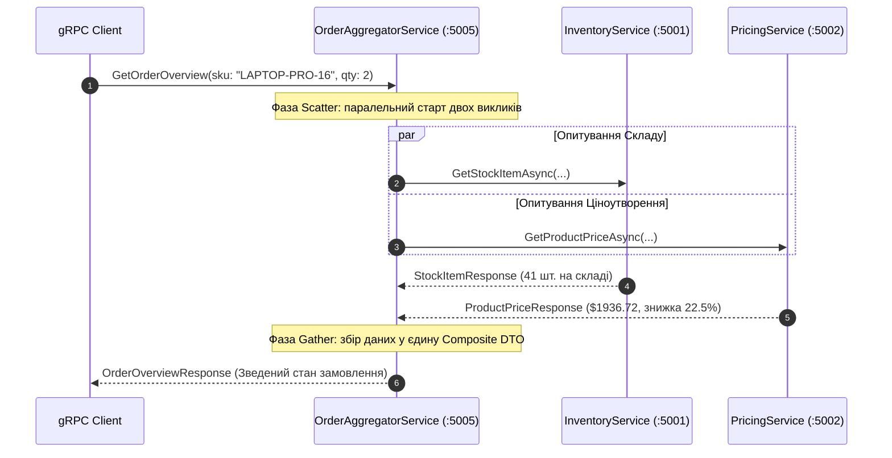

# 🧩 Mastery 05: The Aggregator Pattern & Enterprise Resilience

[](https://dotnet.microsoft.com/)
[](https://microservices.io/patterns/data/api-composition.html)
[]()

> **Мета модуля:** Опанувати проєктування **композитних мікросервісів (Патерн Aggregator / BFF)** на чистому gRPC, реалізувати паралельний патерн **Scatter-Gather** на базі `Task.WhenAll`, налаштувати **каскадне прокидання Deadlines**, реалізувати стійкість до часткових збоїв (**Graceful Degradation**) та впровадити наскрізне трасування за допомогою **Interceptors**.

---

## 📑 Зміст посібника
1. [Проблема «балакучих клієнтів» (Chatty Clients) та потреба в Агрегаторі](#1-проблема-балакучих-клієнтів-chatty-clients-та-потреба-в-агрегаторі)
2. [Патерн Scatter-Gather: паралельні виклики через Task.WhenAll](#2-патерн-scatter-gather-паралельні-виклики-через-taskwhenall)
3. [Математика латентності: послідовне vs паралельне опитування](#3-математика-латентності-послідовне-vs-паралельне-опитування)
4. [Проєктування композитної DTO у Protobuf (`OrderOverviewResponse`)](#4-проєктування-композитної-dto-у-protobuf-orderoverviewresponse)
5. [Каскадне прокидання Deadlines (Deadline Propagation)](#5-каскадне-прокидання-deadlines-deadline-propagation)
6. [Часткові збої: як не покласти систему через один другорядний сервіс](#6-часткові-збої-як-не-покласти-систему-через-один-другорядний-сервіс)
7. [Graceful Degradation: резервна оцінка ціни (Fallback Pricing)](#7-graceful-degradation-резервна-оцінка-ціни-fallback-pricing)
8. [Перехоплювачі (Interceptors): серверний аудит та клієнтський Correlation-Id](#8-перехоплювачі-interceptors-серверний-аудит-та-клієнтський-correlation-id)
9. [Покроковий розбір сервісу OrderAggregatorService](#9-покроковий-розбір-сервісу-orderaggregatorservice)
10. [Практичні лабораторні завдання для закріплення](#10-практичні-лабораторні-завдання-для-закріплення)

---

## 1. Проблема «балакучих клієнтів» (Chatty Clients) та потреба в Агрегаторі

У мікросервісній системі для відображення картки товару клієнту потрібні дані з різних джерел:
* Сервіс складу $\rightarrow$ чи є товар у наявності?
* Сервіс ціноутворення $\rightarrow$ яка персональна ціна для даного клієнта?
* Сервіс доставки $\rightarrow$ орієнтовний термін прибуття.

Якщо мобільний додаток або браузер робитиме ці виклики самостійно:
1. Витрачається заряд батареї та мобільний трафік.
2. Мобільна мережа має високий RTT (Round Trip Time, $\sim 80\text{ ms}$). Три окремі виклики дадуть затримку понад $250\text{ ms}$.
3. Клієнт стає жорстко прив'язаним до топології внутрішніх мікросервісів.

**Рішення: Патерн Aggregator (API Composition / Backend-For-Frontend):**
Клієнт робить **один виклик** до Агрегатора, а Агрегатор усередині високошвидкісного датацентру збирає дані та повертає готову зведену модель.

---

## 2. Патерн Scatter-Gather: паралельні виклики через Task.WhenAll

Патерн **Scatter-Gather (Розкидай-Збери)** працює у дві фази:
* **Scatter (Розкидання):** Агрегатор одночасно ініціює асинхронні запити до всіх необхідних бекенд-сервісів без очікування відповіді від кожного.
* **Gather (Збір):** Агрегатор очікує завершення всіх задач і формує фінальну об'єднану відповідь.



---

## 3. Математика латентності: послідовне vs паралельне опитування

Нехай час відповіді сервісу складу $T_{\text{inv}} = 120\text{ ms}$, а сервісу цін $T_{\text{price}} = 150\text{ ms}$.

* **Послідовне виконання (Sequential Chaining):**
  $$T_{\text{total}} = T_{\text{inv}} + T_{\text{price}} = 120 + 150 = \mathbf{270\text{ ms}}$$
* **Паралельне виконання (Scatter-Gather):**
  $$T_{\text{total}} = \max(T_{\text{inv}}, T_{\text{price}}) + \epsilon_{\text{agg}} = \max(120, 150) + 1 = \mathbf{151\text{ ms}}$$

> [!TIP]
> Паралельний виклик на gRPC виконується **майже вдвічі швидше**, оскільки обидва виклики передаються по єдиному відкритому HTTP/2 з'єднанню без очікування черги.

---

## 4. Проєктування композитної DTO у Protobuf (`OrderOverviewResponse`)

У файлі [`aggregator.proto`](../src/Shared.Contracts/Protos/aggregator.proto) визначено композитний контракт:

```protobuf
syntax = "proto3";

package mastery.aggregator.v1;

option csharp_namespace = "Mastery.Aggregator.V1";

import "google/protobuf/timestamp.proto";
import "inventory.proto";

service OrderAggregator {
  rpc GetOrderOverview (OrderOverviewRequest) returns (OrderOverviewResponse);
}

message OrderOverviewRequest {
  string sku = 1;
  string customer_tier = 2;
  int32 quantity = 3;
}

message OrderOverviewResponse {
  string sku = 1;
  string product_name = 2;
  
  // Дані зі складу (Inventory)
  mastery.inventory.v1.StockStatus stock_status = 3;
  int32 available_stock = 4;
  string primary_warehouse = 5;

  // Дані з ціноутворення (Pricing)
  double unit_price = 6;
  double total_price = 7;
  double total_discount_applied = 8;
  string currency = 9;

  // Прапорці стійкості (Resilience & Degradation)
  bool is_price_estimated = 10;
  string degradation_warning = 11;

  // Метрики виконання
  int64 aggregation_latency_ms = 12;
  google.protobuf.Timestamp generated_at = 13;
}
```

---

## 5. Каскадне прокидання Deadlines (Deadline Propagation)

Якщо клієнт виділив Агрегатору таймаут у $400\text{ ms}$, Агрегатор не має права витрачати на бекенд-сервіси більше часу, ніж у нього залишилося!

У коді [`OrderAggregatorService.cs`](../src/GatewayService/Services/OrderAggregatorService.cs):
```csharp
public override async Task<OrderOverviewResponse> GetOrderOverview(
    OrderOverviewRequest request,
    ServerCallContext context)
{
    // Прокидаємо крайній термін (Deadline) із вхідного контексту клієнта
    var callOptions = new CallOptions(
        deadline: context.Deadline,
        cancellationToken: context.CancellationToken);

    // Всі внутрішні виклики успадковують цей крайній термін!
    var stockTask = _inventoryClient.GetStockItemAsync(stockReq, callOptions).ResponseAsync;
    var priceTask = _pricingClient.GetProductPriceAsync(priceReq, callOptions).ResponseAsync;
```

Якщо загальний час перевищить 400 мс:
1. Клієнт розриває потік фреймом `RST_STREAM`.
2. Агрегатор миттєво скасовує обидва дочірні виклики до `Inventory` та `Pricing`.
3. Уся система захищена від накопичення «завислих» фонових задач.

---

## 6. Часткові збої: як не покласти систему через один другорядний сервіс

У мікросервісній системі всі залежності діляться на дві категорії:
1. **Критичні залежності (Hard Dependencies):** Якщо сервіс складу недоступний або товару немає в базі (`StatusCode.NotFound`), формувати замовлення неможливо. Агрегатор зобов'язаний повернути клієнту помилку `StatusCode.NotFound` або `StatusCode.Unavailable`.
2. **Некритичні залежності (Soft Dependencies):** Якщо сервіс розрахунку персональних знижок `PricingService` тимчасово впав або не вклався в таймаут, **ми не повинні ламати покупку для користувача!**

---

## 7. Graceful Degradation: резервна оцінка ціни (Fallback Pricing)

Замість того, щоб викидати помилку `500 Internal Error`, Агрегатор перехоплює збій другорядного сервісу та переходить у **деградований режим (Graceful Degradation)**:

```csharp
// Graceful Degradation для сервісу ціноутворення
try
{
    price = await priceTask;
}
catch (RpcException ex)
{
    _logger.LogWarning("PricingService недоступний ({Code}). Перехід на Fallback-модель.", ex.StatusCode);

    isPriceEstimated = true;
    degradationWarning = $"Сервіс цін тимчасово недоступний ({ex.StatusCode}). Застосовано орієнтовну базову вартість.";
    
    // Тимчасова безпечна оцінка ціни
    price = new ProductPriceResponse
    {
        BaseUnitPrice = 500.00,
        FinalUnitPrice = 500.00,
        DiscountPercentage = 0.0,
        AppliedDiscountCampaign = "Fallback Model",
        Currency = "USD",
        CalculatedAt = Timestamp.FromDateTime(DateTime.UtcNow)
    };
}
```

Клієнт отримує успішну відповідь із прапорцем `is_price_estimated = true`. UI може показати користувачу повідомлення: *«Ціна уточнюється менеджером»*, але користувач не бачить білого екрана чи помилки сервера!

---

## 8. Перехоплювачі (Interceptors): серверний аудит та клієнтський Correlation-Id

Interceptors у gRPC — це бінарний аналог Middleware в ASP.NET Core.

### 1. Серверний перехоплювач ([`ServerLoggingInterceptor.cs`](../src/GatewayService/Interceptors/ServerLoggingInterceptor.cs)):
Вимірює точний час обробки виклику за допомогою `Stopwatch`, фіксує статус завершення та перехоплює непередбачені винятки:
```csharp
public override async Task<TResponse> UnaryServerHandler<TRequest, TResponse>(
    TRequest request,
    ServerCallContext context,
    UnaryServerMethod<TRequest, TResponse> continuation)
{
    var sw = Stopwatch.StartNew();
    var correlationId = context.RequestHeaders.GetValue("x-correlation-id") ?? Guid.NewGuid().ToString("N")[..12];

    _logger.LogInformation("==> [gRPC Inbound] {Method} | CorrelationId: {CorrelationId}", context.Method, correlationId);

    try
    {
        var response = await continuation(request, context);
        sw.Stop();
        _logger.LogInformation("<== [gRPC Success] {Method} | {Ms} ms", context.Method, sw.ElapsedMilliseconds);
        return response;
    }
    catch (RpcException) { throw; }
    catch (Exception ex)
    {
        _logger.LogError(ex, "Необроблений збій у {Method}", context.Method);
        throw new RpcException(new Status(StatusCode.Internal, "Внутрішня помилка сервера."));
    }
}
```

### 2. Клієнтський перехоплювач ([`ClientTracingInterceptor.cs`](../src/GatewayService/Interceptors/ClientTracingInterceptor.cs)):
Коли Агрегатор звертається до підлеглих сервісів, цей інтерцептор автоматично вкладає у gRPC Metadata заголовок `x-correlation-id`:
```csharp
headers.Add("x-correlation-id", correlationId);
```
Завдяки цьому в логах усіх трьох мікросервісів один і той самий ланцюжок запиту матиме однаковий ідентифікатор трасування.

---

## 9. Покроковий розбір сервісу OrderAggregatorService

У файлі [`GatewayService/Services/OrderAggregatorService.cs`](../src/GatewayService/Services/OrderAggregatorService.cs):
1. Метод `GetOrderOverview` валідує вхідний запит.
2. Готує `callOptions` з дедлайном.
3. Одночасно запускає `_inventoryClient.GetStockItemAsync` та `_pricingClient.GetProductPriceAsync`.
4. Очікує завершення задач через `Task.WhenAll`.
5. Розраховує підсумкову знижку та загальну вартість.
6. Фіксує час агрегації `aggregation_latency_ms`.
7. Повертає об'єкт `OrderOverviewResponse`.

---

## 10. Практичні лабораторні завдання для закріплення

1. **Симуляція збою сервісу цін (Перевірка Fallback):**
   * Зупиніть сервіс `PricingService` (натисніть `Ctrl+C` у його терміналі).
   * Запустіть у клієнті Сценарій 04 (виклик Агрегатора).
   * Переконайтеся, що Агрегатор **не впав з помилкою**, а успішно повернув результат із `IsPriceEstimated = true` та попередженням: *"Сервіс цін тимчасово недоступний"*.
2. **Розширення композитної DTO (Компонент доставки):**
   * Додайте в `aggregator.proto` нове поле: `int32 estimated_delivery_days = 14;`.
   * В `OrderAggregatorService` розрахуйте дні доставки залежно від складу: якщо склад `"WH-KYIV-01"` — 1 день, якщо інший — 2 дні.
   * Виконайте збірку та перевірте значення на клієнті.
