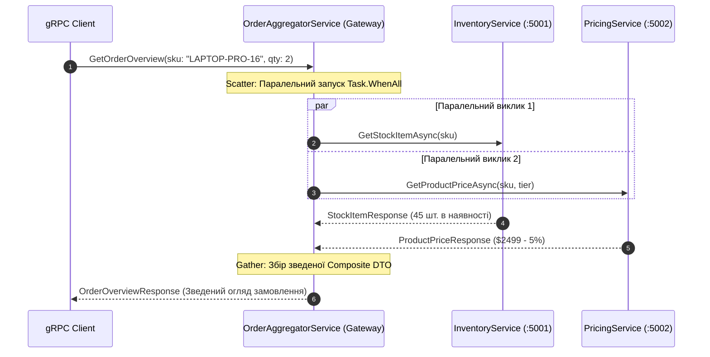

# 🧩 Mastery 05: The Aggregator Pattern & Enterprise Resilience

Патерн **Aggregator (Композитний сервіс / Агрегатор)** є одним із найпоширеніших патернів у мікросервісній архітектурі. Його мета — прийняти один узагальнений запит від клієнта, розіслати паралельні запити до декількох спеціалізованих мікросервісів, об'єднати отримані дані в єдину композитну **DTO (Data Transfer Object)** і повернути клієнту за один мережевий раунд-тріп.

У цьому модулі ми розберемо реалізацію патерну Aggregator на чистому gRPC в .NET 10, паралельне виконання **Scatter-Gather**, техніку **Graceful Degradation** при збоях та використання **Interceptors**.

---

## 1. Архітектура Scatter-Gather на gRPC

Коли клієнт звертається до методу `GetOrderOverview`:



### Чому паралельний виклик (`Scatter-Gather`) критичний:
* **Послідовний виклик:** $\text{Час} = T_{\text{inventory}} + T_{\text{pricing}} = 120\text{ ms} + 150\text{ ms} = 270\text{ ms}$.
* **Паралельний Scatter-Gather:** $\text{Час} = \max(T_{\text{inventory}}, T_{\text{pricing}}) = \max(120, 150) = 150\text{ ms}$!
* Завдяки HTTP/2 мультиплексуванню обидва виклики летять одночасно без конкуренції за сокети.

Реалізація у [`OrderAggregatorService.cs`](../src/GatewayService/Services/OrderAggregatorService.cs):
```csharp
// Одночасний запуск задач без await на кожній окремо
var stockTask = _inventoryClient.GetStockItemAsync(new StockItemRequest { Sku = request.Sku }, callOptions).ResponseAsync;
var priceTask = _pricingClient.GetProductPriceAsync(new ProductPriceRequest { Sku = request.Sku }, callOptions).ResponseAsync;

// Синхронізація виконання
await Task.WhenAll(stockTask, priceTask);
```

---

## 2. Deadline Propagation (Каскадний крайній термін)

Якщо клієнт встановив таймаут у 300 мс на виклик Агрегатора, неприпустимо, щоб Агрегатор виділяв бекенд-сервісам по 2 секунди.
У gRPC крайній термін (`context.Deadline`) передається у виклики автоматично:

```csharp
var callOptions = new CallOptions(
    deadline: context.Deadline,                  // Залишок часу з вхідного запиту
    cancellationToken: context.CancellationToken // Токен скасування клієнта
);

var stock = await _inventoryClient.GetStockItemAsync(stockReq, callOptions);
```

Якщо 300 мс спливають:
1. Клієнтський SDK відправляє HTTP/2 фрейм `RST_STREAM` до Агрегатора.
2. Агрегатор миттєво скасовує підлеглі виклики до `InventoryService` та `PricingService`.
3. Вся мережева ланка звільняє ресурси, запобігаючи каскадному колапсу (Cascading Failure).

---

## 3. Часткові відмови та деградація (Graceful Degradation)

У реальних розподілених системах сервіси періодично падають. Архітектура Агрегатора має чітко розрізняти:
* **Критичні залежності:** якщо товару немає на складі (`InventoryService` повернув `NotFound`), формувати замовлення немає сенсу. Ми повертаємо клієнту `StatusCode.NotFound`.
* **Некритичні залежності:** якщо сервіс знижок і цін (`PricingService`) тимчасово недоступний (мережевий таймаут або 503), **ми не повинні ламати екран користувача!**

### Патерн Fallback:
```csharp
try
{
    price = await priceTask;
}
catch (RpcException ex)
{
    _logger.LogWarning("PricingService недоступний: {Status}. Застосовуємо резервну оцінку.", ex.StatusCode);

    isPriceEstimated = true;
    degradationWarning = $"Сервіс цін тимчасово недоступний ({ex.StatusCode}). Показано базову орієнтовну вартість.";
    
    // Повертаємо резервну базову модель ціни
    price = new ProductPriceResponse
    {
        BaseUnitPrice = 500.00,
        FinalUnitPrice = 500.00,
        AppliedDiscountCampaign = "Fallback Model"
    };
}
```

У фінальній Protobuf-DTO клієнт отримує прапорець `is_price_estimated = true` та попередження `degradation_warning`, що дозволяє UI відобразити користувачу бейдж: *«Попередня ціна (уточнюється)»*, зберігши працездатність сайту.

---

## 4. Перехоплювачі (Interceptors)

Interceptors у gRPC — це аналог ASP.NET Core Middleware, але адаптований для бінарного RPC-конвеєра.

### 1. Серверний перехоплювач ([`ServerLoggingInterceptor.cs`](../src/GatewayService/Interceptors/ServerLoggingInterceptor.cs)):
Вимірює точний час обробки кожного запиту, логує статус-код та перехоплює необроблені винятки:
```csharp
public override async Task<TResponse> UnaryServerHandler<TRequest, TResponse>(
    TRequest request,
    ServerCallContext context,
    UnaryServerMethod<TRequest, TResponse> continuation)
{
    var sw = Stopwatch.StartNew();
    var response = await continuation(request, context);
    sw.Stop();
    _logger.LogInformation("gRPC {Method} завершено за {Ms} ms", context.Method, sw.ElapsedMilliseconds);
    return response;
}
```

### 2. Клієнтський перехоплювач ([`ClientTracingInterceptor.cs`](../src/GatewayService/Interceptors/ClientTracingInterceptor.cs)):
Автоматично додає кореляційний ID (`x-correlation-id`) у gRPC `Metadata` для наскрізного трасування (Distributed Tracing):
```csharp
headers.Add("x-correlation-id", correlationId);
```
Цей заголовок подорожує крізь усі ланки мікросервісів, дозволяючи знайти повний слід запиту в логах.
