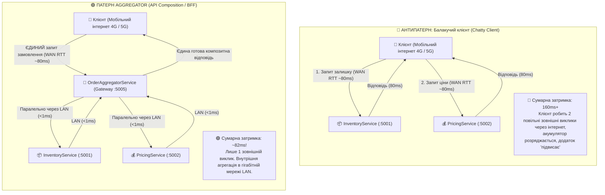
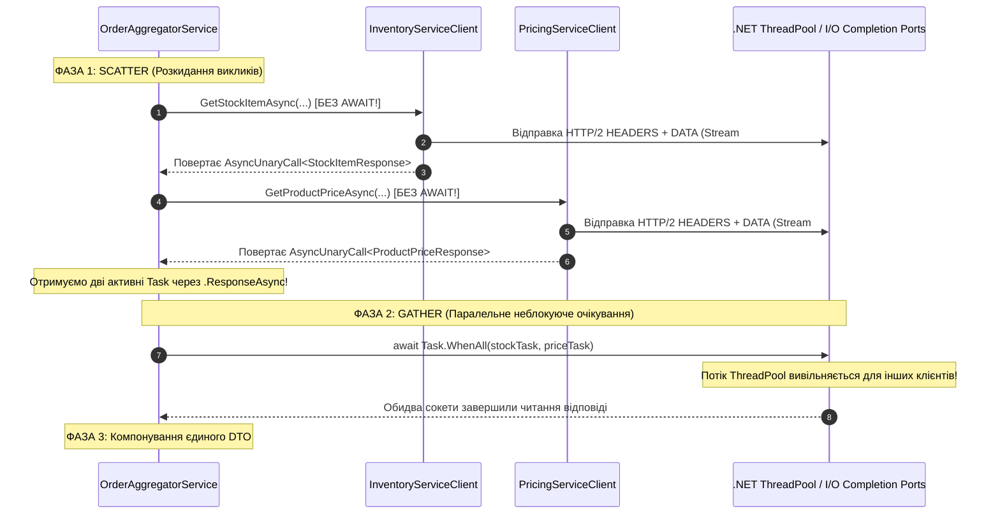
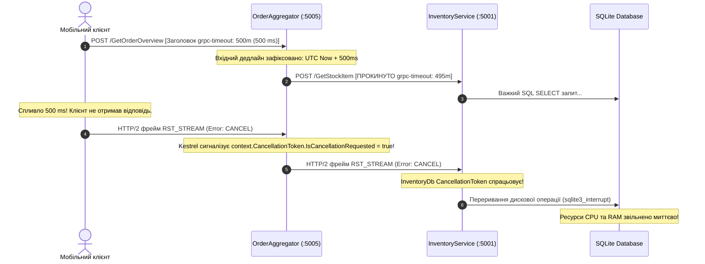
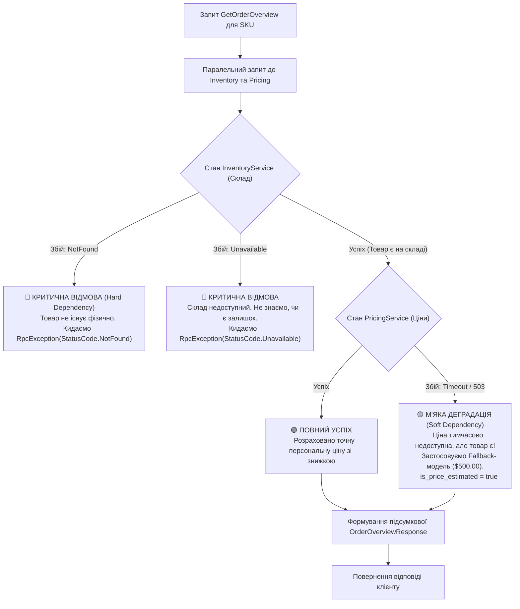
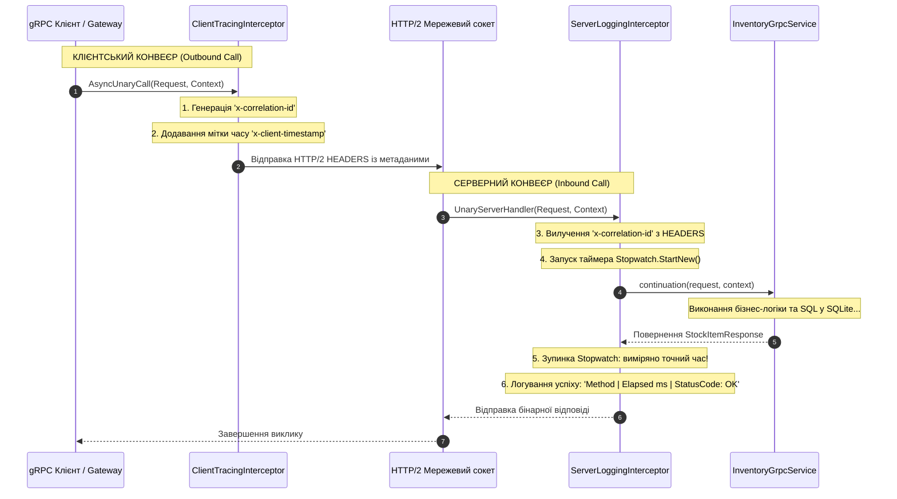

# 🧩 Mastery 05: Патерн Aggregator, стійкість до збоїв та перехоплювачі (Interceptors)

[](https://dotnet.microsoft.com/)
[](https://microservices.io/patterns/data/api-composition.html)
[]()

> **Мета модуля:** Опанувати проєктування **композитних мікросервісів (Патерн Aggregator / BFF)** на чистому gRPC в .NET 10, математично довести переваги паралельного патерну **Scatter-Gather** на базі `Task.WhenAll`, налаштувати **каскадне прокидання Deadlines**, реалізувати стійкість до часткових збоїв (**Graceful Degradation / Fallback**) та побудувати наскрізне трасування за допомогою клієнтських і серверних **Interceptors**.

---

## 📑 Зміст посібника
1. [Проблема «балакучих клієнтів» (Chatty Clients) та архітектурне призначення Агрегатора](#1-проблема-балакучих-клієнтів-chatty-clients-та-архітектурне-призначення-агрегатора)
   * 1.1 [Діаграма: Антипатерн Chatty Client проти патерну Aggregator](#11-діаграма-антипатерн-chatty-client-проти-патерну-aggregator)
2. [Математика латентності: Послідовне опитування проти Scatter-Gather](#2-математика-латентності-послідовне-опитування-проти-scatter-gather)
   * 2.1 [Діаграма: Порівняльний водоспад затримок (Latency Waterfall)](#21-діаграма-порівняльний-водоспад-затримок-latency-waterfall)
   * 2.2 [Математичний розрахунок затримки та економії часу](#22-математичний-розрахунок-затримки-та-економії-часу)
3. [Архітектура Scatter-Gather в .NET 10: `Task.WhenAll` та `AsyncUnaryCall`](#3-архітектура-scatter-gather-в-net-10-taskwhenall-та-asyncunarycall)
   * 3.1 [Діаграма: Життєвий цикл паралельних неблокуючих I/O завдань](#31-діаграма-життєвий-цикл-паралельних-неблокуючих-io-завдань)
   * 3.2 [Порядковий аналіз коду виклику через `ResponseAsync`](#32-порядковий-аналіз-коду-виклику-через-responseasync)
4. [Проєктування композитної DTO у Protobuf (`OrderOverviewResponse`)](#4-проєктування-композитної-dto-у-protobuf-orderoverviewresponse)
   * 4.1 [Аналіз полів контракту aggregator.proto](#41-аналіз-полів-контракту-aggregatorproto)
5. [Каскадний дедлайн (Deadline Propagation) крізь граф мікросервісів](#5-каскадний-дедлайн-deadline-propagation-крізь-граф-мікросервісів)
   * 5.1 [Діаграма: Каскадне скасування через фрейми RST_STREAM](#51-діаграма-каскадне-скасування-через-фрейми-rst_stream)
   * 5.2 [Порядковий аналіз прокидання CallOptions і CancellationToken](#52-порядковий-аналіз-прокидання-calloptions-і-cancellationtoken)
6. [Класифікація залежностей та обробка часткових збоїв (Partial Failures)](#6-класифікація-залежностей-та-обробка-часткових-збоїв-partial-failures)
   * 6.1 [Діаграма дерева рішень: Hard Dependency vs Soft Dependency](#61-діаграма-дерева-рішень-hard-dependency-vs-soft-dependency)
7. [Graceful Degradation: Реалізація резервного ціноутворення (Fallback Pricing)](#7-graceful-degradation-реалізація-резервного-ціноутворення-fallback-pricing)
   * 7.1 [Порядковий аналіз блоку Fallback-обробки](#71-порядковий-аналіз-блоку-fallback-обробки)
8. [Перехоплювачі (Interceptors): Архітектура бінарного конвеєра](#8-перехоплювачі-interceptors-архітектура-бінарного-конвеєра)
   * 8.1 [Діаграма: Наскрізний конвеєр перехоплювачів між сервісами](#81-діаграма-наскрізний-конвеєр-перехоплювачів-між-сервісами)
   * 8.2 [Порядковий аналіз `ServerLoggingInterceptor.cs`](#82-порядковий-аналіз-serverlogginginterceptorcs)
   * 8.3 [Порядковий аналіз `ClientTracingInterceptor.cs`](#83-порядковий-аналіз-clienttracinginterceptorcs)
9. [Покроковий аналіз сервісу `OrderAggregatorService.cs`](#9-покроковий-аналіз-сервісу-orderaggregatorservicecs)
10. [Типові інженерні помилки та антипатерни](#10-типові-інженерні-помилки-та-антипатерни)
11. [Контрольні запитання та лабораторні завдання](#11-контрольні-запитання-та-лабораторні-завдання)

---

<a id="1-проблема-балакучих-клієнтів-chatty-clients-та-архітектурне-призначення-агрегатора"></a>
## 1. Проблема «балакучих клієнтів» (Chatty Clients) та архітектурне призначення Агрегатора

У реальних мікросервісних системах дані навмисно розподілені між різними базами даних відповідно до концепції **Database-per-Service**:
- База складу (`InventoryService`) знає лише про фізичні залишки в комірках та термінали складів.
- База цін (`PricingService`) знає лише про тарифи, прайс-листи та грейди лояльності.

Коли клієнт хоче відобразити картку оформлення замовлення, йому потрібні обидва шматочки інформації одночасно.

<a id="11-діаграма-антипатерн-chatty-client-проти-патерну-aggregator"></a>
### 1.1 Діаграма: Антипатерн Chatty Client проти патерну Aggregator



---

<a id="2-математика-латентності-послідовне-опитування-проти-scatter-gather"></a>
## 2. Математика латентності: Послідовне опитування проти Scatter-Gather

Коли запит потрапляє в Агрегатор, виникає вибір: опитати бекенди **по черзі** (Sequential) чи **одночасно** (Scatter-Gather).

<a id="21-діаграма-порівняльний-водоспад-затримок-latency-waterfall"></a>
### 2.1 Діаграма: Порівняльний водоспад затримок (Latency Waterfall)

```mermaid
gantt
    title Порівняння затримок: Послідовне опитування проти Scatter-Gather
    dateFormat X
    axisFormat %s ms

    section Послідовно (Sequential)
    Виклик InventoryService (110 ms) :active, seq1, 0, 110
    Виклик PricingService (140 ms)   :crit, seq2, 110, 250
    Обробка та відповідь клієнту    :done, seq3, 250, 255

    section Scatter-Gather (Parallel)
    Виклик InventoryService (110 ms) :active, par1, 0, 110
    Виклик PricingService (140 ms)   :crit, par2, 0, 140
    Обробка та відповідь клієнту    :done, par3, 140, 142
```



<a id="22-математичний-розрахунок-затримки-та-економії-часу"></a>
### 2.2 Математичний розрахунок затримки та економії часу

Нехай:
- $T_{\text{inv}}$ — час виконання SQL-запиту та мережевої передачі даних від `InventoryService` ($110\text{ ms}$).
- $T_{\text{price}}$ — час розрахунку знижок та передачі даних від `PricingService` ($140\text{ ms}$).
- $\epsilon$ — накладні витрати CPU Агрегатора на створення об'єктів та об'єднання ($1\text{--}2\text{ ms}$).

1. **Формула послідовного виклику (Sequential Execution):**
   $$T_{\text{seq}} = T_{\text{inv}} + T_{\text{price}} + \epsilon = 110\text{ ms} + 140\text{ ms} + 2\text{ ms} = \mathbf{252\text{ ms}}$$
2. **Формула паралельного виклику Scatter-Gather:**
   $$T_{\text{par}} = \max(T_{\text{inv}}, T_{\text{price}}) + \epsilon = \max(110\text{ ms}, 140\text{ ms}) + 2\text{ ms} = \mathbf{142\text{ ms}}$$

**Висновок:** Завдяки патерну Scatter-Gather загальна затримка знижується на **$43.6\%$** (зі $252\text{ ms}$ до $142\text{ ms}$). Клієнт чекає лише на найповільніший сервіс, а не на їхню суму!

---

<a id="3-архітектура-scatter-gather-в-net-10-taskwhenall-та-asyncunarycall"></a>
## 3. Архітектура Scatter-Gather в .NET 10: `Task.WhenAll` та `AsyncUnaryCall`

Багато розробників помилково ставлять `await` перед кожним викликом клієнта, що зводить паралелізм нанівець:
```csharp
// ❌ АНТИПАТЕРН: Послідовне очікування! Втрата паралелізму
var stock = await _inventoryClient.GetStockItemAsync(req1); // чекаємо 110ms
var price = await _pricingClient.GetProductPriceAsync(req2); // чекаємо ще 140ms
```

<a id="31-діаграма-життєвий-цикл-паралельних-неблокуючих-io-завдань"></a>
### 3.1 Діаграма: Життєвий цикл паралельних неблокуючих I/O завдань



<a id="32-порядковий-аналіз-коду-виклику-через-responseasync"></a>
### 3.2 Порядковий аналіз коду виклику через `ResponseAsync`

Розглянемо правильну реалізацію у файлі [`src/GatewayService/Services/OrderAggregatorService.cs`](../src/GatewayService/Services/OrderAggregatorService.cs):

```csharp
// 1. Створюємо виклик до InventoryService БЕЗ ключового слова await.
// Метод 'GetStockItemAsync' НЕГАЙНО записує HTTP/2 фрейми в мережевий буфер сокета.
// Властивість '.ResponseAsync' повертає стандартний .NET об'єкт 'Task<StockItemResponse>'.
var stockTask = _inventoryClient.GetStockItemAsync(
    new StockItemRequest { Sku = request.Sku },
    callOptions).ResponseAsync;

// 2. Одразу ж у наступному рядку стартуємо виклик до PricingService БЕЗ await.
// Обидва RPC-запити летять по мережі ОДНОЧАСНО у різних HTTP/2 потоках (Stream 1 та Stream 3).
var priceTask = _pricingClient.GetProductPriceAsync(
    new ProductPriceRequest
    {
        Sku = request.Sku,
        CustomerTier = request.CustomerTier ?? "Standard",
        RequestedQuantity = quantity
    },
    callOptions).ResponseAsync;
```

#### Чому це не блокує потоки:
- Об'єкти `Task` від `ResponseAsync` базуються на системних портах завершення вводу-виводу (**I/O Completion Ports - IOCP** у Windows або `epoll` у Linux).
- Поки пакети летять по мережі, жоден потік ОС або ThreadPool не блокується в стані `Thread.Sleep`. Потік вивільняється і може обслуговувати інші вхідні запити.

---

<a id="4-проєктування-композитної-dto-у-protobuf-orderoverviewresponse"></a>
## 4. Проєктування композитної DTO у Protobuf (`OrderOverviewResponse`)

Агрегатор не повинен повертати клієнту два сирі об'єкти від підлеглих сервісів. Він проєктує спеціальний **композитний контракт**, який містить лише те, що потрібно інтерфейсу користувача.

<a id="41-аналіз-полів-контракту-aggregatorproto"></a>
### 4.1 Аналіз полів контракту aggregator.proto

У файлі [`src/Shared.Contracts/Protos/aggregator.proto`](../src/Shared.Contracts/Protos/aggregator.proto):

```protobuf
syntax = "proto3";

package mastery.aggregator.v1;

option csharp_namespace = "Mastery.Aggregator.V1";

import "google/protobuf/timestamp.proto";
import "inventory.proto";

service OrderAggregator {
  rpc GetOrderOverview (OrderOverviewRequest) returns (OrderOverviewResponse);
}

message OrderOverviewRequest {
  string sku = 1;              // Унікальний артикул товару
  string customer_tier = 2;    // Рівень клієнта для розрахунку знижки (VIP, Gold, Silver)
  int32 quantity = 3;          // Бажана кількість одиниць товару
}

message OrderOverviewResponse {
  // Базові ідентифікатори продукту
  string sku = 1;
  string product_name = 2;
  
  // Дані домену Складу (імпортовані з InventoryService)
  mastery.inventory.v1.StockStatus stock_status = 3;
  int32 available_stock = 4;
  string primary_warehouse = 5;

  // Дані домену Ціноутворення (розраховані PricingService)
  double unit_price = 6;
  double total_price = 7;
  double total_discount_applied = 8;
  string currency = 9;

  // Прапорці стійкості до відмов (Resilience Indicators)
  bool is_price_estimated = 10;       // Чи застосовано резервну ціну через збій PricingService
  string degradation_warning = 11;   // Текстове попередження для користувача

  // Телеметрія та моніторинг
  int64 aggregation_latency_ms = 12; // Точний час агрегації на шлюзі в мілісекундах
  google.protobuf.Timestamp generated_at = 13;
}
```

---

<a id="5-каскадний-дедлайн-deadline-propagation-крізь-граф-мікросервісів"></a>
## 5. Каскадний дедлайн (Deadline Propagation) крізь граф мікросервісів

Якщо зовнішній клієнт викликає Агрегатор із дедлайном у 2 секунди, а внутрішній бекенд завис на 30 секунд, виникає небезпечний витік ресурсів. Клієнт уже давно закрив сторінку, а база даних бекенду продовжує марно навантажувати диск.

<a id="51-діаграма-каскадне-скасування-через-фрейми-rst_stream"></a>
### 5.1 Діаграма: Каскадне скасування через фрейми RST_STREAM



<a id="52-порядковий-аналіз-прокидання-calloptions-і-cancellationtoken"></a>
### 5.2 Порядковий аналіз прокидання CallOptions і CancellationToken

У файлі [`OrderAggregatorService.cs`](../src/GatewayService/Services/OrderAggregatorService.cs):

```csharp
public override async Task<OrderOverviewResponse> GetOrderOverview(
    OrderOverviewRequest request,
    ServerCallContext context)
{
    // КРОК 1: Створюємо CallOptions, передаючи ДВА ключових параметри з вхідного контексту:
    // - context.Deadline: абсолютний час UTC, до якого клієнт готовий чекати відповідь.
    // - context.CancellationToken: токен, що активується при раптовому обриві зв'язку.
    var callOptions = new CallOptions(
        deadline: context.Deadline,
        cancellationToken: context.CancellationToken);

    // КРОК 2: Передаємо 'callOptions' у КОЖЕН вихідний виклик до бекенд-сервісів!
    // Клієнт gRPC автоматично обчислює залишковий час і додає його у заголовок 'grpc-timeout'.
    var stockTask = _inventoryClient.GetStockItemAsync(
        new StockItemRequest { Sku = request.Sku },
        callOptions).ResponseAsync;
```

---

<a id="6-класифікація-залежностей-та-обробка-часткових-збоїв-partial-failures"></a>
## 6. Класифікація залежностей та обробка часткових збоїв (Partial Failures)

У розподіленій системі збої є неминучими. Агрегатор зобов'язаний чітко розрізняти, які підсистеми є критичними для бізнесу, а які — другорядними.

<a id="61-діаграма-дерева-рішень-hard-dependency-vs-soft-dependency"></a>
### 6.1 Діаграма дерева рішень: Hard Dependency vs Soft Dependency



---

<a id="7-graceful-degradation-реалізація-резервного-ціноутворення-fallback-pricing"></a>
## 7. Graceful Degradation: Реалізація резервного ціноутворення (Fallback Pricing)

<a id="71-порядковий-аналіз-блоку-fallback-обробки"></a>
### 7.1 Порядковий аналіз блоку Fallback-обробки

У файлі [`OrderAggregatorService.cs`](../src/GatewayService/Services/OrderAggregatorService.cs):

```csharp
// 1. Опитування критичної залежності (Склад). Будь-який збій тут фатальний!
StockItemResponse? stock = null;
try
{
    stock = await stockTask;
}
catch (RpcException ex) when (ex.StatusCode == StatusCode.NotFound)
{
    _logger.LogWarning("Товар '{Sku}' не знайдено на складі при агрегації.", request.Sku);
    throw; // Прокидаємо NotFound назовні — без товару замовлення сформувати неможливо
}
catch (RpcException ex)
{
    _logger.LogError(ex, "Помилка зв'язку зі складом при агрегації.");
    throw new RpcException(new Status(StatusCode.Unavailable, "Сервіс складу недоступний."));
}

// 2. Опитування некритичної залежності (Ціни). Застосовуємо м'яку деградацію (Graceful Degradation)!
ProductPriceResponse? price = null;
bool isPriceEstimated = false;
string degradationWarning = string.Empty;

try
{
    price = await priceTask;
}
catch (RpcException ex)
{
    // Замість падіння всього Агрегатора ми логуємо попередження
    _logger.LogWarning("Помилка від PricingService ({StatusCode}: {Detail}). Застосовується fallback-оцінка.",
        ex.StatusCode, ex.Status.Detail);

    // Встановлюємо прапорці, щоб клієнтський UI міг підсвітити повідомлення користувачу
    isPriceEstimated = true;
    degradationWarning = $"Сервіс цін тимчасово недоступний ({ex.StatusCode}). Розраховано базову орієнтовну вартість.";
    
    // Формуємо тимчасову резервну ціну (Fallback Price Object)
    price = new ProductPriceResponse
    {
        Sku = request.Sku,
        BaseUnitPrice = 500.00,
        FinalUnitPrice = 500.00,
        DiscountPercentage = 0.0,
        AppliedDiscountCampaign = "Fallback Price Model (Degraded Mode)",
        Currency = "USD",
        CalculatedAt = Timestamp.FromDateTime(DateTime.UtcNow)
    };
}
```

---

<a id="8-перехоплювачі-interceptors-архітектура-бінарного-конвеєра"></a>
## 8. Перехоплювачі (Interceptors): Архітектура бінарного конвеєра

**Interceptors (Перехоплювачі)** у gRPC — це елегантна реалізація аспектно-орієнтованого програмування (AOP) та патерну «Ланцюжок обов'язків» (Chain of Responsibility).

<a id="81-діаграма-наскрізний-конвеєр-перехоплювачів-між-сервісами"></a>
### 8.1 Діаграма: Наскрізний конвеєр перехоплювачів між сервісами



<a id="82-порядковий-аналіз-serverlogginginterceptorcs"></a>
### 8.2 Порядковий аналіз `ServerLoggingInterceptor.cs`

Розглянемо файл [`src/GatewayService/Interceptors/ServerLoggingInterceptor.cs`](../src/GatewayService/Interceptors/ServerLoggingInterceptor.cs):

```csharp
public class ServerLoggingInterceptor : Interceptor
{
    private readonly ILogger<ServerLoggingInterceptor> _logger;

    public ServerLoggingInterceptor(ILogger<ServerLoggingInterceptor> logger)
    {
        _logger = logger;
    }

    // Перехоплює будь-який вхідний Unary RPC-виклик на стороні сервера Kestrel
    public override async Task<TResponse> UnaryServerHandler<TRequest, TResponse>(
        TRequest request,
        ServerCallContext context,
        UnaryServerMethod<TRequest, TResponse> continuation)
    {
        // 1. Вилучаємо заголовок трасування із бінарних метаданих HTTP/2 HEADERS
        var correlationId = context.RequestHeaders.GetValue("x-correlation-id") ?? Guid.NewGuid().ToString("N");
        var stopwatch = Stopwatch.StartNew();

        _logger.LogInformation("==> [gRPC Inbound] Метод: {Method} | CorrelationId: {CorrelationId} | Peer: {Peer}",
            context.Method, correlationId, context.Peer);

        try
        {
            // 2. Передаємо запит далі по конвеєру (до наступного перехоплювача або до самого методу сервісу)
            var response = await continuation(request, context);
            stopwatch.Stop();

            _logger.LogInformation("<== [gRPC Success] Метод: {Method} | Тривалість: {ElapsedMs} ms | StatusCode: OK",
                context.Method, stopwatch.ElapsedMilliseconds);

            return response;
        }
        catch (RpcException ex)
        {
            // Очікуваний gRPC статус (наприклад NotFound або InvalidArgument) — логуємо як попередження
            stopwatch.Stop();
            _logger.LogWarning(ex, "<== [gRPC RpcException] Метод: {Method} | {ElapsedMs} ms | StatusCode: {StatusCode} | Причина: {Detail}",
                context.Method, stopwatch.ElapsedMilliseconds, ex.StatusCode, ex.Status.Detail);
            throw;
        }
        catch (Exception ex)
        {
            // Несподіваний крах сервера (NullReference, DB timeout) — маскуємо деталі від клієнта
            stopwatch.Stop();
            _logger.LogError(ex, "<== [gRPC Unhandled Error] Метод: {Method} | {ElapsedMs} ms | Фатальний збій!",
                context.Method, stopwatch.ElapsedMilliseconds);

            throw new RpcException(new Status(StatusCode.Internal, "Внутрішня помилка сервера при обробці gRPC запиту."));
        }
    }
}
```

<a id="83-порядковий-аналіз-clienttracinginterceptorcs"></a>
### 8.3 Порядковий аналіз `ClientTracingInterceptor.cs`

Розглянемо файл [`src/GatewayService/Interceptors/ClientTracingInterceptor.cs`](../src/GatewayService/Interceptors/ClientTracingInterceptor.cs):

```csharp
public class ClientTracingInterceptor : Interceptor
{
    private readonly ILogger<ClientTracingInterceptor> _logger;

    public ClientTracingInterceptor(ILogger<ClientTracingInterceptor> logger)
    {
        _logger = logger;
    }

    // Перехоплює будь-який вихідний клієнтський Unary RPC-виклик перед відправкою у мережу
    public override AsyncUnaryCall<TResponse> AsyncUnaryCall<TRequest, TResponse>(
        TRequest request,
        ClientInterceptorContext<TRequest, TResponse> context,
        AsyncUnaryCallContinuation<TRequest, TResponse> continuation)
    {
        // 1. Отримуємо існуючу колекцію метаданих або створюємо нову
        var headers = context.Options.Headers ?? new Metadata();

        // 2. Якщо заголовок наскрізного трасування відсутній, генеруємо унікальний токен
        if (headers.GetValue("x-correlation-id") is null)
        {
            var correlationId = Guid.NewGuid().ToString("N")[..12];
            headers.Add("x-correlation-id", correlationId);
        }

        // 3. Додаємо мітку часу генерації клієнтського запиту в Unix Epoch ms
        headers.Add("x-client-timestamp", DateTimeOffset.UtcNow.ToUnixTimeMilliseconds().ToString());

        // 4. Створюємо оновлений незмінний контекст виклику з модифікованими заголовками
        var newOptions = context.Options.WithHeaders(headers);
        var newContext = new ClientInterceptorContext<TRequest, TResponse>(context.Method, context.Host, newOptions);

        _logger.LogInformation("--> [gRPC Outbound Client Call] До {Host}{Path} | CorrelationId: {CorrelationId}",
            context.Host, context.Method.FullName, headers.GetValue("x-correlation-id"));

        // 5. Передаємо виклик транспорту Kestrel / SocketsHttpHandler
        return continuation(request, newContext);
    }
}
```

---

<a id="9-покроковий-аналіз-сервісу-orderaggregatorservicecs"></a>
## 9. Покроковий аналіз сервісу `OrderAggregatorService.cs`

Повний цикл виконання методу `GetOrderOverview` у файлі [`OrderAggregatorService.cs`](../src/GatewayService/Services/OrderAggregatorService.cs):

1. **Конструктор (Рядки 22–30):** Приймає два типізованих клієнти `InventoryServiceClient` та `PricingServiceClient`, зареєстровані в DI через `AddGrpcClient`, що забезпечує автоматичний пулінг каналів і додавання клієнтського перехоплювача.
2. **Вхідна валідація (Рядки 41–46):** Перевіряє непорожність `request.Sku`. Якщо аргумент порожній, негайно повертає `RpcException(StatusCode.InvalidArgument)`.
3. **Deadline Propagation (Рядки 48–52):** Ініціалізує `CallOptions` із передачею `context.Deadline` та `context.CancellationToken`.
4. **Scatter Phase (Рядки 54–65):** Стартує два виклики `GetStockItemAsync` та `GetProductPriceAsync` **без очікування через await**.
5. **Обробка критичного складу (Рядки 72–86):** Викликає `await stockTask`. Якщо товар не знайдено на складі (`StatusCode.NotFound`), перериває агрегацію і прокидає `NotFound` клієнту.
6. **Graceful Fallback для цін (Рядки 88–112):** Викликає `await priceTask` усередині захисного блоку `try/catch`. У разі збою бекенду підставляє резервну ціну `$500.00` та прапорець `isPriceEstimated = true`.
7. **Формування DTO (Рядки 122–138):** Обчислює сумарну знижку, заповнює поля `OrderOverviewResponse`, записує час агрегації через `stopwatch.ElapsedMilliseconds` та повертає готову відповідь.

---

<a id="10-типові-інженерні-помилки-та-антипатерни"></a>
## 10. Типові інженерні помилки та антипатерни

1. **Антипатерн «Await у циклі foreach»:** Опитування списку мікросервісів послідовно замість `Task.WhenAll` (збільшує час відповіді у $N$ разів).
2. **Ігнорування Deadline Propagation:** Встановлення жорсткого таймауту у 30 секунд для внутрішніх сервісів, коли клієнт відмовився чекати вже через 1 секунду.
3. **Відсутність Fallback-стратегії:** Падіння всього Агрегатора з кодом `503 Service Unavailable` через тимчасовий збій одного некритичного другорядного сервісу.
4. **Використання mutable Metadata в багатопоточному коді:** Модифікація колекції `context.RequestHeaders` напряму замість створення нового `CallOptions.WithHeaders()`.

---

<a id="11-контрольні-запитання-та-лабораторні-завдання"></a>
## 11. Контрольні запитання та лабораторні завдання

### Контрольні запитання:
1. Чому паралельний Scatter-Gather виконується за час $\max(T_1, T_2)$, а не за їхню суму?
2. Яка різниця між критичною (Hard Dependency) та некритичною (Soft Dependency) залежністю мікросервісу?
3. Що фізично відбувається в мережі HTTP/2 при спрацюванні дедлайну?
4. Чим перехоплювач gRPC відрізняється від Middleware у звичайному ASP.NET Core?
5. Навіщо клієнтський перехоплювач генерує `x-correlation-id` і як це допомагає розробнику при пошуку багів?

### Лабораторні завдання:
1. **Тестування Fallback-механізму Агрегатора:**
   - Зупиніть сервіс `PricingService` (натисніть `Ctrl+C` у вікні сервісу цін).
   - Запустіть у клієнті `ClientApp` Сценарій 04:
     ```powershell
     dotnet run --project src/ClientApp -- 4
     ```
   - Переконайтеся, що Агрегатор не впав із помилкою, а успішно повернув результат із прапорцем `IsPriceEstimated = true` та попередженням.
2. **Тестування жорсткого дедлайну:**
   - Запустіть Сценарій 05 у `ClientApp`:
     ```powershell
     dotnet run --project src/ClientApp -- 5
     ```
   - Подивіться в лог Kestrel сервісів: переконайтеся, що сервер отримав сигнал скасування `CancellationToken` та негайно перервав виконання операції.
