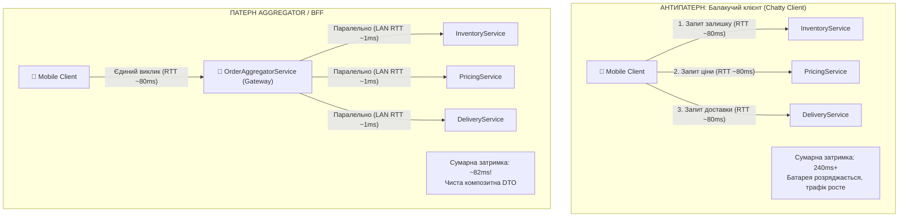
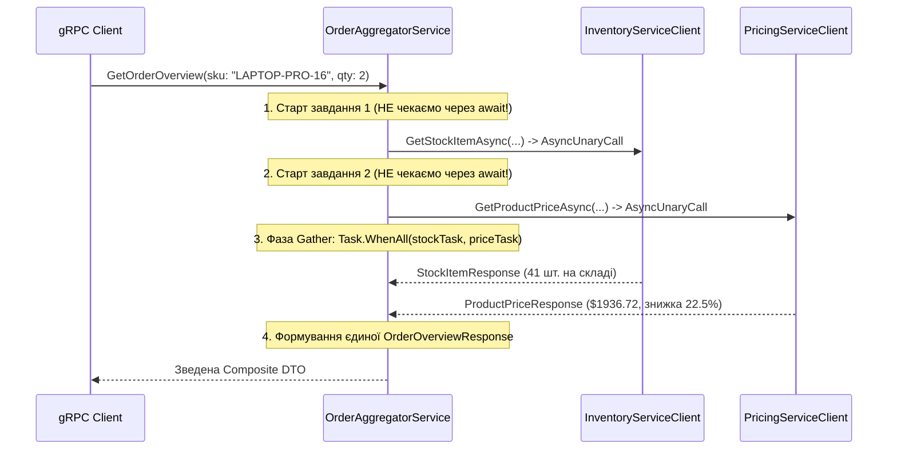
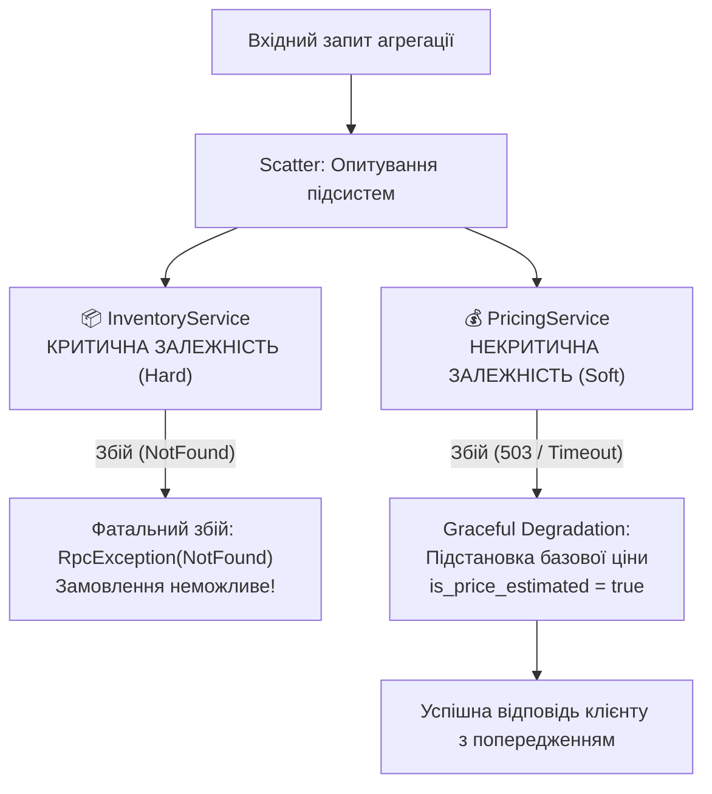

# 🧩 Mastery 05: Патерн Aggregator, стійкість до збоїв та перехоплювачі (Interceptors)

[](https://dotnet.microsoft.com/)
[](https://microservices.io/patterns/data/api-composition.html)
[]()

> **Мета модуля:** Опанувати проєктування **композитних мікросервісів (Патерн Aggregator / BFF)** на чистому gRPC в .NET 10, математично довести переваги паралельного патерну **Scatter-Gather** на базі `Task.WhenAll`, налаштувати **каскадне прокидання Deadlines**, реалізувати стійкість до часткових збоїв (**Graceful Degradation / Fallback**) та побудувати наскрізне трасування за допомогою клієнтських і серверних **Interceptors**.

---

## 📑 Зміст посібника
1. [Проблема «балакучих клієнтів» (Chatty Clients) та необхідність Агрегатора](#1-проблема-балакучих-клієнтів-chatty-clients-та-необхідність-агрегатора)
2. [Математика латентності: Послідовне опитування проти Scatter-Gather](#2-математика-латентності-послідовне-опитування-проти-scatter-gather)
3. [Архітектура Scatter-Gather в .NET 10: `Task.WhenAll` та `AsyncUnaryCall`](#3-архітектура-scatter-gather-в-net-10-taskwhenall-та-asyncunarycall)
4. [Проєктування композитної DTO у Protobuf (`OrderOverviewResponse`)](#4-проєктування-композитної-dto-у-protobuf-orderoverviewresponse)
5. [Каскадний дедлайн (Deadline Propagation) крізь граф мікросервісів](#5-каскадний-дедлайн-deadline-propagation-крізь-граф-мікросервісів)
6. [Класифікація залежностей та обробка часткових збоїв (Partial Failures)](#6-класифікація-залежностей-та-обробка-часткових-збоїв-partial-failures)
7. [Graceful Degradation: Реалізація резервного ціноутворення (Fallback Pricing)](#7-graceful-degradation-реалізація-резервного-ціноутворення-fallback-pricing)
8. [Перехоплювачі (Interceptors): Архітектура бінарного конвеєра](#8-перехоплювачі-interceptors-архітектура-бінарного-конвеєра)
   * 8.1 [Серверний перехоплювач аудиту: `ServerLoggingInterceptor`](#81-серверний-перехоплювач-аудиту-serverlogginginterceptor)
   * 8.2 [Клієнтський перехоплювач трасування: `ClientTracingInterceptor`](#82-клієнтський-перехоплювач-трасування-clienttracinginterceptor)
9. [Покроковий аналіз сервісу `OrderAggregatorService`](#9-покроковий-аналіз-сервісу-orderaggregatorservice)
10. [Типові інженерні помилки та антипатерни](#10-типові-інженерні-помилки-та-антипатерни)
11. [Контрольні запитання та лабораторні завдання](#11-контрольні-запитання-та-лабораторні-завдання)

---

<a id="1-проблема-балакучих-клієнтів-chatty-clients-та-необхідність-агрегатора"></a>
## 1. Проблема «балакучих клієнтів» (Chatty Clients) та необхідність Агрегатора

У реальній мікросервісній системі функціональність розділена між автономними сервісами. Щоб відобразити користувачу сторінку замовлення, додатку потрібні дані щонайменше від двох-трьох незалежних підсистем:
* `InventoryService` $\rightarrow$ Наявність товару на складі та локація зберігання.
* `PricingService` $\rightarrow$ Базова ціна, акції, персональна знижка за грейдом клієнта.
* `DeliveryService` $\rightarrow$ Розрахунок термінів доставки.



### Наслідки антипатерну «Балакучий клієнт»:
1. **Мобільний оверхед:** Мобільні мережі мають високу базову затримку (Round-Trip Time, $60\text{--}120\text{ ms}$). Кілька послідовних звернень роблять інтерфейс повільним та «смиканим».
2. **Крихкість:** Клієнт стає жорстко залежним від внутрішніх IP-адрес і портів окремих мікросервісів.

### Патерн Aggregator (API Composition):
Клієнт звертається до єдиного вхідного сервісу-агрегатора. Агрегатор самостійно опитує бекенди у високошвидкісній локальній мережі датацентру (де затримка $< 1\text{ ms}$) і повертає клієнту готову бінарну композитну модель.

---

<a id="2-математика-латентності-послідовне-опитування-проти-scatter-gather"></a>
## 2. Математика латентності: Послідовне опитування проти Scatter-Gather

Нехай сервіс складу відповідає за час $T_{\text{inv}}$, а сервіс ціноутворення — за $T_{\text{price}}$.

### 1. Послідовне виконання (Sequential Chaining):
Агрегатор спочатку викликає Склад, чекає відповіді, потім викликає Ціни:
$$T_{\text{seq}} = T_{\text{inv}} + T_{\text{price}} + \epsilon$$
Якщо $T_{\text{inv}} = 110\text{ ms}$, а $T_{\text{price}} = 140\text{ ms}$:
$$T_{\text{seq}} = 110 + 140 = \mathbf{250\text{ ms}}$$

### 2. Паралельний патерн Scatter-Gather:
Агрегатор одночасно запускає обидва RPC-виклики без блокування потоку:
$$T_{\text{par}} = \max(T_{\text{inv}}, T_{\text{price}}) + \epsilon_{\text{overhead}}$$
$$T_{\text{par}} = \max(110, 140) + 1 = \mathbf{141\text{ ms}}$$

> [!TIP]
> Завдяки паралельному виконанню загальний час відповіді Агрегатора визначається **лише найповільнішим мікросервісом**, а не їхньою сумою. Це забезпечує виграш у швидкості на $40\text{--}60\%$.

---

<a id="3-архітектура-scatter-gather-в-net-10-taskwhenall-та-asyncunarycall"></a>
## 3. Архітектура Scatter-Gather в .NET 10: `Task.WhenAll` та `AsyncUnaryCall`

Розглянемо технічну реалізацію в C# 14 / .NET 10:



### Ключовий інженерний нюанс: `ResponseAsync`
Коли ви викликаєте gRPC-метод `client.GetStockItemAsync()`, він повертає об'єкт `AsyncUnaryCall<TResponse>`.
Властивість `ResponseAsync` є стандартним об'єктом `Task<TResponse>`, що дозволяє передати її у `Task.WhenAll`:

```csharp
// Фаза Scatter: паралельний запуск двох завдань
var stockTask = _inventoryClient.GetStockItemAsync(stockReq, callOptions).ResponseAsync;
var priceTask = _pricingClient.GetProductPriceAsync(priceReq, callOptions).ResponseAsync;

// Фаза Gather: очікування завершення обох асинхронних операцій
await Task.WhenAll(stockTask, priceTask);
```

---

<a id="4-проєктування-композитної-dto-у-protobuf-orderoverviewresponse"></a>
## 4. Проєктування композитної DTO у Protobuf (`OrderOverviewResponse`)

У файлі [`src/Shared.Contracts/Protos/aggregator.proto`](../src/Shared.Contracts/Protos/aggregator.proto):

```protobuf
syntax = "proto3";

package mastery.aggregator.v1;

option csharp_namespace = "Mastery.Aggregator.V1";

import "google/protobuf/timestamp.proto";
import "inventory.proto";

service OrderAggregator {
  rpc GetOrderOverview (OrderOverviewRequest) returns (OrderOverviewResponse);
}

message OrderOverviewRequest {
  string sku = 1;
  string customer_tier = 2;
  int32 quantity = 3;
}

// Єдина композитна DTO, що об'єднує декілька доменів
message OrderOverviewResponse {
  string sku = 1;
  string product_name = 2;
  
  // Компонент Інвентарю
  mastery.inventory.v1.StockStatus stock_status = 3;
  int32 available_stock = 4;
  string primary_warehouse = 5;

  // Компонент Ціноутворення
  double unit_price = 6;
  double total_price = 7;
  double total_discount_applied = 8;
  string currency = 9;

  // Індикатори часткових збоїв та стійкості
  bool is_price_estimated = 10;
  string degradation_warning = 11;

  // Метрики виконання
  int64 aggregation_latency_ms = 12;
  google.protobuf.Timestamp generated_at = 13;
}
```

---

<a id="5-каскадний-дедлайн-deadline-propagation-крізь-граф-мікросервісів"></a>
## 5. Каскадний дедлайн (Deadline Propagation) крізь граф мікросервісів

Уявімо ситуацію: зовнішній клієнт викликає Агрегатор із таймаутом $500\text{ ms}$.
Агрегатор витратив $150\text{ ms}$ на отримання даних зі складу. Скільки часу залишається на опитування сервісу цін?
Рівно $350\text{ ms}$ ($500 - 150$). Якщо Агрегатор виділить сервісу цін стандартні $5$ секунд, виникне аварійна ситуація: клієнт уже скине з'єднання, а внутрішній бекенд ще 4 секунди рахуватиме ціну!

### Як працює Deadline Propagation:
У gRPC крайній термін фіксується як **абсолютна часова мітка UTC** (`context.Deadline`):

```csharp
public override async Task<OrderOverviewResponse> GetOrderOverview(
    OrderOverviewRequest request,
    ServerCallContext context)
{
    // Прокидаємо вхідний дедлайн у дочірні виклики
    var callOptions = new CallOptions(
        deadline: context.Deadline,                  // Залишковий час
        cancellationToken: context.CancellationToken // Токен скасування клієнта
    );

    // Дочірній сервіс отримує лише залишок часу!
    var stock = await _inventoryClient.GetStockItemAsync(stockReq, callOptions);
```

Якщо за $500\text{ ms}$ відповіді немає:
1. Клієнт надсилає фрейм `RST_STREAM`.
2. Агрегатор негайно скасовує виклики до `Inventory` та `Pricing`.
3. Ресурси всієї системи вивільняються миттєво.

---

<a id="6-класифікація-залежностей-та-обробка-часткових-збоїв-partial-failures"></a>
## 6. Класифікація залежностей та обробка часткових збоїв (Partial Failures)

Розподілена система повинна вміти розрізняти характер своїх залежностей:



1. **Критична залежність (Hard Dependency):** Без інформації про склад неможливо дізнатися, чи існує товар у природі. Якщо `InventoryService` повертає `NotFound`, Агрегатор **зобов'язаний повернути NotFound клієнту**.
2. **Некритична залежність (Soft Dependency):** Якщо сервіс розрахунку персональних знижок ліг або не вклався в дедлайн, не можна показувати користувачу помилку 500! Треба повернути картку товару з базовою розрахунковою ціною та прапорцем деградації.

---

<a id="7-graceful-degradation-реалізація-резервного-ціноутворення-fallback-pricing"></a>
## 7. Graceful Degradation: Реалізація резервного ціноутворення (Fallback Pricing)

У коді [`GatewayService/Services/OrderAggregatorService.cs`](../src/GatewayService/Services/OrderAggregatorService.cs):

```csharp
StockItemResponse? stock = null;
ProductPriceResponse? price = null;
bool isPriceEstimated = false;
string degradationWarning = string.Empty;

// 1. Опитування критичної залежності (Склад)
try
{
    stock = await stockTask;
}
catch (RpcException ex) when (ex.StatusCode == StatusCode.NotFound)
{
    _logger.LogWarning("Товар '{Sku}' не знайдено на складі при агрегації.", request.Sku);
    throw; // Фатальна помилка
}

// 2. Опитування некритичної залежності (Ціни) з Fallback-механізмом
try
{
    price = await priceTask;
}
catch (RpcException ex)
{
    _logger.LogWarning("PricingService недоступний ({Code}). Перехід у деградований режим.", ex.StatusCode);

    isPriceEstimated = true;
    degradationWarning = $"Сервіс цін тимчасово недоступний ({ex.StatusCode}). Застосовано орієнтовну базову вартість.";
    
    // Формуємо безпечну резервну модель ціни
    price = new ProductPriceResponse
    {
        Sku = request.Sku,
        BaseUnitPrice = 500.00,
        FinalUnitPrice = 500.00,
        DiscountPercentage = 0.0,
        AppliedDiscountCampaign = "Fallback Price Model",
        Currency = "USD",
        CalculatedAt = Timestamp.FromDateTime(DateTime.UtcNow)
    };
}
```

Користувач успішно бачить сторінку, а інтерфейс відображає підказку: *«Ціна орієнтовна»*, зберігши конверсію та працездатність додатку.

---

<a id="8-перехоплювачі-interceptors-архітектура-бінарного-конвеєра"></a>
## 8. Перехоплювачі (Interceptors): Архітектура бінарного конвеєра

**Interceptors (Перехоплювачі)** у gRPC — це аналог ASP.NET Core Middleware, але вони працюють на рівні типізованих об'єктів RPC-виклику, а не сирих HTTP-потоків.

<a id="81-серверний-перехоплювач-аудиту-serverlogginginterceptor"></a>
### 8.1 Серверний перехоплювач аудиту: `ServerLoggingInterceptor`
Розташування: [`GatewayService/Interceptors/ServerLoggingInterceptor.cs`](../src/GatewayService/Interceptors/ServerLoggingInterceptor.cs)
* Перехоплює всі вхідні виклики до сервера (`UnaryServerHandler`).
* Запускає високоточний таймер `Stopwatch`.
* Витягує заголовок трасування `x-correlation-id`.
* Логує точний час обробки запиту та статус-код.

```csharp
public override async Task<TResponse> UnaryServerHandler<TRequest, TResponse>(
    TRequest request,
    ServerCallContext context,
    UnaryServerMethod<TRequest, TResponse> continuation)
{
    var stopwatch = Stopwatch.StartNew();
    var correlationId = context.RequestHeaders.GetValue("x-correlation-id") ?? Guid.NewGuid().ToString("N")[..12];

    _logger.LogInformation("==> [gRPC Inbound] {Method} | CorrelationId: {Id}", context.Method, correlationId);

    try
    {
        var response = await continuation(request, context);
        stopwatch.Stop();
        _logger.LogInformation("<== [gRPC Success] {Method} | {Elapsed} ms", context.Method, stopwatch.ElapsedMilliseconds);
        return response;
    }
    catch (RpcException ex)
    {
        stopwatch.Stop();
        _logger.LogWarning("<== [gRPC Error] {Method} | StatusCode: {Code}", context.Method, ex.StatusCode);
        throw;
    }
}
```

<a id="82-клієнтський-перехоплювач-трасування-clienttracinginterceptor"></a>
### 8.2 Клієнтський перехоплювач трасування: `ClientTracingInterceptor`
Розташування: [`GatewayService/Interceptors/ClientTracingInterceptor.cs`](../src/GatewayService/Interceptors/ClientTracingInterceptor.cs)
* Перехоплює всі вихідні виклики Агрегатора до підлеглих сервісів (`AsyncUnaryCall`).
* Автоматично інжектує у метадані (`context.Options.Headers`) заголовок `x-correlation-id` та мітку часу.
* Завдяки цьому лог-файли трьох різних мікросервісів можна об'єднати в єдиний розподілений слід (Distributed Trace).

---

<a id="9-покроковий-розбір-сервісу-orderaggregatorservice"></a>
## 9. Покроковий розбір сервісу `OrderAggregatorService`

Повний код сервісу розташований у [`OrderAggregatorService.cs`](../src/GatewayService/Services/OrderAggregatorService.cs):
1. **Інжекція типізованих клієнтів:** У конструктор впроваджуються `InventoryServiceClient` та `PricingServiceClient`, сконфігуровані через `GrpcClientFactory`.
2. **Паралельна диспетчеризація:** Задачі стартують без оператора `await`, синхронізуючись через `Task.WhenAll`.
3. **Замір часу агрегації:** Агрегатор записує власну затримку обробки у поле `aggregation_latency_ms`.
4. **Формування DTO:** Повертається об'єкт `OrderOverviewResponse`, повністю готовий до відправки клієнту.

---

<a id="10-типові-інженерні-помилки-та-антипатерни"></a>
## 10. Типові інженерні помилки та антипатерни

1. **Антипатерн «Послідовний await у циклі»:** Опитування списку мікросервісів у звичайному циклі `foreach` замість `Task.WhenAll` (збільшує час відповіді у $N$ разів).
2. **Антипатерн «Каскадний колапс через статичний таймаут»:** Замість прокидання `context.Deadline` встановлюється новий таймаут на 10 секунд.
3. **Антипатерн «Падіння всього екрана через один банер»:** Відсутність Fallback-обробки некритичних підсистем.

---

<a id="11-контрольні-запитання-та-лабораторні-завдання"></a>
## 11. Контрольні запитання та лабораторні завдання

### Контрольні запитання:
1. Чому паралельний Scatter-Gather виконується за час $\max(T_1, T_2)$, а не за їх суму?
2. Як працює механізм Deadline Propagation у gRPC?
3. У чому полягає різниця між критичною (Hard) та некритичною (Soft) залежністю мікросервісу?
4. Що таке Graceful Degradation і як прапорець `is_price_estimated` допомагає фронтенду?
5. Чим відрізняється серверний перехоплювач (`UnaryServerHandler`) від клієнтського (`AsyncUnaryCall`)?

### Лабораторні завдання:
1. **Експеримент із частковою відмовою:**
   * Зупиніть сервіс `PricingService` (`Ctrl+C`).
   * Запустіть у консольному клієнті Сценарій 04 (виклик Агрегатора).
   * Перевірте, що Агрегатор повернув результат із прапорцем `IsPriceEstimated = true` та попередженням.
2. **Додавання наскрізного заголовка сесії:**
   * Модифікуйте `ClientTracingInterceptor` так, щоб він додавав заголовок `x-client-session: STUDENT-WORKSHOP-V1`.
   * Перевірте в логах `InventoryService`, що заголовок успішно отримано.
